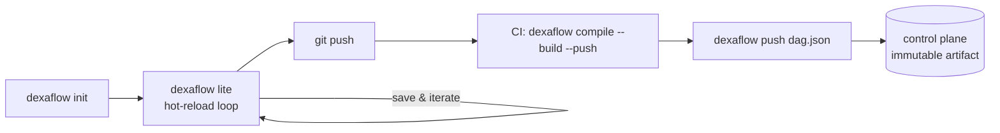

---
# --- AUTO redirect aliases (build_redirects.py) — do not edit by hand ---
aliases:
  - /dag-authoring.html
# --- end AUTO redirect aliases ---
title: DAG authoring
weight: 10
description: "Author a DAG: dexaflow.yaml plus dag.py compiled to one immutable artifact."
---

A Dexaflow DAG is two files in a project directory, compiled into an **immutable
artifact** (`dag.json` + a container image, versioned together — ADR 0003).

```
dags/my_pipeline/
  dag.py         # real Apache Airflow SDK 3.2.x code
  dexaflow.yaml   # Dexaflow deploy config (not an Airflow file)
```

Scaffold one with `dexaflow init dags/my_pipeline`.

## Workspace layout (multi-DAG)

> **Lite-specific.** The hot-reload watcher exists only in `dexaflow lite` — the
> developer-mode loop. At **runtime** Cluster has no "workspace": every DAG ships as
> its own image-and-`dag.json` pair, built by CI and registered via
> `dexaflow push dag.json`, and the control plane never sees a directory of
> siblings. See [The development → deploy lifecycle](#the-development--deploy-lifecycle).
>
> The same *discovery* does run at **build** time in Cluster, in one place:
> [`dexaflow build [workspace]`](/operate/cicd-deploy/) walks a directory of
> projects and builds each with its own `registry:`. That is a convenience for
> the person at the keyboard — it produces the same one-image-per-DAG artifacts
> and changes nothing about how Cluster runs them.

`dexaflow lite` watches a **workspace** that can hold many DAGs as sibling
subdirectories. The default workspace is `~/dexaflow/` (set by `dexaflow setup`).

```
~/dexaflow/                      # workspace root
  recurring_print/               # one DAG project per subdir
    dexaflow.yaml
    dag.py
  recurring_parallel/
    dexaflow.yaml
    dag.py
  ml/
    train/                       # nested subdirs are scanned too
      dexaflow.yaml
      dag.py
```

**Recommended layout (best practice, not enforced)**: name the subdirectory the
same as the `dag_id`. The binding is by `dag_id` (yaml field, or the subdir
basename when no yaml is present — see below), but matching names make the
workspace navigable by humans and grep-friendly. `~/dexaflow/sales_etl/` for a
DAG named `sales_etl`.

### Discovery rules

`dexaflow lite` — and `dexaflow build`, which shares the same discovery — walks
the workspace and treats every subdirectory containing a
`dag.py` (with or without a `dexaflow.yaml`) as a project. The scan:

- Goes **at most 5 levels deep** from the workspace root. A DAG at
  `<ws>/a/b/c/d/dag.py` is the deepest valid case. Deeper paths are skipped.
- Skips `.git`, `__pycache__`, `.venv`, `venv`, and any hidden directory
  (`.*`). That list *mirrors* the `exclude_paths` default so the scan and an
  image build agree on what counts as noise — but discovery has its own copy
  and never reads your `exclude_paths`, so changing that value does not change
  what the scan walks.
- Fails **loud** on a duplicate `dag_id`: if two subdirs resolve to the same
  id, lite refuses to compile any of them and prints both paths so you can
  rename one. There is no last-write-wins.

Every compile log line names the resolved config source — either the absolute
path of the `dexaflow.yaml` that was loaded, or `auto-defaults: <subdir>` when
none exists. This is the one line to grep when "which config did it pick up?"
is the debugging question.

### `dexaflow.yaml` is optional

A subdir with just a `dag.py` is a valid project. Dexaflow synthesizes a config
with `dag_id = <subdir-basename>` and every other field filled from the schema
defaults (see [Configuration → Defaults](/reference/configuration/#defaults)). Add a
`dexaflow.yaml` when you need to pin a Python version, declare dependencies, set
per-task overrides, or change the `dag_id` to something other than the subdir
name.

## dag.py — the Airflow dialect

`dag.py` is **real Airflow SDK 3.2.x** code, imported by the Python parser via the
Airflow `DagBag`. TaskFlow and classic operators both work:

```python
from airflow.sdk import DAG, task

@task
def extract() -> dict:
    return {"rows": 100}

@task
def transform(data: dict) -> dict:
    return {"rows": data["rows"], "doubled": data["rows"] * 2}

with DAG("my_pipeline", schedule="@daily", catchup=False, tags=["etl"]):
    transform(extract())
```

A DAG starts **paused** the first time it is deployed to Cluster, as in Airflow, so
its schedule waits for an unpause. Pass `is_paused_upon_creation=False` to
`DAG(...)` or `@dag(...)` to have it start active (`True` keeps it paused on a
server configured otherwise). It only matters on that first deploy; see
[New DAGs start paused](/concepts/core-concepts/#new-dags-start-paused).

`from airflow.sdk import …` is the canonical Airflow 3 spelling and what we
recommend. The deprecated-but-still-valid Airflow 3 aliases resolve to the same
objects, so a migrated DAG compiles unchanged:

- `from airflow.decorators import task, dag` → the `airflow.sdk` decorators.
- `from airflow import DAG` → `airflow.sdk.DAG`.

The core `airflow.operators.*` operators, however, were **removed** from Airflow
in 3.0 and relocated to `apache-airflow-providers-standard`. Importing one (e.g.
`from airflow.operators.bash import BashOperator`) fails the compile with a
message pointing at the replacement — use
`from airflow.providers.standard.operators.bash import BashOperator` instead.

### Supported task types

Dexaflow runs the common types on a **native fast path** and everything else — any
of Airflow's ~1,500 provider operators and poke-mode sensors — through a **generic
executor**, native-first by type. Nothing is silently dropped or mistranslated.

| Task type | Airflow operator | Where it runs | Notes |
|---|---|---|---|
| `python` | `@task` (TaskFlow) **or** `PythonOperator` | agent in a pod (Cluster) / subprocess (Lite) | The general-purpose escape hatch: any provider library you `pip install` is callable from inside a `@task`. |
| `bash` | `BashOperator` | agent | Executes a shell command. |
| ~~`http_api`~~ (removed) | — | — | **Removed (ADR 0047/0048, #512).** `HttpOperator` now compiles to `airflow_operator` and runs in a **pod**, like any other provider operator — declare `connectors: [http]`. The old inline path ran the request in the control-plane process (an SSRF surface) and is gone. |
| `airflow_operator` | **any provider operator/sensor** (Snowflake, S3, Postgres, BigQuery, …) | agent in a pod | The generic executor (ADR 0040): the runtime imports the class, instantiates it with your args, and calls `execute()`. Declare the provider or compile fails. |

{}
A `bash_command` is Jinja-rendered with the run context (`{{ ds }}`,
`{{ params.x }}`, `{{ var.value.x }}`). The **command text you write** is the
shell structure and is used verbatim; every **interpolated value** is
automatically shell-quoted (`shlex.quote`) before it reaches `bash -c`. This is
a security boundary: `params` is the run's `conf`, which anyone who can
*trigger* the DAG supplies (`execute:dag`, a lower bar than authoring it), so an
un-quoted value would let a trigger inject arbitrary shell (issue #489).

A command whose template cannot render (an undefined name such as
`{{ nope.x }}`, a syntax error, or an expression the sandbox refuses) fails the
attempt without running, and the task log names `bash_command` and the Jinja
error. The raw `{{ ... }}` text is never run
([ADR 0084](/project/adrs/0084-template-render-errors-fail-the-task/)).

Braces meant for another tool, such as `docker ps --format '{{.Names}}'`, are
read as Jinja too and fail to parse. Wrap them in a raw block, as on Airflow:
`docker ps --format '{{.Names}}'`.

Practical consequence — **write interpolations unquoted**, and do not wrap them
in your own quotes:

- ✅ `process --name {{ params.name }}` — the value is quoted for you.
- ❌ `process --name "{{ params.name }}"` — your quotes fight the auto-quoting.
- A value can no longer expand into multiple shell words/flags; if you need
  that, pass the pieces as separate `params` and interpolate each. For secrets,
  reference `$AIRFLOW_VAR_*` / `$AIRFLOW_CONN_*` env vars instead of rendering
  them into the command (see below).
{}

{}
Quoting stops a value from becoming shell syntax, but a rendered value is still
**part of the command line**. The command line is `argv` of the `bash` process:
anything that can list processes in the same container (`ps`,
`/proc/<pid>/cmdline`, a debug sidecar, node tooling with host PID access, or
any process of the same user on a Lite host) reads it, and `set -x`, error
messages and argument-logging wrappers copy it into the task log.

A Variable or Connection the task receives is already in its environment as
`AIRFLOW_VAR_<KEY>` or `AIRFLOW_CONN_<ID>`, so reference it by name and let bash
expand it at run time. On an install that runs `auth.secret_scoping: enforce`,
the task receives only the names its DAG declares in `dexaflow.yaml`
([Declare what a task consumes](/author-dags/variables-connections/#declare-what-a-task-consumes)),
and an undeclared one expands to an empty string. The templated form has the
same requirement, so declare what the command uses either way:

```python
# Wrong: the token is rendered into the command line.
BashOperator(task_id="deploy", bash_command="deploy-tool --token {{ var.value.api_token }}")

# Right: the command line carries only the variable name.
BashOperator(task_id="deploy", bash_command='DEPLOY_TOKEN="$AIRFLOW_VAR_API_TOKEN" deploy-tool')
```

- `{{ var.value.x }}` and `{{ conn.x }}` stay supported for **non-secret**
  configuration (a bucket name, a schema, a host), for Airflow parity.
- A Variable is `$AIRFLOW_VAR_<KEY>` (key uppercased); a Connection is
  `$AIRFLOW_CONN_<ID>`, a URI. In a `@task`, use `Variable.get` and
  `BaseHook.get_connection` instead.
- Put the reference in double quotes (`"$AIRFLOW_VAR_API_KEY"`) so bash does not
  split a value with spaces.
- The second example hands the token to the tool through its own
  environment variable. A tool that only takes a secret as a flag
  (`--token "$AIRFLOW_VAR_API_TOKEN"`) still receives it in its own `argv`, so
  prefer the tool's environment variable or a file (in the task's scratch, never
  the project directory) when it offers one.

The rule and its reasoning are in
[ADR 0070](/project/adrs/0070-secrets-by-env-reference/).
{}

Also supported:

- **Trigger rules**: `all_success`, `all_failed`, `all_done`, `one_success`, `one_failed`.
- **XCom**: TaskFlow data-flow (`transform(extract())`) is resolved automatically into typed inputs (`xcom_input`) — for `@task` **and** operator args.
- **Schedule**: cron strings and presets (`@daily`, `0 * * * *`).
- **Dependencies**: linear ordering via TaskFlow calls or `a >> b`.
- **`.override(...)` on a `@task`**: `estimate.override(task_id="estimate_03")(3)`
  builds the task with different operator arguments, as in Airflow. It takes the
  same arguments as `@task(...)` (`task_id`, `retries`, `retry_delay`,
  `execution_timeout`, `trigger_rule`, `pool_slots`, ...), merged over the
  decorator's, and leaves the decorated function unchanged. A repeated `task_id`
  gets the usual `__1`, `__2` suffix. Two limits: `on_failure_callback` is
  refused in `.override(...)` (set it on `@task(...)`, where the runtime reads it),
  and `.override(...).expand(...)` is refused like any dynamic task mapping.

> Connector cookbooks (postgres, mysql, sqlite, redis, http) are `python`
> tasks that read a managed Connection (`AIRFLOW_CONN_*`) — that is the
> hook-inside-`@task` style. The `airflow_operator` type below is the
> operator-class style; both resolve the same managed connections.

### Provider operators & sensors (`airflow_operator`)

Write the operator exactly as you would in Airflow — Dexaflow captures it and runs
it in its own task pod:

```python
from airflow.sdk import DAG, task
from airflow.providers.snowflake.operators.snowflake import SQLExecuteQueryOperator

@task
def build_sql() -> str:
    return "SELECT count(*) FROM events"

with DAG("rollup", schedule="@daily"):
    # an upstream task's output flows straight into an operator arg
    SQLExecuteQueryOperator(task_id="rollup", conn_id="snowflake_default",
                            sql=build_sql())
```

```yaml
# dexaflow.yaml — installs apache-airflow-providers-snowflake into the image
connectors: [snowflake]      # or: dependencies: [apache-airflow-providers-snowflake]
```

How it works, and the Phase-A limits:

- The operator runs in its **own task pod**; its hooks resolve connections from
  `AIRFLOW_CONN_*` exactly as inside a `@task`.
- Constructor args must be **JSON-serializable** or an **upstream task's output**
  (wired as XCom, like `sql=build_sql()` above). A non-serializable arg — a
  callable, a `datetime`, an arbitrary object — is a **loud compile error**; move
  that logic into a `@task`.
- Literal args are for **small constants**. A task's literal args (`@task`
  `call_args` and operator `operator_args`) ride as a **single environment
  variable** at dispatch, which POSIX caps at ~128 KiB; `dexaflow compile` rejects a
  payload over **100 KiB** with a clear error naming the task. For large data, pass
  a **Connection** or an **external-storage** reference (S3/GCS) and fetch it inside
  the task — never a big dict/list literal.
- The provider must be declared in `dexaflow.yaml` (`connectors:` or
  `dependencies:`). If it isn't, `dexaflow compile` fails and prints the exact line
  to add — no surprise `ModuleNotFoundError` in the pod.
- **Sensors** run in **poke mode** by default (the pod holds until the
  condition is met), or `mode="reschedule"` (ADR 0040 Phase B, #380/#389) — the
  pod is released between pokes and the scheduler re-dispatches the sensor,
  preserving its `try_number`, once its next-poke time passes.
- **Jinja templating** renders the operator's `template_fields` with the run
  context (`{{ ds }}`, `{{ logical_date }}`, `{{ macros.ds_add(ds, 1) }}`,
  `{{ params.x }}`, `{{ var.value.x }}`). A field that fails to render fails
  the task attempt before `execute()`, with the field and the Jinja error in the
  task log, as on Airflow
  ([ADR 0084](/project/adrs/0084-template-render-errors-fail-the-task/)). For a
  context key Dexaflow does not provide yet, compute the value in a `@task` and
  pass it in.
- A native task type (`bash`/`python`) always wins when it matches, so
  `BashOperator`/`HttpOperator`/`PythonOperator` keep their fast path.

### Not supported — `dexaflow compile` rejects these

{}
The contract is **loud rejection, not silent mistranslation**: every
"skipped" branch would otherwise actually execute at runtime, so a
DAG that imports a sensor or interpolates a Jinja template is
refused at compile with a clear error naming the construct
([#225](https://github.com/dexadata/dexaflow/issues/225)).
{}

The unsupported set, with the things Airflow users most often expect to
"just work" called out first:

- **Deferrable operators / sensors** — anything with `deferrable=True` (it suspends
  the task onto a *trigger*) is not supported yet: Dexaflow has no triggerer (ADR
  0040 Phase C). It fails at runtime with a clear message. Pass `deferrable=False`
  — the operator runs synchronously in the pod (poke-style).
- **Jinja templating** in `@task` — `{{ ds }}`, `{{ ti }}`, `{{ var.value.x }}`,
  every `templates_dict=` knob. The control plane never re-parses
  Python and the templating step is intentionally not implemented.
  Workaround: build the values inside the `@task` from `airflow.sdk`
  context.
- **Branching** (`BranchPythonOperator`, `@task.branch`) and
  **short-circuit** (`@task.short_circuit`, `ShortCircuitOperator`) —
  refused for now: the current scheduler does not model
  skipped-vs-executed downstream paths. On the backlog if
  user demand justifies the scheduler change.
- **Virtualenv operators** (`PythonVirtualenvOperator`,
  `@task.virtualenv`) — refused because each DAG already ships as its
  own image with its own dependencies; spinning up a venv at runtime
  is the problem Dexaflow's one-image-per-DAG model already solved.
- **Dynamic task mapping** (`.expand` / `.partial`) — refused. Static
  fan-**in** (collecting a list of task calls into a downstream task) works
  today; what does **not** work is *dynamic* fan-**out** — expanding one task
  into N parallel instances at runtime from an upstream result. That is
  tracked separately.
- **KubernetesPodOperator** — refused; the pod is the *runtime
  substrate* for every Dexaflow task already, so wrapping a user task
  in another pod is redundant and adds an isolation hole.
- **Datasets / Assets triggers** — not implemented yet; the asset
  graph is a 3.x Airflow feature on the backlog.
- **Per-task `default_args` in `dag.py`** are ignored at the parser
  level — use `dexaflow.yaml`'s `tasks.<id>:` override block instead,
  which is checked at compile time.

### Run parameters and their schemas

`params=` on the DAG declares the parameters a run accepts, as in Airflow. A
bare value is a default; a `Param` adds a JSON Schema built from its keyword
arguments, and a `Param` without a default is required:

```python
from airflow.sdk import DAG, Param

with DAG(
    "my_pipeline",
    params={
        "limit": Param(100, type="integer", minimum=1),
        "region": Param(type="string", enum=["us", "eu"]),
    },
):
    ...
```

The control plane checks the schemas when the DAG is registered and validates
a run's `conf` against them when the run is triggered. A task's `xcom_schema`
in `dag.json` works the same way for the value the task pushes. These schemas
may `$ref` only into themselves (`#/$defs/...`) and the standard JSON Schema
meta-schemas. Since 0.5.1 any other reference, such as a `file://` URL or a
relative path, is refused with a schema error at registration, at trigger or
at the push, so inline what a schema needs instead of pointing at a file.

A task sees `params` (`{{ params.x }}`, `context["params"]`) the way Airflow
builds them: the DAG's declared defaults, then the task's own `params=`, then the
run's `conf`, each one winning over the one before for the same key. Since 0.5.5
this holds for every run: a scheduled run, which carries no `conf`, still gets
the DAG defaults, and an operator's `params=` is part of its template context.
Since 0.5.5 the same holds for the `params=` of a `BashOperator` and of
`@task(params=...)`, which the compiler now carries in `dag.json`. A task
param must be JSON-serializable, or `dexaflow compile` fails naming it.
`context["dag_run"].conf` is the run's `conf` alone, without the defaults.
A manual trigger stores the declared defaults in the run's `conf`, as the Airflow
UI's trigger form does, so on such a run a DAG default wins over a task param of
the same name.

### Clearing a task

Clearing a task (the UI's Clear, or
`POST /api/v2/dags/{dag_id}/clearTaskInstances`) runs it again as a new try
with a full retry budget, as Apache Airflow does:

- the budget is the `retries` of the DAG version the re-run executes, so a task
  with `retries: 3` gets three retries after a clear, whatever it spent before;
- its infra re-placements are reset, so it can survive a lost agent again;
- the XCom values of the attempts it clears are deleted, so a downstream task
  cannot read a value the new attempt did not write;
- `on_failure_callback` fires only on the final attempt.

The clear is one transaction: if the XCom values cannot be deleted, nothing is
cleared and the request fails. Before 0.5.1 a clear kept the spent retries,
and the UI could show "try 4 of 3".

#### Clearing onto the current version

By default a clear re-runs the version the run was created with. To re-run on
the DAG's current version, tick "Run with latest bundle version" in the Clear
dialog, or send `run_on_latest_version: true`. As in Airflow, this moves the
run only when the run has finished (`success` or `failed`) and none of its
task instances is `queued` or `running`. The run then takes the current
version's tasks in the same transaction:

- a task the version adds gets a task instance and runs in the re-opened run;
- a task the version dropped keeps its task instance, history and logs, in the
  new state `removed`. It is not run, and it does not count toward the run's
  outcome;
- a `removed` task whose task a later version declares again runs again as a
  new try.

A clear that names a task the current version dropped resets nothing for it.
See [ADR 0086](/project/adrs/0086-clear-rebinds-a-finished-run-with-its-task-set/)
for the reasoning.

#### Clearing a run that is still running

A run that is `queued` or `running`, or a finished run that still has a task
instance `queued` or `running` (marked failed or success while that task ran),
**keeps its DAG version**. Asking for the current version does not move it:

- the cleared tasks re-run on the run's own version, with that version's
  retries, as a clear without the option would;
- tasks already running finish on the image they started with;
- the response says the option was not applied, and why. Both clear routes,
  dry run included, add `run_on_latest_version_not_applied`, one entry per run
  with its `dag_run_id` and a `reason` such as `the run is running: only a
  finished run moves to the current version`. The run's version in the UI
  stays the one it had. The Clear dialog of the Airflow UI that Dexaflow ships
  does not display this field, so read it from the API when you need the
  reason.

To run the cleared tasks on the current version, first get the run to a
finished state with no task queued or running, then clear again with the
option:

1. wait for the run to finish, or mark it failed or success (the run page's
   **Mark run as**, or `PATCH /api/v2/dags/{dag_id}/dagRuns/{dag_run_id}` with
   a `state`);
2. if you marked it while a task was still running, wait for that task to end;
3. clear again with `run_on_latest_version: true`.

Or trigger a new run, which always uses the current version.

For example, with `etl` still running on version 3 while version 4 is
current:

```bash
curl -sS -X POST -H "Authorization: Bearer $TOKEN" -H 'Content-Type: application/json' \
  "$DEXAFLOW_URL/api/v2/dags/etl/dagRuns/$RUN_ID/clear" \
  -d '{"dry_run": true, "run_on_latest_version": true}' | jq .run_on_latest_version_not_applied
```

```json
[
  {
    "dag_run_id": "manual__2026-10-16T09:00:00+00:00",
    "reason": "the run is running: only a finished run moves to the current version"
  }
]
```

Once the run has finished, the same dry run answers no
`run_on_latest_version_not_applied`, and the clear with `"dry_run": false`
moves the run to version 4.

## dexaflow.yaml — deploy config

These are Dexaflow concerns, **not** Airflow operator attributes (you cannot invent
kwargs on an operator — the parser imports real Airflow and would raise).

```yaml
schema_version: "1.0"
dag_id: my_pipeline
description: Daily ETL.
owner: data-eng
tags: [etl]
python_version: "3.11"
dependencies:           # pip packages baked into the image
  - pandas==2.1.0
defaults:               # DAG-level defaults (applied to every task)
  retries: 1
  retry_delay_seconds: 30
staging:                # opt-in shared per-run RWX volume (ADR 0022)
  enabled: false
tasks:                  # per-task overrides, keyed by task_id (ADR 0023)
  transform:
    retries: 3
    resources:
      requests: { cpu: "2", memory: 4Gi }
```

### Binding + override layers (ADR 0023)

Config binds to the DAG by `dag_id` and to tasks by `task_id`. Three layers,
**most specific wins**:

```
task override (tasks.<id>)  >  DAG default (defaults)  >  platform default (server)
```

- `tasks.<id>` is merged at **compile** time onto the task in `dag.json`.
- Platform defaults are applied at **dispatch** time, filling gaps the artifact
  left empty (keeps the artifact portable across clusters), one resource
  dimension at a time: a task that declares only `ephemeral_storage`, or only
  cpu, still gets the platform default for the dimensions it left out. A
  dimension the task sets at all (a request or a limit) is entirely the task's
  ([#802](https://github.com/dexadata/dexaflow/issues/802)).
- **`staging` is DAG-level only** — one RWX volume is shared atomically by the
  whole run, so it cannot be per-task.

### Task size (`size`, ADR 0066)

`size` is how many slots of its pool a task takes while it is queued or
running: Airflow's `pool_slots`. It defaults to 1, so a pool of 8 slots runs
eight tasks of size 1, or two of size 4. A task that does not fit waits until
enough slots free up; it never fails for it. Smaller tasks cannot keep a task of
more than one slot out forever: once it has waited past
`scheduler.pool_starvation_threshold` (60s by default), the pool holds new
admissions until it fits. Tasks of size 1 never reserve a pool.

The Pools screen and `/api/v2/pools` count slots the same way: two tasks of
size 4 running in a pool of 8 show 8 occupied slots and 0 open, and each
state's count (`running_slots`, `queued_slots`, `scheduled_slots`,
`deferred_slots`) is the sum of its tasks' sizes. A task's size and pool are
recorded when its run starts, and a clear takes both from the version the
re-run executes, so a task a newer version moved to another pool is charged
there once it is cleared onto that version. The API's task instances report
the same `pool` and `pool_slots`.

```yaml
defaults:
  size: 1          # every task that sets none
tasks:
  train:
    size: 4        # this task takes 4 slots
```

`@task(pool_slots=4)` or an operator's `pool_slots=4` in `dag.py` sets the same
thing. Most specific wins: `tasks.<id>.size` > `pool_slots` in `dag.py` >
`defaults.size` > 1. Pools are enforced on Cluster only; Lite ignores the size.

When the operator sets a resource unit (`executor.unit`, for example 250m CPU
and 512Mi memory per slot), the size also sizes the pod: a task of size 4 gets
1 CPU and 2Gi wherever it does not set cpu or memory itself, and a task whose
own `resources` ask for more than size x unit is refused when the DAG is
registered, with the size it would need.

### Guardrails (fail loudly, never silently)

- A `tasks:` entry naming a `task_id` absent from the DAG → **compile error**.
- A duplicate `task_id` key in the YAML → **parse error**.
- Across a monorepo, a duplicate `dag_id` is a CI-gate concern (one image per DAG).
- A task's `execution.labels` or `execution.annotations` key under the
  `leoflow.io/` prefix → **validation error**. That prefix belongs to Dexaflow's
  own pod metadata, which other components identify task and warm-worker pods
  by; use a prefix of your own (for example `team.example.com/owner`). A DAG
  version registered before this rule still runs, with those keys dropped from
  its pods.

## The development → deploy lifecycle



### 1 · Develop (fast, isolated)

```bash
dexaflow init dags/my_pipeline          # scaffold dag.py + dexaflow.yaml
dexaflow lite dags/my_pipeline           # cluster-mode: real pods on an isolated k3d
# or: dexaflow lite --executor=subprocess dags/my_pipeline   (fastest, host venv)
```

Open <http://localhost:8088> — the UI is marked **Dexaflow Lite** (silver
edition badge); log in with the admin password generated by `dexaflow setup`
(or run `dexaflow lite reset-password` if you misplaced it). Edit
`dag.py`/`dexaflow.yaml` and **save**; Dexaflow recompiles, re-runs the guardrails,
and re-registers. A bad binding prints an error in the terminal **immediately**:

```text
✗ dexaflow.yaml tasks: unknown task_id "transfrom"; the DAG defines [extract load transform]
```

Lite is fully isolated from Demo/Cluster (own database, cluster, and ports):
**no split brain**. See [Operating modes](/concepts/editions/).

### 2 · Deploy (authoritative, immutable)

On `git push`, CI compiles + builds + pushes the artifact. The **same** parser,
overlay, and guardrails run as a gate, so what you tested in Lite is what ships:

```bash
dexaflow compile dags/my_pipeline --image ghcr.io/org/my_pipeline:$GIT_SHA --build --push -o dag.json
dexaflow push dag.json
```

Without `-o` the artifact lands **next to the project**
(`dags/my_pipeline/dag.json`), not in the directory you ran the command from.
The pipelines below pass `-o` so the two lines agree wherever the job happens to
run.

Full, copy-pasteable pipelines for **GitHub Actions, GitLab CI, Google Cloud
Build/Run, and generic runners** are in **[CI/CD & deploy examples](/operate/cicd-deploy/)**.

#### What ends up in the image

`--build` bakes the build context into the image, and with the default
`project: "."` that context is your whole DAG directory. The image is pushed to
a registry and pulled by every pod that runs the DAG, so anything in it is
shared with everyone who can pull it.

`exclude_paths` in `dexaflow.yaml` decides what stays out. During the build it is
materialized as a `.dockerignore` in the context — merged with your own if you
have one, and removed afterwards, so the workspace is unchanged when the build
ends. Your rules come first and Dexaflow's last, which means `exclude_paths` has
the final word: a `!` re-include in your `.dockerignore` cannot silently defeat
an exclusion you declared in `dexaflow.yaml`.

Each entry is written out in the forms Docker honours rather than verbatim.
`.dockerignore` is **not** `.gitignore`: a pattern with no slash matches only at
the context root, so `__pycache__` alone would leave every nested one in the
image. Dexaflow emits `p`, `**/p` and `p/**` for a bare name — the last of those
is also what lets `exclude_paths` beat an earlier `!` rule, which re-stating the
plain pattern does not do.

For a dbt project, two things a host-side `dbt parse` leaves behind are
excluded automatically, scoped to each project directory: `logs/` and
`.user.yml`. Both matter beyond image size — `.user.yml` is dbt's
anonymous-usage cookie identifying *your* machine, and it is read by the in-pod
dbt, so every pod from that image reports as you; `logs/dbt.log` carries
absolute paths from the build host.

Nothing else in a dbt project is excluded, deliberately. `target/` holds the
manifest `dbt.manifest` points at, `dbt_packages/` is where `dbt deps`
installs, and `profiles.yml` may be a BYO profile you point `DBT_PROFILES_DIR`
at — each is a real input in a configuration people use, so excluding them
would break working projects.

Credentials are **not** excluded for you either. A `.env` can be a legitimate
input — a DAG calling `load_dotenv()` reads it at run time — and so can a BYO
`profiles.yml`, so dropping either silently would break that project far from
the cause. Instead the build warns:

```console
warning: .env is in the build context and will be baked into the image, which is
pushed to a registry and pulled by every pod that runs this DAG. If it holds
credentials, add ".env" to exclude_paths in dexaflow.yaml.
```

Act on it or declare it deliberately; the warning stops once the file is in
`exclude_paths`.

---

See also: [Concepts & glossary](/concepts/core-concepts/) · [Operating modes](/concepts/editions/)
· [HTTP API](/api-reference.html) · [ADR 0023 — binding & overrides](/project/adrs/0023-dag-authoring-config-binding/).
