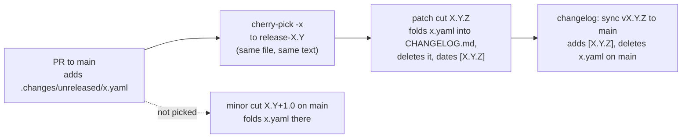

1. **Changelog fragment.** Run `make changelog` and pick the kind:
   - `Added` for something new;
   - `Changed` for any behavior an operator or DAG author can notice, even
     when it fixes a bug: the docs gate at release cut reads `Added`,
     `Changed`, `Deprecated` and `Removed`, and a behavior change filed as
     `Fixed` slips past it;
   - `Fixed` for a bug fix that changes nothing else;
   - `Security`, `Deprecated` or `Removed` when they apply.

   One file per PR in `.changes/unreleased/`, so fragments never conflict. A PR
   with nothing user-facing uses the `skip-changelog` label instead.
2. **Docs.** Update the pages under `website/content/` that describe what you
   changed: reference for flags, configuration and API, how-to for procedures,
   [upgrades](/operate/upgrades/) for migrations and new settings. With
   nothing user-facing, use the `skip-docs` label and add a line
   `Skip-docs: <reason>` to the PR description.
3. **Milestone.** Every PR to `main` names the release it targets (`v0.5.3`,
   `v0.6.0`); the milestone guard fails without it.
4. **Check locally:** `bash scripts/check-changelog-entry.sh`,
   `bash scripts/check-changelog-structure.sh` and
   `bash scripts/check-docs-updated.sh`, or `make ci-local` for every gate.

## What happens to the fragment

You write the fragment; the release tooling does everything else with it.

- **Do not edit `CHANGELOG.md` dated sections** (`## [X.Y.Z] - <date>`).
  They are published release notes, copied between branches verbatim.
- **Do not delete or rename a merged fragment yourself.** The cut deletes it
  when it ships, and after a patch release the sync pull request deletes it
  from `main`. A fragment renamed or reworded on one side of a cherry-pick is
  how one entry gets published twice.
- **When you cherry-pick,** keep the fragment exactly as it is on `main`
  (see [Backport to a release branch](/contribute/recipes/backport-to-a-release-branch/)).
- **The CHANGELOG structure check** (`scripts/check-changelog-structure.sh`)
  runs on pull requests that touch the changelog or a fragment. It fails a
  fragment that does not parse, has a kind `.changie.yaml` does not declare or
  an empty body, or whose text is already an entry of a released section, and
  a `CHANGELOG.md` whose headings are out of shape or that lacks the section of
  a tagged release.

The maintainer side (the fold, the dating, the sync and how to recover when it
drifts) is in
[RELEASING.md](https://github.com/dexadata/dexaflow/blob/main/RELEASING.md#how-the-changelog-flows).
