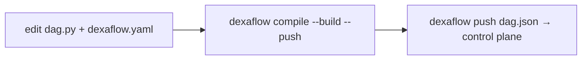

---
# --- AUTO redirect aliases (build_redirects.py) — do not edit by hand ---
aliases:
  - /deploy.html
# --- end AUTO redirect aliases ---
title: "CI/CD & deploy examples"
linkTitle: "CI/CD & deploy"
weight: 20
description: "Build, push and register DAGs from CI — GitHub Actions, GitLab CI, Cloud Build."
---

{}
[**Your first Pro DAG (≈10 min)**](/operate/first-pro-dag/) takes one DAG from source
to a running pod with **one command** (`dexaflow deploy`), so you see each
artifact boundary before you automate it. This page is the CI recipes for the
same pipeline.
{}

Deploying a Dexaflow DAG is the same everywhere because a DAG is an **immutable
artifact**: a `dag.json` + a container image, versioned together (ADR 0003).

**By hand or in a pipeline,** one command does it all:

```bash
dexaflow auth login --server https://pro.example.com   # by hand, once; stores the session
dexaflow deploy --yes                                  # compile → build → push → pin digest → register
```

`dexaflow deploy` is the [pipeline-less promotion](/project/adrs/0041-leoflow-deploy-pipelineless/):
it builds for the cluster's architecture (`--platform`, else `build.platforms`
in `dexaflow.yaml`, `linux/amd64` when neither is set) with the first
[builder](/operate/builders/) that applies, pins the image by digest, and
registers the artifact.
`--yes` skips the confirmation prompt (use it in automation). **It is the
recommended command in CI too**, and the recipes below use it.

**The explicit steps** are still available when a pipeline wants the build and
the register as separate stages:



1. **`dexaflow compile --build --push`**: parse `dag.py`, overlay
   `dexaflow.yaml`, run the **guardrails** (unknown `task_id`, unsupported
   operator, duplicate keys), build the DAG image and push it.
2. **`dexaflow push dag.json`**: register the artifact with the control plane.

{}
`compile --build --push` writes the image **tag** it pushed into `dag.json`
(`registry/image:tag`), and `push` registers that file as it is. The control
plane then pulls by tag, so a tag that is rebuilt later can run different bytes
under the same version. `dexaflow deploy` is the only command that resolves the
pushed image's digest and registers `registry/image@sha256:…`. Prefer `deploy`
in CI; if you split the steps, tag by commit (`tag_strategy: git_sha`) and never
reuse a tag.
{}

{}
The same checks that warn you locally in `dexaflow lite` fail the CI build, so a
bad `dag_id`/`task_id` binding or an unsupported operator never reaches prod.
{}

{}
The [**first Pro DAG walkthrough**](/operate/first-pro-dag/) runs `deploy` by
hand so you can watch the DAG cross each boundary. Come back here to wire the
same command into CI.
{}

{}
Registry auth, RBAC scope, non-root images, private-registry pulls, and the
`--dag-version`/`409` gotcha are exactly the errors CI hits first, since a
runner has none of a laptop's ambient state (no `docker login`, no
`dexaflow auth login` session, often a shallow clone with no tags for the
default version label to start from). **[Deploy prerequisites & why shortcuts fail](/operate/deploy-prerequisites/)**
has the exact error and fix for each.
{}

## Your repo of DAGs (CI is the recommended path)

In Pro you keep your DAGs in a Git repository, one directory per DAG, and **CI**
turns each into an artifact when it changes. This is the recommended path: a push
triggers the pipeline, no one builds by hand. Each DAG is just **two files**, no
Dockerfile and no `requirements.txt`:

```text
my-dags/                      # your Git repo
├── .github/workflows/
│   └── deploy-dag.yml        # the CI below (the recommended path)
└── dags/
    ├── my_pipeline/
    │   ├── dag.py            # the DAG (TaskFlow / operators)
    │   └── dexaflow.yaml      # id, python_version, dependencies, registry
    └── another_pipeline/
        ├── dag.py
        └── dexaflow.yaml
```

`dexaflow deploy` (and `compile --build`) **generates the Dockerfile from
`dexaflow.yaml`**: `FROM` the published Dexaflow base, your deps/connectors
installed, your DAG copied in. No Dockerfile to maintain. A `Dockerfile` in the
DAG directory is used verbatim instead and the yaml's dependencies then do not
reach the image, so ship one only if you want full control (see
[your own Dockerfile](/operate/first-pro-dag/#advanced-your-own-dockerfile)).

The built image is **your** artifact: push it wherever you like (Docker Hub, ECR,
Artifact Registry, ACR, GHCR, a private registry), via the `registry:` block in
`dexaflow.yaml`. `deploy` requires that block; it has no `--image` flag. The
only image Dexaflow owns is the base your DAG layers on.

**The mental model:** a push that touches `dags/my_pipeline/**` triggers CI for
*that* DAG only (the `paths:` filter), which compiles → builds (from yaml) →
pushes the image to your registry → registers `dag.json`. The control plane runs
the new version on the next trigger. One DAG per pipeline keeps blast radius
small: a broken `another_pipeline` never blocks `my_pipeline`.

The first registration of a DAG leaves it **paused**, as in Airflow: its
schedule creates no run until someone unpauses it (UI switch, or
`dexaflow admin dags unpause <dag_id>`). Later registrations never change that,
so a pipeline that redeploys an active DAG keeps it active. A DAG that should
start active sets `is_paused_upon_creation=False`; see
[New DAGs start paused](/concepts/core-concepts/#new-dags-start-paused).

### What a deploy says, and the flags that change it

Every deploy prints the server it goes to (and the target that chose it)
before it builds, and ends with a line saying what happens next:

```text
next: etl is paused, so nothing runs until `dexaflow admin dags unpause etl`; unpausing creates 13 catchup runs since start_date 2026-10-01T00:00:00Z, then one run per tick; next tick 2026-10-14T00:00:00Z (UTC).
```

An active DAG gets its next run time instead. The line follows the scheduler:
with `catchup=True` and a `start_date`, every tick since `start_date` gets a
run; otherwise only the latest tick does. A DAG that already ran resumes after
its last run, so its count is an upper bound, as it is for `--active` on a DAG
that was paused. Times are in UTC: the scheduler does not yet apply a DAG's
`timezone` or `end_date`, so the line ignores them too.

With no server set anywhere (no `--server`, `--target`, `DEXAFLOW_SERVER_URL`
or `server_url`), `deploy` stops before building instead of going to
`http://localhost:8080`; a machine set up for Lite keeps the local default.

| Flag | What it does |
|---|---|
| `--paused` / `--active` | Leaves the DAG paused or active after this deploy, new or not, instead of the creation rule above. The register sets it in its own transaction, audited as `dag.pause` or `dag.unpause`; for content that is already current, nothing is registered and the DAG is paused or unpaused with the Airflow `PATCH /api/v2/dags/{dag_id}`. Pausing is a run-state write: these flags need `write:dag` (the `deployer` role alone is refused with `403`), and a scoped token needs `dexaflow:run` as well as `dexaflow:deploy`, so a deploy-only token is refused with `403`. |
| `--plan` | Says per DAG what a deploy would build, push and register, and why (content changed, already current, an older version, a new DAG), without running the parser, the builder or the register. Works with `--all`. |
| `--output json` | Prints one JSON document on stdout for the pipeline to read; the human lines and the builder's output go to stderr. |

The JSON document has one entry per DAG:

```json
{
  "server": "https://pro.example.com",
  "target": "prod",
  "dags": [
    {
      "dag_id": "my_pipeline",
      "status": "registered",
      "version": "v1.4.0-3f9c2a1b7d4e",
      "image": "ghcr.io/acme/my_pipeline@sha256:4e1f...",
      "digest": "sha256:4e1f...",
      "spec_hash": "9b0c...",
      "created": true,
      "dag_created": true,
      "is_paused": true,
      "next": "my_pipeline is paused, so nothing runs until ..."
    }
  ]
}
```

`created` says a new version was registered and `dag_created` that it was
the DAG's first. `status` is `registered` (a new version), `unchanged` (the server already had
this exact content), `current` (the content label is the current version, so
nothing was built), or `failed` (one DAG of `--all`, with `error`). With
`--plan` it is `planned` or `refused`, and a `plan` object carries `build`,
`push`, `register` and `reason`. After a failure of `--all` the document is
still printed, so the pipeline sees which DAGs went through.

{}
The per-DAG pipeline above stays the recommendation, and the `paths:` filter is
the point of it: one DAG per pipeline is what keeps a broken DAG from blocking
its neighbours.

`dexaflow build [workspace]` is for the times you are **not** in that pipeline:
after a base-image bump that every DAG must pick up, when you clone the repo onto
a new machine, or when you want to see all the images a change produces before
pushing anything. It walks the workspace and builds each project with the image
that project's own `registry:` block derives (the same derivation `deploy` uses,
so nothing about naming is new):

```bash
dexaflow build my-dags/           # build every project under my-dags/
dexaflow build my-dags/ --push    # ...and push each to its registry
```

Two behaviours matter more than the loop itself:

- A project that declares **no `registry:`** is reported by name, not skipped
  quietly. A command that covers less than the workspace without saying so leaves
  you believing images exist.
- A failure **stops** the run, names the project, and lists what was already
  built. A half-built workspace (some images new, some stale) is invisible
  afterwards.

With no `--dag-version` / `--sha` it derives them the same way `deploy` does,
per project: the version label from `git describe` in the project's directory
plus a hash of that project's content, and the short commit hash of that
directory. (`deploy` has no `--sha` flag at all; it always derives the sha.)

Using it **as** your CI, in place of per-DAG pipelines, is a deliberate trade:
one job rebuilds everything on any change, so blast radius and build time both
grow with the repo. Choose it only if you want that.
{}

## Rolling back

A rollback makes a version the control plane already holds current again. It
rebuilds nothing: the version runs the image digest it was registered with.

```bash
dexaflow dags versions my_pipeline                 # what is registered, and which is current
dexaflow rollback my_pipeline                      # back to the version before the current one
dexaflow rollback my_pipeline --to v1.4.0-3fa2c1   # or to a label (or a version number) from the list
```

`dexaflow dags versions` lists each version, newest first: its number, its
label, a `*` on the current one, when it was registered, the id of the user
who registered it (`dexaflow admin users list` maps ids to emails), and the
short image digest. `--to` matches a label first, then a version number. `dexaflow rollback` prints the version it moved from and
the one it moved to, and takes `--server` and `--token` like the other
commands. Both read and write through the API: the listing is
`GET /api/v2/dags/{dag_id}/dagVersions`, and the rollback is
`PUT /api/v2/dags/{dag_id}/currentVersion` with `{"version": "<label>"}` or
`{"version_number": <n>}`, which needs the same permission as registering a
version (scope `dexaflow:deploy` for a scoped token).

What a rollback changes, in one transaction:

- **New runs** use the version made current, from the next scheduler tick.
- **The schedule** and the other DAG settings (catchup, start date, max active
  runs, description, owner, tags) become that version's.
- **Runs already created keep their version**, including runs in flight.
- **Pause state does not change.** A paused DAG stays paused, an unpaused one
  stays unpaused.

What the UI shows after a rollback follows Airflow, which has no rollback and
always runs its newest version:

- **The DAG header's Latest Dag Version** and the version the **Code** tab
  opens on are still the newest version, not the current one. The Code tab's
  version picker shows the source registered with each version
  (`GET /api/v2/dagSources/{dag_id}?version_number=<n>`; without
  `version_number` or with `0`, the newest version's source).
- **A run, and each of its task instances, shows the version it ran with**, so
  a run created after the rollback shows the version made current, and its
  Code tab opens on that version's source.
- **The Clear dialog offers "Run with latest bundle version"** even on a run
  that already uses the current version, because the UI compares the run's
  version with the newest one. In Dexaflow that option re-pins the run to the
  current version, so on such a run it changes nothing.
- **Which version is current** is the `*` in `dexaflow dags versions`, and the
  `is_current` field of each version in `GET /api/v2/dags/{dag_id}/dagVersions`
  and of `latest_dag_version` in the DAG details. The MCP `dag://source`
  resource serves the current version's source, as `dag://spec` serves its
  spec.

The version must still pass what a register of it would pass today: the
operator's execution policy, the tenant limits, and its declared Variables and
Connections. A version that no longer does is refused with `400` (or `403` for
a tenant limit), and the current version stays. Naming the version that is
already current changes nothing. Every rollback is recorded in the audit log as
`dag.version.set_current`, with the user and the from and to versions.

Two things that look like a rollback are not:

- Re-running `dexaflow push` with an older `dag.json` is a no-op: content the
  control plane already has answers `created: false`, and the newer version
  stays current, schedule included.
- Retagging an image in the registry changes nothing: a version registered by
  `deploy` names its image by digest.

`dexaflow deploy` of code that matches a version registered earlier (after a
`git revert`, for example) stops before building and suggests the
`dexaflow rollback <dag_id> --to <label>` command for that version.

## Prerequisites

- The `dexaflow` CLI on the runner (download the release binary, or `go install`).
- **Python 3.11 to 3.13 on the runner** (`dexaflow compile` invokes the
  stdlib-only parser shim, [ADR 0024](/project/adrs/0024-dag-parsing-structural-shim/),
  to turn `dag.py` into `dag.json`). See [Python on the runner](#python-on-the-runner) below.
- A container registry your cluster can pull from, and the builder logged in to
  it (`docker login`).
- The control plane URL, passed as `--server` or exported as
  `DEXAFLOW_SERVER_URL` (the pre-rename `LEOFLOW_SERVER_URL` still works). The
  CLI reads no other variable for it: a pipeline that exports something else
  (`DEXAFLOW_SERVER`, for instance) silently targets the default,
  `http://localhost:8080`.
- A CI credential for the control plane, below.

## Credentials for the control plane

A CI job authenticates with a **deploy token**: a long-lived API token that
registers DAG versions and nothing else. Store it as a CI secret named
`DEXAFLOW_TOKEN`; `deploy`, `push`, `rollback` and the other commands read that
variable (the pre-rename `LEOFLOW_TOKEN` still works).

1. Once, as an admin, create a service user for CI with the built-in
   **`deployer`** role. It reads DAGs and their versions, registers versions
   and sets the current version (rollback), and nothing else: it cannot delete
   or pause a DAG, trigger a run, or touch connections, variables or users.

   ```bash
   dexaflow auth create-user --email ci-deploy@example.com --password-stdin \
     --role deployer < password.txt
   ```

2. Create a deploy token for that user. Sign in as the service user (the
   command signs in with `--username` and the password, or uses the session
   `dexaflow auth login` saved), name the token after the pipeline that will
   hold it, and choose its lifetime:

   ```bash
   dexaflow auth create-token --server https://pro.example.com \
     --username ci-deploy@example.com --password-stdin \
     --scope deploy --name github-my-dags --ttl 90d < password.txt
   ```

   The token (it starts with `dxf_`) is printed **once**, alone on stdout; the
   name, id, scopes and expiry go to stderr. Store it as the `DEXAFLOW_TOKEN`
   secret of the pipeline. The server keeps only its SHA-256 hash, so a lost
   token cannot be shown again: create a new one.

3. Set `DEXAFLOW_SERVER_URL` and `DEXAFLOW_TOKEN` in the job and run
   `dexaflow deploy`, as in the examples below.

What a deploy token can do, and how it ends:

- **Scope.** `--scope deploy` carries `dexaflow:deploy`: the token reads
  DAGs, DAG details and versions, registers versions and sets the current
  version, and is refused everything else, whatever its owner's roles: no
  variables, connections, logs, XComs, runs, users or event log. It never does
  more than its owner's roles allow either, and the owner's roles are read
  again on every request. `--scope read` makes a token that reads everything
  its owner can read, so do not give one to CI. `deploy --trigger` needs to
  trigger a run, which a deploy token cannot do.
- **Lifetime.** `--ttl` takes days (`90d`) or a duration (`12h`), from one hour
  to 365 days; the default is 90 days. An expired token answers `401`.
- **Listing.** `dexaflow auth tokens list` shows your tokens with their id,
  name, scopes, expiry and when each was last used (recorded at most once every
  five minutes). An admin sees every token of the tenant.
- **Revoking.** `dexaflow auth tokens revoke <id>` stops a token on its next
  request. Deactivating the owner stops all of the owner's tokens.
- **Limits.** A token cannot create, list or revoke tokens. A user holds at
  most 50 live tokens, and token names are unique among a user's live tokens:
  1 to 64 letters, digits, dots, dashes or underscores. Once a token has
  expired, a new token can take its name: the create retires the expired token
  and records it in the audit log as `api_token.retire_expired`, with the old
  token's id, when it expired and the id of the token that took its name, so
  it is not mistaken for a manual revoke (`api_token.revoke`). The token is
  sent in the `Authorization` header only; it never works as a browser session
  cookie.

Creating, listing and revoking tokens is also available through the API
(`POST`, `GET /api/v2/apiTokens` and `DELETE /api/v2/apiTokens/{id}`). The UI
does not list tokens yet.

{}
A session token from `dexaflow auth create-token` without `--scope` **expires
after one hour** (`auth.jwt.token_ttl_seconds`, 3600 by default), so it cannot
be stored as a CI secret. On a control plane older than deploy tokens, store
the service user's password instead (`DEXAFLOW_CI_PASSWORD` below) and mint a
session token at the start of each job:

```bash
export DEXAFLOW_SERVER_URL=https://pro.example.com
DEXAFLOW_TOKEN="$(printf '%s\n' "$DEXAFLOW_CI_PASSWORD" |
  dexaflow auth create-token --username ci-deploy@example.com --password-stdin)"
export DEXAFLOW_TOKEN
```

That token lives one hour: a build that can take longer should run the steps
apart (`dexaflow compile --build --push`, then mint the token, then
`dexaflow push`, which registers the tag; see the warning at the top).
{}

## Python on the runner

The `dexaflow compile` step (which `deploy` runs) needs Python 3.11, 3.12, or
3.13 on `PATH` as `python3` to parse `dag.py`. **Bring your own Python** on the
runner; the managed CPython that `dexaflow setup` can download is meant for a
developer laptop, not for build pipelines, where it adds ~50 MB to every run and
bypasses your runner's pin/caching.

The recommended path on each runner type:

| Runner | Recipe |
|---|---|
| **GitHub Actions** | Add `actions/setup-python@v5` with `python-version: '3.12'` before installing dexaflow. Cached automatically. |
| **GitLab CI** | Install `python3` in the job image (`apk add python3` on `docker:27`), or use an image that ships both Python and the Docker CLI. |
| **Cloud Build / CodeBuild** | Run the step on a `python:3.12-slim` image and install the Docker CLI there (the recipe below). `gcr.io/cloud-builders/docker` is Ubuntu 20.04, whose `python3` is 3.8. |
| **Self-hosted runners** | Pin Python via your image baseline (`apt install python3.12` or `pyenv`) and version-lock in your runner provisioning. |
| **Generic Docker-in-Docker** | Base your build container on `python:3.12-slim` (gives you Python + a Debian userland for the `docker build` shell). |

Older Python (≤3.10) fails the compile cleanly: `dexaflow compile` errors out
with the version requirement, not a confusing traceback.

### No `dexaflow setup` in CI

`dexaflow compile` and `dexaflow deploy` extract the parser bundled in the binary
into `~/.dexaflow/pysrc/` on their own the first time they run (and again after a
binary upgrade), so a runner needs no setup step. Install the binary with
`DEXAFLOW_NO_SETUP=1`: `dexaflow setup` would also prepare Lite (credentials,
datastore) and may download a managed Python, none of which a pipeline uses.

Caching `~/.dexaflow/pysrc/` between runs is optional; the extraction takes a
few seconds.

## Examples

Each recipe deploys `dags/my_pipeline`, whose `dexaflow.yaml` carries the
`registry:` block (`url` + `image_name`). Replace `https://pro.example.com` with
your control plane.


{}

```yaml title=".github/workflows/deploy-dag.yml"
name: Deploy DAG
on:
  push:
    branches: [main]
    paths: ["dags/my_pipeline/**"]
jobs:
  deploy:
    runs-on: ubuntu-latest
    permissions: { contents: read, packages: write }
    env:
      DEXAFLOW_SERVER_URL: https://pro.example.com
    steps:
      - uses: actions/checkout@v4
        with: { fetch-depth: 0 }          # git describe needs history and tags
      - uses: actions/setup-python@v5     # BYO Python, see #python-on-the-runner
        with: { python-version: '3.12' }
      - uses: docker/login-action@v3
        with:
          registry: ghcr.io
          username: ${{ github.actor }}
          password: ${{ secrets.GITHUB_TOKEN }}
      - name: Install dexaflow
        run: curl -fsSL https://raw.githubusercontent.com/dexadata/dexaflow/main/install.sh | DEXAFLOW_VERSION=<VERSION> DEXAFLOW_NO_SETUP=1 DEXAFLOW_INSTALL_DIR=/usr/local/bin sh
      - name: Deploy
        env:
          DEXAFLOW_TOKEN: ${{ secrets.DEXAFLOW_TOKEN }}   # a deploy token
        run: dexaflow deploy dags/my_pipeline --yes
```

GHCR refuses image names with upper-case letters, so keep `registry.url` and
`registry.image_name` lower case. If you build the name from
`${{ github.repository }}` (for `compile --image`, say), lower-case it first:
`IMAGE="ghcr.io/${GITHUB_REPOSITORY,,}/my_pipeline:${GITHUB_SHA}"`.

Do not add `docker/setup-buildx-action` to this job. It makes a
`docker-container` builder the default, whose builds stay in the builder's
cache instead of the local image store; the CLI runs a plain `docker build`
without `--load`, so the `docker push` that follows finds no image.

{}
{}

```yaml title=".gitlab-ci.yml"
deploy_dag:
  image: docker:27
  services: [docker:27-dind]
  variables:
    # Talk to the dind service over TLS; the runner shares /certs/client.
    DOCKER_HOST: tcp://docker:2376
    DOCKER_TLS_CERTDIR: "/certs"
    DEXAFLOW_SERVER_URL: https://pro.example.com
  before_script:
    - apk add --no-cache python3 git   # BYO Python, see #python-on-the-runner
  rules:
    - if: $CI_COMMIT_BRANCH == "main"
      changes: ["dags/my_pipeline/**/*"]
  script:
    - echo "$CI_REGISTRY_PASSWORD" | docker login -u "$CI_REGISTRY_USER" --password-stdin "$CI_REGISTRY"
    - wget -qO- https://raw.githubusercontent.com/dexadata/dexaflow/main/install.sh | DEXAFLOW_VERSION=<VERSION> DEXAFLOW_NO_SETUP=1 DEXAFLOW_INSTALL_DIR=/usr/local/bin sh
    - dexaflow deploy dags/my_pipeline --yes   # DEXAFLOW_TOKEN is a masked CI/CD variable
```

`docker:dind` runs only on a runner configured with `privileged = true` (and,
for the TLS variables above, `volumes = ["/certs/client"]`) in its
`config.toml`; GitLab's shared SaaS runners are. `DEXAFLOW_TOKEN` is a
masked CI/CD variable holding the deploy token. `registry.url` in `dexaflow.yaml` is your project's
`$CI_REGISTRY_IMAGE`, written out (for example
`registry.gitlab.com/your-group/my-dags`).

{}
{}

Build, push and register on Cloud Build; the DAG image runs as task pods on your
cluster. The build's service account is already authorized to push to Artifact
Registry in the same project, so `registry.url` in `dexaflow.yaml` is
`us-central1-docker.pkg.dev/<project>/dags`. The deploy token lives in Secret
Manager as `dexaflow-deploy-token` and reaches the step as `DEXAFLOW_TOKEN`.

`gcloud builds submit` uploads the source without `.git`, so `git describe`
cannot name the version and every build would get the label `dev`; a second
deploy with changed content is then refused with `409`. The recipe passes the
build id as `--dag-version` to keep each build's label unique.

```yaml title="cloudbuild.yaml"
steps:
  - name: python:3.12-slim
    entrypoint: bash
    secretEnv: ["DEXAFLOW_TOKEN"]
    env:
      - DEXAFLOW_SERVER_URL=${_DEXAFLOW_SERVER_URL}
    args:
      - -c
      - |
        set -euo pipefail
        # Python 3.12 from the step image; add the Docker CLI and curl. Cloud
        # Build mounts the Docker socket and its registry credentials into
        # every step, so docker build/push work from this image too.
        apt-get update -qq && apt-get install -y --no-install-recommends docker.io curl ca-certificates git
        curl -fsSL https://raw.githubusercontent.com/dexadata/dexaflow/main/install.sh | DEXAFLOW_VERSION=<VERSION> DEXAFLOW_NO_SETUP=1 DEXAFLOW_INSTALL_DIR=/usr/bin sh
        dexaflow deploy dags/my_pipeline --yes --dag-version "$BUILD_ID"
substitutions:
  _DEXAFLOW_SERVER_URL: https://pro.example.com
availableSecrets:
  secretManager:
    - versionName: projects/$PROJECT_ID/secrets/dexaflow-deploy-token/versions/latest
      env: DEXAFLOW_TOKEN
options: { logging: CLOUD_LOGGING_ONLY }
```

{}
When the local Docker daemon can't reach Google's IPs (in Cloud Shell, for
example), don't build locally at all. The `cloudbuild.yaml` above runs the
whole deploy **inside Cloud Build** (Google's network, not your machine):
serverless, still yaml-driven, no Dockerfile, no local egress. Trigger it from
Cloud Shell with:

```bash
gcloud builds submit --config cloudbuild.yaml .
```

Cloud Build receives the source, builds, pushes to Artifact Registry and
registers there; your machine never touches a Docker daemon. (Use
`gcloud builds submit --tag …` only if you ship your own Dockerfile; the
yaml-driven path has none for it to build.)
{}

{}
{}

Any runner with Docker, **Python 3.11+**, and the `dexaflow` CLI
(see [Python on the runner](#python-on-the-runner)):

```bash
export DEXAFLOW_SERVER_URL=https://pro.example.com
export DEXAFLOW_TOKEN="$DEPLOY_TOKEN_FROM_YOUR_SECRET_STORE"   # a deploy token
dexaflow deploy dags/my_pipeline --yes
```

Split into a build stage and a register stage, the same pipeline registers the
image **tag** rather than its digest (see the warning at the top):

```bash
dexaflow compile dags/my_pipeline --build --push -o dag.json   # image from registry: in dexaflow.yaml
dexaflow push dag.json
```
{}


## Control-plane deployment (Helm chart, in validation)

Deploying the control plane itself (Helm chart, published `dexaflow-server`/
`dexaflow-migrate` images, TLS on the agent channel, keyless cloud auth) is the
**Pro** track. One command installs the chart with auto-generated TLS and no
cert-manager — from its published OCI artifact
(`helm install dexaflow oci://ghcr.io/dexadata/charts/dexaflow --version <VERSION>`),
or from source on `main` for the bleeding edge
(`helm install lf ./helm/dexaflow …`). See [Install Pro](/get-started/installation/#install-pro).
The chart is installable today and in validation — see the
[Helm chart](https://github.com/dexadata/dexaflow/blob/main/helm/dexaflow/README.md), the reproducible
[Kubernetes test setup](https://github.com/dexadata/dexaflow/blob/main/deploy/k8s/README.md)
(the `deploy/k8s` recipe is cloud-portable — it runs unchanged on EKS / GKE / AKS),
[Operating modes](/concepts/editions/),
and the [Roadmap](/project/roadmap/). The product proves itself in **Lite** first.

See also: [DAG authoring](/author-dags/dag-authoring/) · [Operating modes](/concepts/editions/).
