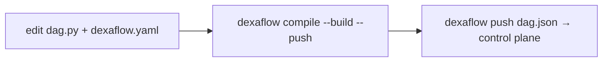

---
# --- AUTO redirect aliases (build_redirects.py) — do not edit by hand ---
aliases:
  - /deploy.html
# --- end AUTO redirect aliases ---
title: "CI/CD & deploy examples"
linkTitle: "CI/CD & deploy"
weight: 20
description: "Build, push and register DAGs from CI — GitHub Actions, GitLab CI, Cloud Build."
---

{}
[**Your first Pro DAG (≈10 min)**](/operate/first-pro-dag/) takes one DAG from source
to a running pod with **one command** (`dexaflow deploy`), so you see each
artifact boundary before you automate it. This page is the CI recipes for the
same pipeline.
{}

Deploying a Dexaflow DAG is the same everywhere because a DAG is an **immutable
artifact**: a `dag.json` + a container image, versioned together (ADR 0003).

**By hand or in a pipeline,** one command does it all:

```bash
dexaflow auth login --server https://pro.example.com   # by hand, once; stores the session
dexaflow deploy --yes                                  # compile → build → push → pin digest → register
```

`dexaflow deploy` is the [pipeline-less promotion](/project/adrs/0041-leoflow-deploy-pipelineless/):
it builds for the cluster's architecture (`build.platforms` in `dexaflow.yaml`,
`linux/amd64` when unset), pins the image by digest, and registers the artifact.
`--yes` skips the confirmation prompt (use it in automation). **It is the
recommended command in CI too**, and the recipes below use it.

**The explicit steps** are still available when a pipeline wants the build and
the register as separate stages:



1. **`dexaflow compile --build --push`**: parse `dag.py`, overlay
   `dexaflow.yaml`, run the **guardrails** (unknown `task_id`, unsupported
   operator, duplicate keys), build the DAG image and push it.
2. **`dexaflow push dag.json`**: register the artifact with the control plane.

{}
`compile --build --push` writes the image **tag** it pushed into `dag.json`
(`registry/image:tag`), and `push` registers that file as it is. The control
plane then pulls by tag, so a tag that is rebuilt later can run different bytes
under the same version. `dexaflow deploy` is the only command that resolves the
pushed image's digest and registers `registry/image@sha256:…`. Prefer `deploy`
in CI; if you split the steps, tag by commit (`tag_strategy: git_sha`) and never
reuse a tag.
{}

{}
The same checks that warn you locally in `dexaflow lite` fail the CI build, so a
bad `dag_id`/`task_id` binding or an unsupported operator never reaches prod.
{}

{}
The [**first Pro DAG walkthrough**](/operate/first-pro-dag/) runs `deploy` by
hand so you can watch the DAG cross each boundary. Come back here to wire the
same command into CI.
{}

{}
Registry auth, RBAC scope, non-root images, private-registry pulls, and the
`--dag-version`/`409` gotcha are exactly the errors CI hits first, since a
runner has none of a laptop's ambient state (no `docker login`, no
`dexaflow auth login` session, no git history for `--dag-version` to resolve
against). **[Deploy prerequisites & why shortcuts fail](/operate/deploy-prerequisites/)**
has the exact error and fix for each.
{}

## Your repo of DAGs (CI is the recommended path)

In Pro you keep your DAGs in a Git repository, one directory per DAG, and **CI**
turns each into an artifact when it changes. This is the recommended path: a push
triggers the pipeline, no one builds by hand. Each DAG is just **two files**, no
Dockerfile and no `requirements.txt`:

```text
my-dags/                      # your Git repo
├── .github/workflows/
│   └── deploy-dag.yml        # the CI below (the recommended path)
└── dags/
    ├── my_pipeline/
    │   ├── dag.py            # the DAG (TaskFlow / operators)
    │   └── dexaflow.yaml      # id, python_version, dependencies, registry
    └── another_pipeline/
        ├── dag.py
        └── dexaflow.yaml
```

`dexaflow deploy` (and `compile --build`) **generates the Dockerfile from
`dexaflow.yaml`**: `FROM` the published Dexaflow base, your deps/connectors
installed, your DAG copied in. No Dockerfile to maintain. A `Dockerfile` in the
DAG directory is used verbatim instead and the yaml's dependencies then do not
reach the image, so ship one only if you want full control (see
[your own Dockerfile](/operate/first-pro-dag/#advanced-your-own-dockerfile)).

The built image is **your** artifact: push it wherever you like (Docker Hub, ECR,
Artifact Registry, ACR, GHCR, a private registry), via the `registry:` block in
`dexaflow.yaml`. `deploy` requires that block; it has no `--image` flag. The
only image Dexaflow owns is the base your DAG layers on.

**The mental model:** a push that touches `dags/my_pipeline/**` triggers CI for
*that* DAG only (the `paths:` filter), which compiles → builds (from yaml) →
pushes the image to your registry → registers `dag.json`. The control plane runs
the new version on the next trigger. One DAG per pipeline keeps blast radius
small: a broken `another_pipeline` never blocks `my_pipeline`.

{}
The per-DAG pipeline above stays the recommendation, and the `paths:` filter is
the point of it: one DAG per pipeline is what keeps a broken DAG from blocking
its neighbours.

`dexaflow build [workspace]` is for the times you are **not** in that pipeline:
after a base-image bump that every DAG must pick up, when you clone the repo onto
a new machine, or when you want to see all the images a change produces before
pushing anything. It walks the workspace and builds each project with the image
that project's own `registry:` block derives (the same derivation `deploy` uses,
so nothing about naming is new):

```bash
dexaflow build my-dags/           # build every project under my-dags/
dexaflow build my-dags/ --push    # ...and push each to its registry
```

Two behaviours matter more than the loop itself:

- A project that declares **no `registry:`** is reported by name, not skipped
  quietly. A command that covers less than the workspace without saying so leaves
  you believing images exist.
- A failure **stops** the run, names the project, and lists what was already
  built. A half-built workspace (some images new, some stale) is invisible
  afterwards.

With no `--dag-version` / `--sha` it derives them the same way `deploy` does:
`git describe`, and the short commit hash. (`deploy` has no `--sha` flag at all;
it always derives the sha.)

Using it **as** your CI, in place of per-DAG pipelines, is a deliberate trade:
one job rebuilds everything on any change, so blast radius and build time both
grow with the repo. Choose it only if you want that.
{}

## Rolling back

There is **no rollback command yet** (tracked in
[#1702](https://github.com/dexadata/dexaflow/issues/1702)), and nothing makes an
older version current again by itself:

- Re-running `dexaflow push` with an older `dag.json` does **not** roll back.
  Content the control plane already has is a no-op: it answers success, the
  newer version stays current, and the DAG's schedule fields (`schedule`,
  `catchup`, `start_date`, `max_active_runs`) are still overwritten with the old
  file's values.
- Retagging an image in the registry does not roll back either: a version
  registered by `deploy` names its image by digest.

What works today is registering the old code **as a new version**, under a new
version label and on the old image digest. From the commit you want back:

```bash
git checkout <old-commit>
dexaflow compile dags/my_pipeline -o dag.json \
  --image "ghcr.io/your-org/my-pipeline@sha256:<old-digest>" \
  --dag-version "<old-version>-rollback-1"
dexaflow push dag.json --server "$DEXAFLOW_SERVER_URL"
```

The old digest is in the `image …@sha256:…` line `deploy` printed for that
version, and in the `dag.json` it wrote; keeping that file as a CI artifact makes
a rollback a lookup. Runs already in flight keep the version they started with.

## Prerequisites

- The `dexaflow` CLI on the runner (download the release binary, or `go install`).
- **Python 3.11 to 3.13 on the runner** (`dexaflow compile` invokes the
  stdlib-only parser shim, [ADR 0024](/project/adrs/0024-dag-parsing-structural-shim/),
  to turn `dag.py` into `dag.json`). See [Python on the runner](#python-on-the-runner) below.
- A container registry your cluster can pull from, and the builder logged in to
  it (`docker login`).
- The control plane URL, passed as `--server` or exported as
  `DEXAFLOW_SERVER_URL`. The CLI reads no other variable for it: a pipeline that
  exports something else (`DEXAFLOW_SERVER`, for instance) silently targets the
  default, `http://localhost:8080`.
- A CI credential for the control plane, below.

## Credentials for the control plane

A control-plane token **expires after one hour** (`auth.jwt.token_ttl_seconds`,
3600 by default), so a token stored as a CI secret stops working the same
afternoon. Store a **password** instead, and mint a fresh token at the start of
each job:

1. Once, as an admin, create a service user for CI with a role that grants
   `write:dag`, and store its password as a CI secret
   (`DEXAFLOW_CI_PASSWORD` below):

   ```bash
   dexaflow auth create-user --email ci-deploy@example.com --password-stdin \
     --role "$DEPLOY_ROLE" < password.txt
   ```

2. In each job, exchange it for a token. `deploy`, `push` and the other
   commands read `DEXAFLOW_TOKEN`:

   ```bash
   export DEXAFLOW_SERVER_URL=https://pro.example.com
   DEXAFLOW_TOKEN="$(printf '%s\n' "$DEXAFLOW_CI_PASSWORD" |
     dexaflow auth create-token --username ci-deploy@example.com --password-stdin)"
   export DEXAFLOW_TOKEN
   ```

The token never leaves the job, and a job that runs longer than an hour should
mint a new one before it registers.

## Python on the runner

The `dexaflow compile` step (which `deploy` runs) needs Python 3.11, 3.12, or
3.13 on `PATH` as `python3` to parse `dag.py`. **Bring your own Python** on the
runner; the managed CPython that `dexaflow setup` can download is meant for a
developer laptop, not for build pipelines, where it adds ~50 MB to every run and
bypasses your runner's pin/caching.

The recommended path on each runner type:

| Runner | Recipe |
|---|---|
| **GitHub Actions** | Add `actions/setup-python@v5` with `python-version: '3.12'` before installing dexaflow. Cached automatically. |
| **GitLab CI** | Install `python3` in the job image (`apk add python3` on `docker:27`), or use an image that ships both Python and the Docker CLI. |
| **Cloud Build / CodeBuild** | Install `python3` in the docker builder step, or use a cloud-provider image that ships Python 3.11+. |
| **Self-hosted runners** | Pin Python via your image baseline (`apt install python3.12` or `pyenv`) and version-lock in your runner provisioning. |
| **Generic Docker-in-Docker** | Base your build container on `python:3.12-slim` (gives you Python + a Debian userland for the `docker build` shell). |

Older Python (≤3.10) fails the compile cleanly: `dexaflow compile` errors out
with the version requirement, not a confusing traceback.

### No `dexaflow setup` in CI

`dexaflow compile` and `dexaflow deploy` extract the parser bundled in the binary
into `~/.dexaflow/pysrc/` on their own the first time they run (and again after a
binary upgrade), so a runner needs no setup step. Install the binary with
`DEXAFLOW_NO_SETUP=1`: `dexaflow setup` would also prepare Lite (credentials,
datastore) and may download a managed Python, none of which a pipeline uses.

Caching `~/.dexaflow/pysrc/` between runs is optional; the extraction takes a
few seconds.

## Examples

Each recipe deploys `dags/my_pipeline`, whose `dexaflow.yaml` carries the
`registry:` block (`url` + `image_name`). Replace `https://pro.example.com` with
your control plane.


{}

```yaml title=".github/workflows/deploy-dag.yml"
name: Deploy DAG
on:
  push:
    branches: [main]
    paths: ["dags/my_pipeline/**"]
jobs:
  deploy:
    runs-on: ubuntu-latest
    permissions: { contents: read, packages: write }
    env:
      DEXAFLOW_SERVER_URL: https://pro.example.com
    steps:
      - uses: actions/checkout@v4
        with: { fetch-depth: 0 }          # git describe needs history and tags
      - uses: actions/setup-python@v5     # BYO Python, see #python-on-the-runner
        with: { python-version: '3.12' }
      - uses: docker/login-action@v3
        with:
          registry: ghcr.io
          username: ${{ github.actor }}
          password: ${{ secrets.GITHUB_TOKEN }}
      - name: Install dexaflow
        run: curl -fsSL https://raw.githubusercontent.com/dexadata/dexaflow/main/install.sh | DEXAFLOW_VERSION=<VERSION> DEXAFLOW_NO_SETUP=1 DEXAFLOW_INSTALL_DIR=/usr/local/bin sh
      - name: Deploy
        env:
          DEXAFLOW_CI_PASSWORD: ${{ secrets.DEXAFLOW_CI_PASSWORD }}
        run: |
          DEXAFLOW_TOKEN="$(printf '%s\n' "$DEXAFLOW_CI_PASSWORD" |
            dexaflow auth create-token --username ci-deploy@example.com --password-stdin)"
          export DEXAFLOW_TOKEN
          dexaflow deploy dags/my_pipeline --yes
```

GHCR refuses image names with upper-case letters, so keep `registry.url` and
`registry.image_name` lower case. If you build the name from
`${{ github.repository }}` (for `compile --image`, say), lower-case it first:
`IMAGE="ghcr.io/${GITHUB_REPOSITORY,,}/my_pipeline:${GITHUB_SHA}"`.

Do not add `docker/setup-buildx-action` to this job. It makes a
`docker-container` builder the default, whose builds stay in the builder's
cache instead of the local image store; the CLI runs a plain `docker build`
without `--load`, so the `docker push` that follows finds no image.

{}
{}

```yaml title=".gitlab-ci.yml"
deploy_dag:
  image: docker:27
  services: [docker:27-dind]
  variables:
    # Talk to the dind service over TLS; the runner shares /certs/client.
    DOCKER_HOST: tcp://docker:2376
    DOCKER_TLS_CERTDIR: "/certs"
    DEXAFLOW_SERVER_URL: https://pro.example.com
  before_script:
    - apk add --no-cache python3 git   # BYO Python, see #python-on-the-runner
  rules:
    - if: $CI_COMMIT_BRANCH == "main"
      changes: ["dags/my_pipeline/**/*"]
  script:
    - echo "$CI_REGISTRY_PASSWORD" | docker login -u "$CI_REGISTRY_USER" --password-stdin "$CI_REGISTRY"
    - wget -qO- https://raw.githubusercontent.com/dexadata/dexaflow/main/install.sh | DEXAFLOW_VERSION=<VERSION> DEXAFLOW_NO_SETUP=1 DEXAFLOW_INSTALL_DIR=/usr/local/bin sh
    - export DEXAFLOW_TOKEN="$(printf '%s\n' "$DEXAFLOW_CI_PASSWORD" | dexaflow auth create-token --username ci-deploy@example.com --password-stdin)"
    - dexaflow deploy dags/my_pipeline --yes
```

`docker:dind` runs only on a runner configured with `privileged = true` (and,
for the TLS variables above, `volumes = ["/certs/client"]`) in its
`config.toml`; GitLab's shared SaaS runners are. `DEXAFLOW_CI_PASSWORD` is a
masked CI/CD variable. `registry.url` in `dexaflow.yaml` is your project's
`$CI_REGISTRY_IMAGE`, written out (for example
`registry.gitlab.com/your-group/my-dags`).

{}
{}

Build, push and register on Cloud Build; the DAG image runs as task pods on your
cluster. The build's service account is already authorized to push to Artifact
Registry in the same project, so `registry.url` in `dexaflow.yaml` is
`us-central1-docker.pkg.dev/<project>/dags`. The CI password lives in Secret
Manager.

```yaml title="cloudbuild.yaml"
steps:
  - name: gcr.io/cloud-builders/docker
    entrypoint: bash
    secretEnv: ["DEXAFLOW_CI_PASSWORD"]
    env:
      - DEXAFLOW_SERVER_URL=${_DEXAFLOW_SERVER_URL}
    args:
      - -c
      - |
        set -euo pipefail
        # BYO Python: the docker builder image is Debian; install python3.
        apt-get update -qq && apt-get install -y --no-install-recommends python3
        curl -fsSL https://raw.githubusercontent.com/dexadata/dexaflow/main/install.sh | DEXAFLOW_VERSION=<VERSION> DEXAFLOW_NO_SETUP=1 DEXAFLOW_INSTALL_DIR=/usr/bin sh
        DEXAFLOW_TOKEN="$(printf '%s\n' "$$DEXAFLOW_CI_PASSWORD" |
          dexaflow auth create-token --username ci-deploy@example.com --password-stdin)"
        export DEXAFLOW_TOKEN
        dexaflow deploy dags/my_pipeline --yes
substitutions:
  _DEXAFLOW_SERVER_URL: https://pro.example.com
availableSecrets:
  secretManager:
    - versionName: projects/$PROJECT_ID/secrets/dexaflow-ci-password/versions/latest
      env: DEXAFLOW_CI_PASSWORD
options: { logging: CLOUD_LOGGING_ONLY }
```

{}
When the local Docker daemon can't reach Google's IPs (in Cloud Shell, for
example), don't build locally at all. The `cloudbuild.yaml` above runs the
whole deploy **inside Cloud Build** (Google's network, not your machine):
serverless, still yaml-driven, no Dockerfile, no local egress. Trigger it from
Cloud Shell with:

```bash
gcloud builds submit --config cloudbuild.yaml .
```

Cloud Build receives the source, builds, pushes to Artifact Registry and
registers there; your machine never touches a Docker daemon. (Use
`gcloud builds submit --tag …` only if you ship your own Dockerfile; the
yaml-driven path has none for it to build.)
{}

{}
{}

Any runner with Docker, **Python 3.11+**, and the `dexaflow` CLI
(see [Python on the runner](#python-on-the-runner)):

```bash
export DEXAFLOW_SERVER_URL=https://pro.example.com
DEXAFLOW_TOKEN="$(printf '%s\n' "$DEXAFLOW_CI_PASSWORD" |
  dexaflow auth create-token --username ci-deploy@example.com --password-stdin)"
export DEXAFLOW_TOKEN
dexaflow deploy dags/my_pipeline --yes
```

Split into a build stage and a register stage, the same pipeline registers the
image **tag** rather than its digest (see the warning at the top):

```bash
dexaflow compile dags/my_pipeline --build --push -o dag.json   # image from registry: in dexaflow.yaml
dexaflow push dag.json
```
{}


## Control-plane deployment (Helm chart, in validation)

Deploying the control plane itself (Helm chart, published `dexaflow-server`/
`dexaflow-migrate` images, TLS on the agent channel, keyless cloud auth) is the
**Pro** track. One command installs the chart with auto-generated TLS and no
cert-manager — from its published OCI artifact
(`helm install dexaflow oci://ghcr.io/dexadata/charts/dexaflow --version <VERSION>`),
or from source on `main` for the bleeding edge
(`helm install lf ./helm/dexaflow …`). See [Install Pro](/get-started/installation/#install-pro).
The chart is installable today and in validation — see the
[Helm chart](https://github.com/dexadata/dexaflow/blob/main/helm/dexaflow/README.md), the reproducible
[Kubernetes test setup](https://github.com/dexadata/dexaflow/blob/main/deploy/k8s/README.md)
(the `deploy/k8s` recipe is cloud-portable — it runs unchanged on EKS / GKE / AKS),
[Operating modes](/concepts/editions/),
and the [Roadmap](/project/roadmap/). The product proves itself in **Lite** first.

See also: [DAG authoring](/author-dags/dag-authoring/) · [Operating modes](/concepts/editions/).
