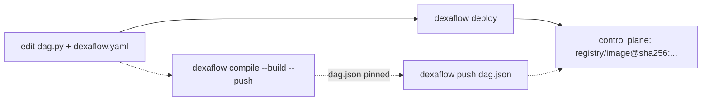

---
# --- AUTO redirect aliases (build_redirects.py) — do not edit by hand ---
aliases:
  - /deploy.html
# --- end AUTO redirect aliases ---
title: "CI/CD & deploy examples"
linkTitle: "CI/CD & deploy"
weight: 20
description: "Build, push and register DAGs from CI: GitHub Actions, GitLab CI, Cloud Build, Argo Workflows, Tekton and Jenkins, with buildah or kaniko."
---

{}
[**Your first Cluster DAG (≈10 min)**](/operate/first-cluster-dag/) takes one DAG from source
to a running pod with **one command** (`dexaflow deploy`), so you see each
artifact boundary before you automate it. This page is the CI recipes for the
same pipeline.
{}

Deploying a Dexaflow DAG is the same everywhere because a DAG is an **immutable
artifact**: a `dag.json` + a container image, versioned together (ADR 0003).

**By hand or in a pipeline,** one command does it all:

```bash
dexaflow auth login --server https://cluster.example.com   # by hand, once; stores the session
dexaflow deploy --yes                                  # compile → build → push → pin digest → register
```

`dexaflow deploy` is the [pipeline-less promotion](/project/adrs/0041-leoflow-deploy-pipelineless/):
it builds for the cluster's architecture (`--platform`, else `build.platforms`
in `dexaflow.yaml`, `linux/amd64` when neither is set) with the first
[builder](/operate/builders/) that applies, pins the image by digest, and
registers the artifact.
`--yes` skips the confirmation prompt (use it in automation). **It is the
recommended command in CI too**, and the recipes below use it.

**The explicit steps** are still available when a pipeline wants the build and
the register as separate stages. Both paths register the image by digest:



1. **`dexaflow compile --build --push`**: parse `dag.py`, overlay
   `dexaflow.yaml`, run the **guardrails** (unknown `task_id`, unsupported
   operator, duplicate keys), build the DAG image, push it, and write the
   pushed image's digest into `dag.json` as `registry/image@sha256:…`.
2. **`dexaflow push dag.json`**: register the artifact with the control plane.

{}
`compile --build --push` reads the digest of the image it pushed (the same read
`deploy` makes, with the same [registry credentials](/operate/builders/#registry-credentials))
and writes `registry/image@sha256:…` into `dag.json`, so `push` registers the
bytes that were built. When only that read fails (the push succeeded), the
compile keeps the tag in `dag.json` and warns with the reason, and `push`
tries the read again; `deploy` stops instead, since it registers only a
digest. `push` pins too: when `dag.json` names a tag (a file
compiled by an older CLI, or an image another tool pushed), it resolves the tag
in the registry and registers the digest it names at that moment. `push --image
<ref>` registers another image than the one in `dag.json`, a tag resolved the
same way or a `<repository>@sha256:<digest>` used as given. When the registry
cannot be read, `push` registers the tag as written with a warning that says
why, and a server under [`deploy.require_digest: enforce`](#require-images-pinned-by-digest)
refuses it with an error that names the reason and the fix. `dexaflow deploy`
remains the recommended command: it adds the preflight, the plan and the
reuse of an image already built.
{}

{}
The same checks that warn you locally in `dexaflow lite` fail the CI build, so a
bad `dag_id`/`task_id` binding or an unsupported operator never reaches prod.
{}

{}
The [**first Cluster DAG walkthrough**](/operate/first-cluster-dag/) runs `deploy` by
hand so you can watch the DAG cross each boundary. Come back here to wire the
same command into CI.
{}

{}
Registry auth, RBAC scope, non-root images, private-registry pulls, and the
`--dag-version`/`409` gotcha are exactly the errors CI hits first, since a
runner has none of a laptop's ambient state (no `docker login`, no
`dexaflow auth login` session, often a shallow clone with no tags for the
default version label to start from). **[Deploy prerequisites & why shortcuts fail](/operate/deploy-prerequisites/)**
has the exact error and fix for each.
{}

## Your repo of DAGs (CI is the recommended path)

In Cluster you keep your DAGs in a Git repository, one directory per DAG, and **CI**
turns each into an artifact when it changes. This is the recommended path: a push
triggers the pipeline, no one builds by hand. Each DAG is just **two files**, no
Dockerfile and no `requirements.txt`:

```text
my-dags/                      # your Git repo, a workspace
├── dexaflow.workspace.yaml   # targets and shared defaults (registry, ...)
├── .github/workflows/
│   └── dexaflow-deploy.yaml  # the pipeline `dexaflow ci init github` writes
├── ci/
│   └── dexaflow-deploy.sh    # the deploy step every generated pipeline runs
└── dags/
    ├── my_pipeline/
    │   ├── dag.py            # the DAG (TaskFlow / operators)
    │   └── dexaflow.yaml      # id, python_version, dependencies, registry
    └── another_pipeline/
        ├── dag.py
        └── dexaflow.yaml
```

`dexaflow deploy` (and `compile --build`) **generates the Dockerfile from
`dexaflow.yaml`**: `FROM` the published Dexaflow base, your deps/connectors
installed, your DAG copied in. No Dockerfile to maintain. A `Dockerfile` in the
DAG directory is used verbatim instead and the yaml's dependencies then do not
reach the image, so ship one only if you want full control (see
[your own Dockerfile](/operate/first-cluster-dag/#advanced-your-own-dockerfile)).

The built image is **your** artifact: push it wherever you like (Docker Hub, ECR,
Artifact Registry, ACR, GHCR, a private registry). `deploy` needs a registry
prefix from one of `--registry`, `DEXAFLOW_REGISTRY`, the `registry:` block of
`dexaflow.yaml`, the target, the workspace defaults, your config file or the
cluster's deploy defaults
([Registry, platforms and base image](/operate/workspaces-and-targets/#registry-platforms-and-base-image)),
and names the image after the `dag_id` unless `registry.image_name` says
otherwise; it has no `--image` flag. The only image Dexaflow owns is the base
your DAG layers on.

**The mental model:** a push to `main` runs one pipeline, which deploys only the
DAG projects that push changed (`deploy --all --changed-since <before>`, see
[Deploying only what changed](#deploying-only-what-changed)): each one is
compiled, built from its yaml, pushed to your registry and registered. The
control plane runs the new version on the next trigger. The projects deploy one
after the other, and a broken `another_pipeline` does not stop `my_pipeline`
from deploying; the job still fails, naming the DAG that did not deploy.
[`dexaflow ci init`](#writing-the-pipeline-dexaflow-ci-init) writes that
pipeline for you.

The first registration of a DAG leaves it **paused**, as in Airflow: its
schedule creates no run until someone unpauses it (UI switch, or
`dexaflow admin dags unpause <dag_id>`). Later registrations never change that,
so a pipeline that redeploys an active DAG keeps it active. A DAG that should
start active sets `is_paused_upon_creation=False`; see
[New DAGs start paused](/concepts/core-concepts/#new-dags-start-paused).

### What a deploy says, and the flags that change it

Every deploy prints the server it goes to (and the target that chose it)
before it builds, and ends with a line saying what happens next:

```text
next: etl is paused, so nothing runs until `dexaflow admin dags unpause etl`; unpausing creates 13 catchup runs since start_date 2026-10-01T00:00:00Z, then one run per tick; next tick 2026-10-14T00:00:00Z (UTC).
```

An active DAG gets its next run time instead. The line follows the scheduler:
with `catchup=True` and a `start_date`, every tick since `start_date` gets a
run; otherwise only the latest tick does. A DAG that already ran resumes after
its last run, so its count is an upper bound, as it is for `--active` on a DAG
that was paused. Times are in UTC: the scheduler does not yet apply a DAG's
`timezone` or `end_date`, so the line ignores them too.

With no server set anywhere (no `--server`, `--target`, `DEXAFLOW_SERVER_URL`
or `server_url`), `deploy` stops before building instead of going to
`http://localhost:8080`; a machine set up for Lite keeps the local default.

#### Checks before the build (preflight)

A deploy that the server or the registry would refuse fails in seconds,
before the build, with a message that names what to fix. `deploy` checks, in
this order:

1. **Before the compile: the control plane answers and the token may
   deploy.** A token the server refuses (`401`) names `dexaflow auth login`;
   a token without the `deployer` role, `deploy` or `write` on dags, or an API
   token without the `deploy` scope (`403`) names
   `dexaflow auth create-token --scope deploy`. With `--paused` or `--active`
   the check also covers what those flags need (`write` on dags and, for an
   API token, the `dexaflow:run` scope), and the refusal says so. A server
   that cannot be reached stops the deploy here.
2. **Before the build: the registry accepts a push** to the image's
   repository with the credentials the daemonless build paths push with:
   the docker config (`~/.docker/config.json` and its credential helpers)
   and, for an Artifact Registry, GCR, ECR or ACR host, the session of the
   `gcloud`, `aws` or `az` CLI, as `registry.auth_method` says (see
   [Registry credentials](/operate/builders/#registry-credentials)). The
   line says where the credential came from. The check starts an
   upload and cancels it (best effort: a registry that refuses the cancel
   expires the empty upload), so no image is written. A refusal of the
   credential found stops a `docker` deploy, naming the login command of the
   registry (`gcloud auth configure-docker <host>`,
   `aws ecr get-login-password --region <region> | docker login ...`,
   `az acr login --name <name>`, or `dexaflow registry login <registry>`). With no
   credential found, or with another `--builder` (podman, for one, keeps
   credentials of its own in `auth.json`), a refusal is a `note:` naming the
   command for that builder, and why the cloud CLI gave no token when it
   could not (not on `PATH`, not signed in), and the push decides. Nothing is checked when nothing is pushed: with
   `--skip-build`, or when the registry already holds the image for the
   content label.
3. **After the compile, before the build: the server's dry run of the
   register.** The compiled `dag.json` goes to
   `POST /api/v2/dags/{dag_id}/versions/dry_run`, which runs every check the
   register runs (spec validation, the operator's image, service account
   and field allowlists, the resource unit, source mode, the tenant's limits,
   the declared connections and variables, the version label) and writes
   nothing. The register gets the image pinned by digest, which the build
   makes later. When nothing is built (`--skip-build`, or the registry
   already holds the image for the content label) the dry run is sent the
   digest the registry holds for the tag, the very image the register gets,
   so an allowlist that names that exact digest accepts it. Before a build
   it is sent the repository at a placeholder digest, so an allowlist of
   repositories or of `repo@*` decides as for the register. A refusal stops
   the deploy with the server's reason, except two the built image decides
   when it is still to be built. One is a refusal of the placeholder image
   when it is the only refusal and the allowlist names the image's
   repository at a digest (`<repo>@sha256:...`), which a reproducible build
   may match; a repository the allowlist does not cover still stops the
   deploy. The other is a version label registered with other content. Each
   of those is a `note:`, and the register answers it. So is a dry run the server
   could not answer (`5xx`, or `429` under load): the deploy goes on and the
   register runs the checks. A warning (a task that does not fit its size
   under `executor.unit.enforce: warn`) prints on stderr and the deploy goes
   on.
4. **With the dry run: what the task pods will run as.** The dry run
   answer also says whether the server runs task pods as non-root
   (`taskPodSecurity.runAsNonRoot`) and, for each ServiceAccount a task pod
   would run as (the task's `execution.service_account`, else the chart's
   task ServiceAccount, else the namespace's `default`), whether it exists in
   the task namespace and how many `imagePullSecrets` it carries. Both used
   to fail only when a task pod started.
   - A ServiceAccount that does not exist stops the deploy, naming it and
     its tasks: the pods of those tasks would not be created. Set
     `execution.service_account` to one that exists, or have the operator
     create it (`taskServiceAccount.create` in the Helm values). The
     namespace's `default` ServiceAccount is the exception: Kubernetes
     creates it in every namespace a moment after the namespace, so a
     missing `default` is a `note:` and the deploy goes on.
   - A ServiceAccount with no `imagePullSecrets` is a `note:`: a private
     registry is then pulled only with the nodes' own credentials (IRSA,
     Workload Identity, a credential helper), which the server cannot see.
     The operator lists a pull secret in `taskServiceAccount.imagePullSecrets`
     otherwise. A ServiceAccount the server could not look up is a `note:`
     with the reason: the control plane reads the account with `get` on
     `serviceaccounts` in the task namespace, which the chart grants
     ([ADR 0085](/project/adrs/0085-control-plane-reads-task-service-accounts/)),
     except in a split control plane, whose API role has no access to the
     cluster.
   - When the project builds from its own `Dockerfile`, the deploy reads the
     `USER` its final stage ends with (the one of the stage it is built
     `FROM`, when that is a stage of the same file). On a server that runs
     task pods as non-root, `USER root`, `USER 0` or a user name
     (`USER app`, which the kubelet cannot check is not root) stops the
     deploy and names the fix: a numeric non-root id such as
     `USER 65532:65532`. No `USER` (the base image decides) or a build
     variable (`USER $UID`) is a `note:`. A server that does not run task
     pods as non-root takes any `USER`. When the server does not say (an
     older server, or no dry run), root or a name is a `note:`. The
     Dockerfile generated from `dexaflow.yaml` always ends with
     `USER 65532:65532` and is not read; nothing is read with
     `--skip-build` or in source mode, which build nothing.

Each check that passes prints a `preflight:` line (on stderr with
`--output json`). A server from before the dry run route answers it with
`404` and registers nothing, also during a rolling upgrade when one replica
is older: the deploy prints a `note:` and its policy checks run at the
register, after the build, as before. `dexaflow doctor` runs the first two
checks for the target in use, refreshing a saved session as a deploy does.

| Flag | What it does |
|---|---|
| `--paused` / `--active` | Leaves the DAG paused or active after this deploy, new or not, instead of the creation rule above. The register sets it in its own transaction, audited as `dag.pause` or `dag.unpause`; for content that is already current, nothing is registered and the DAG is paused or unpaused with the Airflow `PATCH /api/v2/dags/{dag_id}`. Pausing is a run-state write: these flags need `write:dag` (the `deployer` role alone is refused with `403`), and a scoped token needs `dexaflow:run` as well as `dexaflow:deploy`, so a deploy-only token is refused with `403`. |
| `--plan` | Says per DAG what a deploy would build, push and register, and why (content changed, already current, an older version, a new DAG), without running the parser, the builder or the register. Works with `--all`, and in [source mode](/operate/source-mode/#deploying-in-source-mode), where nothing is built or pushed. |
| `--changed-since <ref>` | With `--all`, deploys only the projects whose files changed since a git ref, and lists the others as skipped. See [Deploying only what changed](#deploying-only-what-changed). |
| `--output json` | Prints one JSON document on stdout for the pipeline to read; the human lines and the builder's output go to stderr. |

The JSON document has one entry per DAG:

```json
{
  "server": "https://cluster.example.com",
  "target": "prod",
  "dags": [
    {
      "dag_id": "my_pipeline",
      "status": "registered",
      "version": "v1.4.0-3f9c2a1b7d4e",
      "image": "ghcr.io/acme/my_pipeline@sha256:4e1f...",
      "digest": "sha256:4e1f...",
      "spec_hash": "9b0c...",
      "created": true,
      "dag_created": true,
      "is_paused": true,
      "next": "my_pipeline is paused, so nothing runs until ...",
      "execution": {
        "warm_pools": true,
        "tasks": [
          { "task_id": "extract", "mode": "warm" },
          { "task_id": "load", "mode": "dedicated", "reason": "node_selector set" }
        ],
        "pool": { "state": "on", "detail": "2 idle warm workers (up to 5) ...", "min_idle_workers": 2, "max_pool_size": 5 }
      }
    }
  ]
}
```

`created` says a new version was registered and `dag_created` that it was
the DAG's first. `status` is `registered` (a new version), `unchanged` (the server already had
this exact content), `current` (the content label is the current version, so
nothing was built), `skipped` (unchanged since the `--changed-since` ref, with
`reason`), or `failed` (one DAG of `--all`, with `error`). With
`--plan` it is `planned` or `refused`, and a `plan` object carries `build`,
`push`, `register` and `reason`, and `source_mode: true` for a deploy in
[source mode](/operate/source-mode/#deploying-in-source-mode). `links` and
`checks` carry what the server added to the register's answer, when it added
any ([Links and checks from the server](#links-and-checks-from-the-server)).
After a failure of `--all` the document is still printed, so the pipeline
sees which DAGs went through.

`execution` is the server's answer on where each task runs: `mode` is `warm`
(warm-eligible) or `dedicated`, with the `reason` for a dedicated pod, and
`pool.state` is `off`, `none` or `on`, with `previous_pool: "draining"` for a
new version of an existing DAG on a server that keeps warm workers: the
previous version's pool drains, and the new one starts at the next reconcile
when the DAG declares `min_idle_workers`, else with its first run (see
[Prewarm and drain on deploy](/operate/warm-pools/#prewarm-and-drain-on-deploy)). The human output
prints it as an `execution` line and, unless every task takes a dedicated pod
for one reason, a `warm pool` line; see
[Where a deploy's tasks run](/operate/warm-pools/#where-a-deploys-tasks-run).
A server from before the field sends none, and the entry has no `execution`.
`--plan` does not run the parser, so it has no tasks to report on.

#### Links and checks from the server

A server, or a platform in front of it, may add two optional fields to the
answer of the register and of its dry run: a `links` object (a name for each
URL, such as the page of the new version in its own UI) and a `checks` list
(what it checked, and the result). Each check is an object with a `name`, a
`status` and an optional `detail`, or a plain string. The engine sends
neither; `deploy` prints whatever it gets, the links sorted by name and the
checks in the order given, under the `preflight:` line of the dry run and
under the `Deployed` line of the register:

```text
Deployed my_pipeline -> https://cluster.example.com
  image ghcr.io/acme/my_pipeline@sha256:4e1f...
  registered version v1.4.0-3f9c2a1b7d4e
  link     console: https://console.example.com/dags/my_pipeline
  check    lint: passed (0 findings)
```

Only `http` and `https` links are kept; any other (a `javascript:`, `file:`
or relative URL) is dropped. Before printing, control characters (C0 and C1)
are removed, and so are format characters (bidirectional overrides, zero-width
characters) and line and paragraph separators, so a server cannot drive the
terminal or disguise a link. With `--output json`, the register's `links` and
`checks` are fields of the DAG's entry, absent when the server sent none.

#### How the server recognizes the CLI

Every request the CLI sends to a control plane, from any command (each HTTP
client it builds sets the headers in its transport), carries
`User-Agent: dexaflow-cli/<version>`, and `X-Dexaflow-CI: true` when one of
the usual CI variables is set (`CI`, `GITHUB_ACTIONS` or `GITLAB_CI`, to
anything but empty, `false` or `0`), so a server can tell an interactive
deploy from a pipeline's. Neither header grants anything: authorization
still comes from the token alone.

{}
The pipeline `dexaflow ci init` writes stays the recommendation: it deploys
only the DAGs a change touched (`--changed-since`), and a broken DAG does not
stop the others from deploying.

`dexaflow build [workspace]` is for the times you are **not** in that pipeline:
after a base-image bump that every DAG must pick up, when you clone the repo onto
a new machine, or when you want to see all the images a change produces before
pushing anything. It walks the workspace and builds each project with the image
that project's own `registry:` block derives (the same derivation `deploy` uses,
so nothing about naming is new):

```bash
dexaflow build my-dags/           # build every project under my-dags/
dexaflow build my-dags/ --push    # ...and push each to its registry
```

Two behaviours matter more than the loop itself:

- A project that declares **no `registry:`** is reported by name, not skipped
  quietly. A command that covers less than the workspace without saying so leaves
  you believing images exist.
- A failure **stops** the run, names the project, and lists what was already
  built. A half-built workspace (some images new, some stale) is invisible
  afterwards.

With no `--dag-version` / `--sha` it derives them the same way `deploy` does,
per project: the version label from `git describe` in the project's directory
plus a hash of that project's content, and the short commit hash of that
directory. (`deploy` has no `--sha` flag at all; it always derives the sha.)

Using it **as** your CI, in place of `deploy --all --changed-since`, is a
deliberate trade: one job rebuilds everything on any change, so build time
grows with the repo, and it only builds: nothing is registered. Choose it only
if you want that.
{}

## Deploying only what changed

In a repository with many DAG projects, `deploy --all --changed-since <ref>`
deploys only the projects whose files differ from a git ref, so a commit that
touches one DAG does not compile the others:

```bash
dexaflow deploy --all --changed-since origin/main --yes
```

```text
==> orders: dags/orders/dag.py changed since origin/main
==> skipping billing (unchanged since origin/main)
==> deploying orders (/repo/dags/orders)
...
Deployed 1 DAG(s) from /repo (1 unchanged since origin/main, skipped)
```

A project counts as changed when a file its image or its version label is
built from changed: the DAG source, the `include_paths` (shared code included),
the dbt project and `dbt_groups` directories, `dbt.manifest`, its
`dexaflow.yaml` (or `leoflow.yaml`), its `.dockerignore`, and its own
Dockerfile (with a project Dockerfile, every file of the project directory the
`.dockerignore` keeps). These are the files the content label hashes, so a
skipped project is one whose label would not change. A file that `exclude_paths`
leaves out, or that the generated Dockerfile does not copy (a `README.md` next
to `dag.py`, say), changes nothing. A change to the workspace file
(`dexaflow.workspace.yaml`, which holds the shared defaults and the targets)
counts as a change to every project.

How the comparison works:

- **The ref is compared with the working tree**, not with `HEAD` and not from a
  merge base: committed, staged, unstaged and untracked files all count, and so
  do submodules, whatever `diff.ignoreSubmodules` says. A change on the ref's
  side since your branch started counts too, so the comparison errs toward
  deploying.
- **A file git ignores cannot be compared.** A project built from one (a
  generated module under `include_paths`, dbt `deps` output) always counts as
  changed, and the output names the file. Inside a submodule, the submodule's
  own ignore rules decide. So does a project built from a file
  outside the repository, or one whose folder resolves outside it.
- **The ref must be in the clone.** A shallow clone (the default of
  `actions/checkout`) stops with a message saying to fetch the history: use
  `fetch-depth: 0`, or `git fetch --unshallow`. A ref that does not exist, or a
  folder outside a git repository, stops the deploy too; nothing is deployed
  by guess.
- **A project removed since the ref** (its `dexaflow.yaml` or `dag.py` deleted)
  is reported with its `dag_id`, and nothing is deployed or deregistered for
  it: its DAG stays registered and scheduled until you pause it with
  `dexaflow admin dags pause <dag_id>` (or every such DAG at once with
  [`dexaflow sync <dir> --prune`](#syncing-a-target-with-the-workspace-gitops))
  or remove it with `dexaflow dags delete <dag_id> --deregister`. A project moved to another
  folder keeps its `dag_id`: it is reported as moved, with no removal advice,
  and deployed from its new folder. A `dag_id` changed in place is not reported:
  the project is deployed under its new id, and the DAG under the old id stays
  registered until you remove it.
- **It selects among the workspace's projects**, so it goes with `--all`, or a
  bare `dexaflow deploy` at the workspace root. With a `dag_id` or a path it is
  refused, rather than silently skipping the DAG you named.
- What git does not see is not compared: the CLI version, `--registry`,
  `--platform`, the target's settings and the config file. After upgrading the
  CLI or changing a target, deploy with `--all` alone once.

With `--output json`, every skipped project has an entry with `status:
"skipped"` and its `reason`, the removed ones are listed under `removed`
(`path`, `dag_id`, `reason`), and the moved ones under `moved` (`dag_id`,
`from`, `to`).

`--changed-since` and the content label solve different costs. Without the
flag, `deploy --all` already registers nothing for a project whose label is the
current version, and reuses an image the registry holds for its label
([ADR 0076](/project/adrs/0076-reuse-image-by-content-label/)); but it still
compiles every project and asks the server about each. `--changed-since`
skips those projects before any of that. Use it in the pipeline of a large
repository, on every push; use `--all` alone when the inputs git does not see
changed (above), or to check that every project is deployed.

The pipeline [`dexaflow ci init`](#writing-the-pipeline-dexaflow-ci-init)
writes does this on every push to `main`, and the generated files are under
[Examples](#examples-what-dexaflow-ci-init-writes). What it passes to
`--changed-since` decides what a failed or cancelled run leaves behind:

- **GitHub** passes the commit of the last successful run of the workflow on
  the branch (`gh run list --status success`). A run that failed, or one the
  `concurrency:` group cancelled while it waited, leaves that commit where it
  was, so the next run deploys its changes too. With no successful run yet,
  every DAG is deployed.
- **GitLab** passes the commit of the last successful push pipeline on the
  branch when the job has `DEXAFLOW_GITLAB_API_TOKEN`, a project access token
  with the `read_api` scope: the job token cannot read the pipelines API.
  Without it, the job passes the commit the branch was on before the push
  (`$CI_COMMIT_BEFORE_SHA`), and a failed, cancelled or skipped pipeline is
  not caught up by the next push, which compares with its own previous commit:
  rerun the failed pipeline, or run one by hand, which deploys every DAG. Turn
  off "Auto-cancel redundant pipelines" for the branch and set the process mode
  of the `dexaflow-deploy` resource group to `oldest_first`, so pipelines
  deploy in push order.
- **Cloud Build** has no previous commit to pass: it deploys every DAG, unless
  you set `_DEXAFLOW_BASE_REF` on a build whose source is a git clone.

Every system deploys all the DAGs when the base commit is all zeros (a new
branch) or missing from the clone (after a force push).

In a pipeline of your own, compare with the last commit that deployed rather
than with the previous push: move a ref after each successful deploy (for
example `git push -f origin HEAD:refs/tags/deployed-prod` in a last step) and
pass `--changed-since deployed-prod`, with a `concurrency:` group on the job so
two runs never move it out of order.

## Rolling back

A rollback makes a version the control plane already holds current again. It
rebuilds nothing: the version runs the image digest it was registered with.

```bash
dexaflow dags versions my_pipeline                 # what is registered, and which is current
dexaflow rollback my_pipeline                      # back to the version before the current one
dexaflow rollback my_pipeline --to v1.4.0-3fa2c1   # or to a label (or a version number) from the list
```

`dexaflow dags versions` lists each version, newest first: its number, its
label, a `*` on the current one, when it was registered, the id of the user
who registered it (`dexaflow admin users list` maps ids to emails), the
commit it was built from (see [Where a version was built](#where-a-version-was-built))
and the short image digest. `--to` matches a label first, then a version number. `dexaflow rollback` prints the version it moved from and
the one it moved to, and takes `--server` and `--token` like the other
commands. Both read and write through the API: the listing is
`GET /api/v2/dags/{dag_id}/dagVersions`, and the rollback is
`PUT /api/v2/dags/{dag_id}/currentVersion` with `{"version": "<label>"}` or
`{"version_number": <n>}`, which needs the same permission as registering a
version (scope `dexaflow:deploy` for a scoped token).

A rollback passes the checks a register of the version would pass today.
Under `deploy.require_digest: enforce`, a version registered with a tag
cannot be made current again: redeploy its sources with `dexaflow deploy`, or
set the setting to `warn` (see
[Require images pinned by digest](#require-images-pinned-by-digest)).

What a rollback changes, in one transaction:

- **New runs** use the version made current, from the next scheduler tick.
- **The schedule** and the other DAG settings (catchup, start date, max active
  runs, description, owner, tags) become that version's.
- **Runs already created keep their version**, including runs in flight.
- **Pause state does not change.** A paused DAG stays paused, an unpaused one
  stays unpaused.

What the UI shows after a rollback follows Airflow, which has no rollback and
always runs its newest version:

- **The DAG header's Latest Dag Version** and the version the **Code** tab
  opens on are still the newest version, not the current one. The Code tab's
  version picker shows the source registered with each version
  (`GET /api/v2/dagSources/{dag_id}?version_number=<n>`; without
  `version_number` or with `0`, the newest version's source).
- **A run, and each of its task instances, shows the version it ran with**, so
  a run created after the rollback shows the version made current, and its
  Code tab opens on that version's source.
- **The Clear dialog offers "Run with latest bundle version"** even on a run
  that already uses the current version, because the UI compares the run's
  version with the newest one. In Dexaflow that option re-pins the run to the
  current version, so on such a run it changes nothing. On a finished run
  whose version adds or drops a task, the clear creates the added tasks' task
  instances and marks the dropped ones `removed`. A run that is still running
  keeps its version, and the API response says the option was not applied
  (the dialog does not show it): see
  [Clearing a run that is still running](/author-dags/dag-authoring/#clearing-a-run-that-is-still-running).
- **Which version is current** is the `*` in `dexaflow dags versions`, and the
  `is_current` field of each version in `GET /api/v2/dags/{dag_id}/dagVersions`
  and of `latest_dag_version` in the DAG details. The MCP `dag://source`
  resource serves the current version's source, as `dag://spec` serves its
  spec.

The version must still pass what a register of it would pass today: the
operator's execution policy, the tenant limits, and its declared Variables and
Connections. A version that no longer does is refused with `400` (or `403` for
a tenant limit), and the current version stays. Naming the version that is
already current changes nothing. Every rollback is recorded in the audit log as
`dag.version.set_current`, with the user and the from and to versions.

Two things that look like a rollback are not:

- Re-running `dexaflow push` with an older `dag.json` is a no-op: content the
  control plane already has answers `created: false`, and the newer version
  stays current, schedule included.
- Retagging an image in the registry changes nothing: a version registered by
  `deploy` names its image by digest.

`dexaflow deploy` of code that matches a version registered earlier (after a
`git revert`, for example) stops before building and suggests the
`dexaflow rollback <dag_id> --to <label>` command for that version.

## Where a version was built

Every `dexaflow deploy` and `dexaflow push` records where the version was
built. `GET /api/v2/dags/{dag_id}/dagVersions` (and `.../dagVersions/{n}`, and
the answer of a rollback) returns it as `build_info` next to Airflow's fields,
`null` for a version registered without it; the `dag_version` embedded in task
instance, run and DAG details answers leaves it out:

| Field | Where the CLI reads it |
|---|---|
| `commit` | `git rev-parse HEAD` in the project directory, when it is in a git work tree. |
| `repo` | The `origin` remote of that work tree, as an `https` URL: credentials and a trailing `.git` are dropped, and an ssh remote (`git@host:org/repo.git`) becomes `https://host/org/repo`. Outside git, `GITHUB_SERVER_URL`/`GITHUB_REPOSITORY` or GitLab's `CI_PROJECT_URL`. |
| `pipeline_url` | The CI run: on GitHub Actions `GITHUB_SERVER_URL/GITHUB_REPOSITORY/actions/runs/GITHUB_RUN_ID`, else `CI_PIPELINE_URL` (GitLab), `BUILD_URL` (Jenkins), `BUILDKITE_BUILD_URL` or `CIRCLE_BUILD_URL`, without a query string or fragment. |
| `builder` | The builder that produced the image, as the deploy prints it (`code-layer`, `local-daemon (docker)`, ...). Absent when the deploy built nothing: with `--skip-build`, and when it reused an image the registry already held for this content label. |
| `base_image` | The base image of the generated Dockerfile, which carries the task agent. Absent when the project ships its own Dockerfile, and when the deploy built nothing (`--skip-build`, or a reused image). |
| `cli_version` | The version of the CLI that built and registered the version. |

What cannot be read is left out; a deploy never fails for it. `dexaflow promote`
forwards the source version's `build_info` to the destination.

Build info is metadata of the register, not part of `dag.json`: it changes
neither the spec, its hash nor the version label, so the same sources built by
two pipelines still compile to one version. A version is immutable, so a
re-push of content already registered creates nothing and keeps the build info
of its first register. The CLI sends it as the `build_commit`, `build_repo`,
`build_pipeline_url`, `build_builder`, `build_base_image` and
`build_cli_version` query parameters of
`POST /api/v2/dags/{dag_id}/versions`; another client can send them too. The
server checks them as external input (a commit is 7 to 64 lower case hex
characters, the two URLs are absolute `http` or `https` URLs of at most 2048
bytes without credentials, query string or fragment, every field is valid
UTF-8 without control characters) and
refuses a bad value with `400`. The register's `dag.version.register` audit
entry records the same `build_info`. It is the caller's claim, recorded as
sent and not verified: a deploy token can write any commit there.

## Syncing a target with the workspace (GitOps)

`dexaflow sync <dir>` makes the target in use run what a folder of DAG
projects holds, the way Argo CD or Flux make a cluster match a repository. It
compares every project under `<dir>` with the DAGs registered on the target,
says per DAG what it does, and does it:

```bash
dexaflow sync ./dags --dry-run --prune     # what would change; exit 1 if anything would
dexaflow sync ./dags --prune --yes         # make the target match
```

```text
workspace: /repo/dags
target prod: https://cluster.example.com (target prod, from --target)

  DAG      STATE             CURRENT VERSION             PAUSED  ACTION
  billing  drift             v1.3.0-4-g77aa01-1f0c (#4)  no      deploy v1.4.0-3fa2c1
  intake   not deployed      -                           -       deploy v1.4.0-9b0e12
  orders   behind            v1.4.1-c41d2e (#7)          no      none: registered content is newer than the workspace; run with --rollback to make v1.4.0-0d11f9 current
  reports  in sync           v1.4.0-5e6f70 (#2)          no      none
  legacy   not in workspace  -                           no      pause
  old_etl  not in workspace  -                           yes     none: already paused

dry run: 3 change(s) would be made (2 deploy, 1 pause); 1 behind, left as is (pass --rollback)
```

| State | What it means | What sync does |
|---|---|---|
| `in sync` | The local content label is the current version. | Nothing. |
| `drift` | The local content label is no registered version: the files changed, or the commit did (the label starts with `git describe`). | Deploys it. |
| `not deployed` | The server does not know the DAG, or holds no current version of it. | Deploys it. |
| `behind` | The local content label is a registered version older than the current one: the target was deployed from a newer commit than this checkout. | Reports it and leaves it. With `--rollback`, makes that version current again, as `dexaflow rollback --to <label>` does: nothing is built and `is_paused` is kept. |
| `not in workspace` | The target holds a DAG no project under `<dir>` defines. | Reports it; with `--prune`, pauses it. |
| `error` | The project could not be read (its `dexaflow.yaml` does not parse, say) or its DAG could not be read. | Nothing; the exit code is 2. |

A `git revert` does not make a DAG `behind`: the revert is a new commit, so
`git describe` and the label change, and the DAG is `drift` and deployed again
under the new label. A DAG is `behind` when the checkout itself is older than
what was deployed, for example when Argo CD syncs an earlier revision.

The comparison is the one [`dexaflow status`](/operate/workspaces-and-targets/)
makes, and the label is the one `dexaflow deploy` computes, so "in sync" means
a deploy would build and register nothing. What goes into the label decides
when sync agrees with the job that deployed:

- **`git describe` of the project.** A new commit moves the label even for a
  DAG whose files did not change: after each commit, `sync` deploys every DAG
  once, as `deploy --all` would. Run anywhere else (a hook, a second clone),
  sync must see the same history and tags as the job that deployed, or every
  DAG reads as `drift`.
- **The CLI version.** Pin the same `dexaflow` version in CI and in the hook;
  after an upgrade every DAG reads as `drift` once.
- **`--registry`, `--platform` and `--dockerfile`**, and the target's, the
  workspace's and the cluster's deploy defaults. Pass `sync` the flags a
  deploy is given.
- **Only the default label.** Sync deploys with the content label. A DAG
  deployed with `--dag-version` never reads as `in sync`, and sync would
  register it again under the content label: a team that labels its versions
  by hand should keep using `deploy` and use `sync --dry-run --prune` only to
  find the DAGs to retire.

How each change is made:

- **Deploys** go through the same code as `dexaflow deploy --all`: compile,
  build and push (or reuse the image the registry already holds for the
  content label), pin the digest, register. A new DAG is paused or active as
  the server decides for new DAGs (`is_paused_upon_creation`, then
  `dags_are_paused_at_creation`); a redeploy never changes `is_paused`.
- **Rollbacks** (`--rollback` only) make the matching version current with
  `PUT /api/v2/dags/{dag_id}/currentVersion`, as in [Rolling back](#rolling-back).
- **`--prune` pauses**, it never deletes: `PATCH /api/v2/dags/{dag_id}` with
  `is_paused: true`, undone with `dexaflow admin dags unpause <dag_id>`. A DAG
  that comes back to the workspace later is deployed again but stays paused,
  since a deploy never changes `is_paused`: unpause it yourself. To remove a
  DAG for good, use `dexaflow dags delete <dag_id> --deregister`.
- A change that fails is reported on its DAG and the other changes still go
  through.
- At a terminal, sync shows the plan and asks before it changes anything
  (`Apply 2 deploys and 1 pause on https://cluster.example.com? [y/N]`); `--yes`
  skips the question. `--output json` never asks: pass `--yes` or `--dry-run`.

What `--prune` guards against:

- **Every DAG the token can see is a candidate.** Nothing marks which
  workspace deployed a DAG yet, so every DAG on the target that no project
  under `<dir>` defines is `not in workspace`, and `--prune` pauses a DAG
  deployed to the same target from another repository. Sync one folder per
  target (or per tenant), the folder that holds all of that target's DAGs.
- **A project sync cannot read stops it.** A `dexaflow.yaml` that does not
  parse hides the project's `dag_id` (a project with a `dag.py` is found under
  its folder name, a dbt project not at all), so its DAG would read as
  `not in workspace`. With `--prune`, a project in `error` makes sync apply
  nothing at all and exit 2; without `--prune` the other changes go through.
- **A cap.** With `--prune`, sync applies nothing when it would pause more
  DAGs than `--max-prune` (by default, the number of projects under `<dir>`).
- **A confirmation.** Without a terminal, `--prune` needs `--yes`.
- **The DAG list.** With `--prune`, a list of the target's DAGs that cannot
  be read changes nothing; without it, that is a warning and the deploys and
  rollbacks go through.
- **An empty folder** is refused, so a wrong path never reads as "nothing
  should run".

Targets resolve as for a command run in `<dir>`, whatever folder sync runs
in: `--server`, `--target`, `DEXAFLOW_TARGET`, `DEXAFLOW_SERVER_URL`, the
target selected for the workspace around `<dir>` (`dexaflow target use`), its
`default_target`, then `server_url` in the config file. The token is
`--token`, then `DEXAFLOW_TOKEN`, then the one saved for that server, and the
token decides the tenant. Like a deploy, sync refuses to guess the built-in
`http://localhost:8080`.

**Credentials.** A [deploy token](#credentials-for-the-control-plane) can
read, deploy and roll back, so it is enough for `sync`, `sync --rollback` and
`sync --dry-run --prune`. Pausing needs `write` on DAGs (and the
`dexaflow:run` scope for a scoped token), which the `deployer` role and a
deploy token do not have: `sync --prune` with one reports each pause as
failed (`403`) and exits 2.

Exit codes, for a CI check or a hook:

| Code | Meaning |
|---|---|
| `0` | The target matches the workspace (`--dry-run`), or every change was applied. |
| `1` | `--dry-run` found something to change, or a `behind` DAG was left alone (no `--rollback`). |
| `2` | The target or a project could not be read, a change failed, `--prune` refused to apply, the confirmation was declined, or the command was used wrongly. |

A DAG that is `not in workspace` counts as a change only with `--prune`, and
only while it is not paused, so `sync --dry-run` without `--prune` passes on a
target that also runs DAGs from elsewhere.

`--output json` prints one JSON document on stdout (the deploy lines go to
stderr): `workspace`, `target`, `server`, `source`, `dry_run`, `prune`, an
`error` when the target could not be read, `refused` when `--prune` applied
nothing, `dags` (each with `dag_id`, `path` for a project, `state`,
`local_version`, `current_version`, `matched_version` for `behind`,
`is_paused`, `action` (`none`, `deploy`, `rollback` or `pause`), `result`
(`planned`, `applied` or `failed`), the `deploy` result of a deployed DAG,
and `error`), a `summary` (`in_sync`, `behind`, `deploy`, `rollback`,
`pause`, `not_in_workspace`, `errors`) and the `exit_code`. Fields are only
ever added.

**As a CI check.** Run the dry run on a schedule, or after the deploy job, to
catch a target changed by hand or a deploy that did not finish:

```yaml
      - name: Is prod running what main holds
        env:
          DEXAFLOW_SERVER_URL: https://cluster.example.com
          DEXAFLOW_TOKEN: ${{ secrets.DEXAFLOW_TOKEN }}   # a deploy token
        run: dexaflow sync ./dags --dry-run --prune
```

**As an Argo CD hook.** Argo CD runs a `Job` annotated as a hook after each
sync of an Application. The control plane never reads git (the DAGs are
built and registered from outside it), so the Job clones the repository at
the revision Argo CD synced and runs `dexaflow sync` itself. Argo CD hands a
Helm source the synced commit as `$ARGOCD_APP_REVISION` in its parameters, so
ship the Job as a small chart in the DAG repository, for example
`deploy/dexaflow-sync/`:

```yaml title="deploy/dexaflow-sync/Chart.yaml"
apiVersion: v2
name: dexaflow-sync
version: 0.1.0
```

```yaml title="deploy/dexaflow-sync/values.yaml"
revision: ""                       # set by Argo CD to the synced commit
repository: https://github.com/acme/dags
server: https://cluster.example.com
image: registry.example.com/tools/dexaflow-cli:1.4.0   # your image: the CLI, git and Python
```

```yaml title="deploy/dexaflow-sync/templates/sync-job.yaml"
apiVersion: batch/v1
kind: Job
metadata:
  generateName: dexaflow-sync-
  annotations:
    argocd.argoproj.io/hook: PostSync
    argocd.argoproj.io/hook-delete-policy: BeforeHookCreation
spec:
  backoffLimit: 0
  template:
    spec:
      restartPolicy: Never
      containers:
        - name: sync
          image: {{ .Values.image | quote }}
          env:
            - name: DEXAFLOW_SERVER_URL
              value: {{ .Values.server | quote }}
            - name: DEXAFLOW_TOKEN
              valueFrom: { secretKeyRef: { name: dexaflow-sync, key: token } }
            - name: REPOSITORY
              value: {{ .Values.repository | quote }}
            - name: REVISION
              value: {{ required "revision is set by Argo CD" .Values.revision | quote }}
          command: [sh, -c]
          args:
            - git clone --quiet "$REPOSITORY" /work &&
              git -C /work checkout --quiet "$REVISION" &&
              dexaflow sync /work/dags --rollback --prune --yes
```

```yaml title="the Application"
apiVersion: argoproj.io/v1alpha1
kind: Application
metadata:
  name: dags
  namespace: argocd
spec:
  project: default
  source:
    repoURL: https://github.com/acme/dags
    targetRevision: main
    path: deploy/dexaflow-sync
    helm:
      parameters:
        - name: revision
          value: $ARGOCD_APP_REVISION
  destination:
    server: https://kubernetes.default.svc
    namespace: dexaflow-sync
```

Notes on the hook:

- **A full clone**, with history and tags, so the labels are the ones CI
  computed; the CLI image pins the same `dexaflow` version as CI.
- **`--rollback`**: syncing an earlier revision in Argo CD is a rollback, so
  the hook makes the older version current instead of stopping on `behind`.
- **No builder in a pod.** Let CI build and push the images
  (`dexaflow deploy --all`); the hook's deploys then reuse the image the
  registry holds for each content label. A DAG whose image is missing fails
  with exit 2, which fails the hook.
- **No published CLI image yet**: build one with the release binary, `git`
  and Python 3.11 to 3.13 (the compile parses `dag.py`).
- **`--prune` needs a token that may pause DAGs** (see Credentials above).
  With a deploy token, drop `--prune` from the hook and run
  `dexaflow sync ./dags --dry-run --prune` in CI to report the DAGs to retire.

**With Flux**, which has no hooks and no revision to hand a `Job`, run sync
in the CI job that pushes the commit Flux deploys, right after
`dexaflow deploy --all` (or in its place), with `--yes`; and run
`dexaflow sync ./dags --dry-run --prune` on a schedule to catch drift.


## Promoting between environments

`dexaflow promote` registers on one [target](/operate/workspaces-and-targets/) the exact
version another target runs: the same `dag.json` and the same image digest.
Nothing is compiled or built, so what reaches production is what ran in
staging.

```bash
dexaflow promote my_pipeline --from staging --to prod --dry-run   # what would be copied and registered
dexaflow promote my_pipeline --from staging --to prod             # the current version of staging
dexaflow promote my_pipeline --from staging --to prod --version v1.4.0-3fa2c1   # or another version
```

- **Which version.** Without `--version` it is the source's current version.
  `--version` matches a label first, then a version number from
  `dexaflow dags versions my_pipeline --target staging`.
- **Only images pinned by digest.** The version must run
  `<repo>@sha256:<digest>`, as every version `dexaflow deploy`, and
  `compile --build --push` followed by `push`, registers. A version registered
  with a tag (by a CLI from before #1703, or by a push that could not read the
  registry) is refused: a tag can name other bytes tomorrow.
- **The image, copied when needed.** The destination registry is `--registry`,
  else the `registry` of the `--to` target, else the
  `deploy.defaults.registry` its control plane advertises. When one is set and
  the image is not already in it, the image is copied there by digest, with
  every layer and platform, byte for byte (bytes that do not match their
  digest are refused), and the copy is checked in the destination afterwards.
  The repository path is kept: `ghcr.io/acme-dev/team-a/etl@sha256:…` promoted
  to a target whose registry is `registry.acme.dev/prod` becomes
  `registry.acme.dev/prod/acme-dev/team-a/etl@sha256:…` (same digest). The copy
  is also tagged with the version label, unless that tag already names another
  digest there, which refuses the promote: a promote never moves a tag. The
  version is registered with the copy, and only its `image` field differs from
  the source's `dag.json`. When the destination already holds this version,
  nothing is copied. Without a destination registry the same reference is
  registered, and the destination cluster must be able to pull it. The copy
  reads and pushes with the credentials of `docker login` and of a cloud CLI
  session, as a deploy does; a failure names the login command of each
  registry.
- **The normal register.** The destination gets the version through
  `POST /api/v2/dags/{dag_id}/versions`, after its dry run
  (`/versions/dry_run`): a refusal (the execution allowlist, the tenant
  limits, a label already registered there with other content), or any answer
  that is not a dry run other than an older server's `404` or `405`, stops
  the promote before anything is copied. A DAG the promote creates starts
  paused if the server or the DAG says so (`is_paused_upon_creation`, else
  `dags_are_paused_at_creation`), as a deploy's would, and an existing DAG
  keeps `is_paused`. Content the destination already has answers that nothing
  changed. When both servers run the same Dexaflow version, the destination
  records the same spec hash as the source when the image is not copied.
- **Audited, as claimed.** The register's `dag.version.register` audit entry
  carries `promoted_from` with the source target's name and server URL as the
  promoting CLI sent them (`promoted_from` and `promoted_from_server` on the
  register). The destination records this claim; it does not verify it. The
  source version's `build_info` (commit, pipeline, builder) is sent along, so
  the destination lists where the version was built.
- **A token for each control plane.** `--from-token` and `--to-token`, else
  the session saved for each server by `dexaflow auth login --target <name>`.
  `DEXAFLOW_TOKEN` is not read, so one token is never sent to two control
  planes. The source side reads each version's spec
  (`GET /api/v2/dags/{dag_id}/dagVersions/{version_number}/spec`), which holds
  the DAG's source, environment literals and params, so it needs read on dags
  and, for an API token, the `read` scope: a deploy-only token is refused
  there with `403`. The destination side needs only what a deploy needs: a
  `deployer` user or a token with the `deploy` scope.
- **For pipelines.** `--yes` skips the confirmation prompt, and
  `--output json` prints one JSON document on stdout (the source and
  destination targets, servers, version and images, whether the image was
  copied, and the status `registered`, `unchanged`, `planned` or `failed`),
  with the human lines on stderr.

In a pipeline, a promotion job after the staging deploy:

```yaml
      - name: Promote to prod
        env:
          STAGING_TOKEN: ${{ secrets.DEXAFLOW_STAGING_TOKEN }}
          PROD_TOKEN: ${{ secrets.DEXAFLOW_PROD_TOKEN }}
        run: |
          dexaflow promote my_pipeline --from staging --to prod --yes \
            --from-token "$STAGING_TOKEN" --to-token "$PROD_TOKEN"
```

## Require images pinned by digest

A version registered with a tag (`ghcr.io/acme/etl:v1`) runs whatever the tag
names when a node pulls it, so two nodes can run different bytes for one
version. The server setting `deploy.require_digest`
(`DEXAFLOW_DEPLOY_REQUIRE_DIGEST`, Helm `deploy.requireDigest`) decides what
the control plane does with an image that is not pinned as
`<repository>@sha256:<64 hex>` (sha256 only: another digest algorithm counts as
not pinned):

| Value | Register of an unpinned image | Making such a version current again |
|---|---|---|
| `off` (default) | Registered, as every release before the setting did. | Allowed, as before. |
| `warn` | Registered, with a warning in the answer's `warnings`, which `dexaflow push` and `dexaflow deploy` print on stderr. | Allowed, with a warning that `dexaflow rollback` prints on stderr. |
| `enforce` | Refused with a 400 that names the setting and how to pin. Nothing is registered. | Refused with a 400 that names the way out: redeploy the version's sources with `dexaflow deploy`, or set `warn`. |

Under `warn` and `enforce` the server logs each image it warns about
(`admitting an image not pinned by digest`, with the DAG, the version, the
image and the stage) and counts each warning and refusal in
`dexaflow_unpinned_image_total{stage="register|set_current",outcome="warned|refused"}`.
The `dag.version.register` and `dag.version.set_current` audit entries record
`require_digest` and `image_pinned`. The dry run of a register (the deploy
preflight) answers with the same warning or refusal, and records nothing.

**`dexaflow deploy`, `dexaflow promote` and `dexaflow compile --build --push`
followed by `dexaflow push` register pinned images** (#1703). `push` resolves
a tag in `dag.json` to its digest before registering it, so a file compiled by
an older CLI is pinned too, as long as the registry can be read from where
`push` runs. When it cannot, `push` registers the tag with a warning, and under
`enforce` the refusal names why the image could not be pinned. Resolving a
tag reads the registry (for up to 30 seconds), with the credentials of
`registry.auth_method` in the project's `dexaflow.yaml`: the one next to
`dag.json`, else the one in the working directory, else the one `--project
<dir>` names. Pin by hand with `--image`, which skips that read when it is
already a `<repository>@sha256:<digest>`; a tag given with `--image` must
resolve, or the push fails:

```bash
ref=ghcr.io/acme/my_pipeline:v1
digest=$(docker buildx imagetools inspect "$ref" --format '{{json .Manifest}}' | jq -r .digest)
repo=$ref
case ${ref##*/} in *:*) repo=${ref%:*} ;; esac   # drop the tag, never a registry port
dexaflow push dag.json --image "$repo@$digest"
```

A CLI from before #1703 registers the tag that `compile --build --push`
pushed: use `warn` to find the pipelines that still do, and upgrade their CLI
or move them to `dexaflow deploy`.

Set `enforce` only once nothing on the cluster registers a tag any more: no
increase of `outcome="warned"` while every pipeline has run.

A [source mode](/operate/source-mode/) version names the runtime image, which
the server requires pinned by digest, so it passes every mode. Under
`dexaflow lite`, the local dev loop registers a placeholder image: leave the
setting `off` there.

## Prerequisites

- The `dexaflow` CLI on the runner (download the release binary, or `go install`).
- **Python 3.11 to 3.13 on the runner** (`dexaflow compile` invokes the
  stdlib-only parser shim, [ADR 0024](/project/adrs/0024-dag-parsing-structural-shim/),
  to turn `dag.py` into `dag.json`). See [Python on the runner](#python-on-the-runner) below.
- A container registry your cluster can pull from, and a credential for it on
  the runner: the `gcloud`, `aws` or `az` session for Artifact Registry, ECR and
  ACR, the docker config (`docker login`, or a login action) for the others,
  and the container tool's own login when it builds
  ([Registry credentials](/operate/builders/#registry-credentials)).
- The control plane URL, passed as `--server` or exported as
  `DEXAFLOW_SERVER_URL` (the pre-rename `LEOFLOW_SERVER_URL` still works). The
  CLI reads no other variable for it: a pipeline that exports something else
  (`DEXAFLOW_SERVER`, for instance) silently targets the default,
  `http://localhost:8080`.
- A CI credential for the control plane, below.

## Credentials for the control plane

A CI job authenticates with a **deploy token**: a long-lived API token that
registers DAG versions and nothing else. A control plane that trusts your CI
provider takes the job's own OIDC token instead, and no token is stored
([Deploying without a stored token](#deploying-without-a-stored-token-ci-oidc)). Store it as a CI secret named
`DEXAFLOW_TOKEN`; `deploy`, `push`, `rollback` and the other commands read that
variable (the pre-rename `LEOFLOW_TOKEN` still works).

1. Once, as an admin, create a service user for CI with the built-in
   **`deployer`** role. It reads DAGs and their versions, registers versions
   and sets the current version (rollback), and nothing else: it cannot delete
   or pause a DAG, trigger a run, or touch connections, variables or users.

   ```bash
   dexaflow auth create-user --email ci-deploy@example.com --password-stdin \
     --role deployer < password.txt
   ```

2. Create a deploy token for that user. Sign in as the service user (the
   command signs in with `--username` and the password, or uses the session
   `dexaflow auth login` saved), name the token after the pipeline that will
   hold it, and choose its lifetime:

   ```bash
   dexaflow auth create-token --server https://cluster.example.com \
     --username ci-deploy@example.com --password-stdin \
     --scope deploy --name github-my-dags --ttl 90d < password.txt
   ```

   The token (it starts with `dxf_`) is printed **once**, alone on stdout; the
   name, id, scopes and expiry go to stderr. Store it as the `DEXAFLOW_TOKEN`
   secret of the pipeline. The server keeps only its SHA-256 hash, so a lost
   token cannot be shown again: create a new one.

3. Set `DEXAFLOW_SERVER_URL` and `DEXAFLOW_TOKEN` in the job and run
   `dexaflow deploy`, as in the examples below.

What a deploy token can do, and how it ends:

- **Scope.** `--scope deploy` carries `dexaflow:deploy`: the token reads
  DAGs, DAG details and versions, registers versions and sets the current
  version, and is refused everything else, whatever its owner's roles: no
  variables, connections, logs, XComs, runs, users or event log. It never does
  more than its owner's roles allow either, and the owner's roles are read
  again on every request. `--scope read` makes a token that reads everything
  its owner can read, so do not give one to CI. `deploy --trigger` needs to
  trigger a run, which a deploy token cannot do.
- **Lifetime.** `--ttl` takes days (`90d`) or a duration (`12h`), from one hour
  to 365 days; the default is 90 days. An expired token answers `401`.
- **Listing.** `dexaflow auth tokens list` shows your tokens with their id,
  name, scopes, expiry and when each was last used (recorded at most once every
  five minutes). An admin (whoever holds `write:user`) sees every token of the
  tenant, and never a token of another tenant.
- **Revoking.** `dexaflow auth tokens revoke <id>` stops a token on its next
  request. Deactivating the owner stops all of the owner's tokens.
- **In the UI.** **User > API tokens** lists the same tokens as
  `dexaflow auth tokens list`: name, scope, owner, when it was created, when it
  expires and when it was last used, never the token itself. **Revoke** asks
  for a confirmation and then stops the token, like
  `dexaflow auth tokens revoke`, and the revoke is recorded in the audit log as
  `api_token.revoke`. The screen does not create tokens: the secret is shown
  once, by `dexaflow auth create-token`.
- **Limits.** A token cannot create, list or revoke tokens. A user holds at
  most 50 live tokens, and token names are unique among a user's live tokens:
  1 to 64 letters, digits, dots, dashes or underscores. Once a token has
  expired, a new token can take its name: the create retires the expired token
  and records it in the audit log as `api_token.retire_expired`, with the old
  token's id, when it expired and the id of the token that took its name, so
  it is not mistaken for a manual revoke (`api_token.revoke`). The token is
  sent in the `Authorization` header only; it never works as a browser session
  cookie.
- **Turned off.** An operator can turn API tokens off with
  `auth.api_tokens.disabled: true` (Helm: `auth.apiTokens.disabled`), for
  example where a platform in front of Dexaflow decides at each sign-in who
  may reach it and no credential should outlive that decision. The token
  routes and the **API tokens** screen are then not served, and every `dxf_`
  token answers `401`, including one created before; it works again if the
  tokens are turned back on before it expires. Deploy through CI OIDC or the
  platform's issuer instead.

Creating, listing and revoking tokens is also available through the API
(`POST`, `GET /api/v2/apiTokens` and `DELETE /api/v2/apiTokens/{id}`).

{}
A session token from `dexaflow auth create-token` without `--scope` **expires
after one hour** (`auth.jwt.token_ttl_seconds`, 3600 by default), so it cannot
be stored as a CI secret. On a control plane older than deploy tokens, store
the service user's password instead (`DEXAFLOW_CI_PASSWORD` below) and mint a
session token at the start of each job:

```bash
export DEXAFLOW_SERVER_URL=https://cluster.example.com
DEXAFLOW_TOKEN="$(printf '%s\n' "$DEXAFLOW_CI_PASSWORD" |
  dexaflow auth create-token --username ci-deploy@example.com --password-stdin)"
export DEXAFLOW_TOKEN
```

That token lives one hour: a build that can take longer should run the steps
apart (`dexaflow compile --build --push`, then mint the token, then
`dexaflow push`, which registers the digest `compile` wrote into `dag.json`).
{}

### When deploys go through your platform's issuer

A control plane with `auth.trusted_issuer.deploy_audience` set takes deploys
only from its trusted issuer
([deploys through the issuer only](/reference/configuration/#deploys-through-the-issuer-only)):
a deploy token, a session token and a password login all get `403` on
`dexaflow deploy`, `dexaflow push` and `dexaflow rollback`, and `deploy` says
that the control plane takes deploys only through its trusted issuer. Deploy
through the platform that owns deployments instead. When that platform runs
`dexaflow deploy` itself, it passes a bearer its issuer minted for the deploy
audience, with the `dexaflow:deploy` scope and a user linked to the issuer,
as `DEXAFLOW_TOKEN` or `--token`, its `aud` being the deploy audience alone.
With `--paused` or `--active`, which set `is_paused`, the token also needs
the `dexaflow:run` scope (and the user `write` on dags). The token is
short-lived (at most `auth.trusted_issuer.bearer_max_lifetime_seconds`), so
mint it for each job. Deleting a DAG goes through the issuer the same way.

## Deploying without a stored token (CI OIDC)

A deploy token is a secret that lives for months in the CI system. When the
control plane trusts the CI provider instead, nothing long-lived is stored:
each job asks its provider for an OIDC token minted for that one job,
`dexaflow auth ci-token` exchanges it at `POST /api/v2/auth/ciToken` for a
deploy session of the control plane, and the session expires an hour later
(`auth.ci_oidc.session_ttl_seconds`). GitHub Actions, GitLab CI and Google
Cloud Build are supported, and any other provider that publishes its keys
([ADR 0092](/project/adrs/0092-ci-deploys-with-oidc-tokens/)).

### Trusting a CI provider

List the providers the control plane trusts under `auth.ci_oidc.issuers`. Each
entry is one provider for one tenant:

```yaml
auth:
  ci_oidc:
    session_ttl_seconds: 3600
    issuers:
      - name: github-acme
        provider: github
        issuer: https://token.actions.githubusercontent.com
        audience: https://dexaflow.acme.example
        tenant: acme
        rules:
          - claims:
              repository: acme/dags
              ref: refs/heads/main
              environment: production
            role: deployer
      - name: gitlab-acme
        provider: gitlab
        issuer: https://gitlab.com
        audience: https://dexaflow.acme.example
        tenant: acme
        rules:
          - claims: {project_path: acme/dags, ref: main, ref_protected: "true"}
            role: deployer
      - name: cloudbuild-acme
        provider: cloudbuild
        issuer: https://accounts.google.com
        audience: https://dexaflow.acme.example
        tenant: acme
        rules:
          - claims: {email: dags-builder@acme-ci.iam.gserviceaccount.com}
            role: deployer
```

With the Helm chart, the same list goes under `auth.ciOidc.issuers` and the
lifetime under `auth.ciOidc.sessionTtlSeconds`; the chart passes the list to
the server as JSON in `LEOFLOW_AUTH_CI_OIDC_ISSUERS` (`DEXAFLOW_AUTH_CI_OIDC_ISSUERS`
works too, and wins over the file). The server checks every entry at boot and
refuses to start, naming the field, when one is wrong.

| Field | What it is |
|---|---|
| `name` | 1 to 40 lowercase letters, digits or `-`. It names the entry in logs, metrics, audit records and the sessions it issues. |
| `provider` | `github`, `gitlab`, `cloudbuild` or `other`. It decides which identity claim each rule must pin. |
| `issuer` | The exact `iss` of the provider's tokens, `https` (`http` only on a loopback host). The keys are read from its discovery document, whose `issuer` must be the same. |
| `jwks_url` | Optional: where the keys are, instead of discovery. |
| `audience` | The `aud` the job asks its token for. One issuer and audience pair belongs to one entry, so give each tenant its own audience. |
| `tenant` | The tenant every session of this entry acts in. It is never read from a claim: a token that claims another tenant still gets this one. |
| `max_lifetime_seconds` | The longest `exp - iat` a token may have, `0` (one hour) to 86400. GitHub and Cloud Build mint tokens for minutes; raise it for a GitLab job token that lives as long as a long job. |
| `rules` | Which jobs may deploy, and as what. The first rule whose claims all match decides; a token that matches none is refused with `403`. |

A rule has `claims`, a `role` and optional `scopes`:

- **`claims`** maps claim names to values. A value is matched against a string
  claim of the token, exactly or as a pattern (`*` and `?` within a segment, so
  `acme/*` matches `acme/dags` but not `acme/dags/sub`, and `[a-z]` ranges). A
  pattern must name something: `*` alone is refused. Each rule pins an identity
  claim of its provider, so no rule admits every job on the provider:
  `repository`, `repository_id`, `repository_owner` or `repository_owner_id`
  on GitHub, `project_path`, `project_id`, `namespace_path` or `namespace_id`
  on GitLab, `email` or `sub` on Cloud Build. Pin the branch (`ref`) and, on
  GitHub, the `environment` too, so a pull request or a feature branch cannot
  deploy.
- **`role`** is a role of the entry's tenant, `deployer` for most pipelines.
  `admin` is refused. The role must exist when the token is exchanged (the
  exchange answers `403` otherwise), and its permissions are read again on
  every request, so changing the role changes what live sessions can do.
- **`scopes`** narrow the session, as the scopes of an API token do:
  `dexaflow:deploy` (the default), `dexaflow:run` (for `deploy --trigger` and
  `--paused`/`--active`) or `dexaflow:read`.

### What the pipeline does

`dexaflow ci init github|gitlab|cloudbuild` asks the control plane the
pipeline deploys to which issuers it offers your tenant (`GET
/api/v2/deployDefaults`, with your CLI session), and when one matches the
system it writes the tokenless pipeline:

- **GitHub**: the workflow gets `id-token: write`, and the deploy step asks
  the runner for a token for the entry's audience, with no `DEXAFLOW_TOKEN`
  secret.
- **GitLab**: the job declares `id_tokens: DEXAFLOW_OIDC_TOKEN` with the
  entry's audience, with no `DEXAFLOW_TOKEN` variable.
- **Cloud Build**: the step runs `gcloud auth print-identity-token
  --audiences=<audience> --include-email` as the build's service account, and
  the Secret Manager secret is gone.

`ci/dexaflow-deploy.sh` then exchanges that token with `dexaflow auth ci-token`
and deploys with the session it prints. A `DEXAFLOW_TOKEN` set in the CI system still works when
`DEXAFLOW_OIDC_TOKEN` is not set, so a pipeline can go back to a deploy token
without being written again. The pre-rename `LEOFLOW_OIDC_TOKEN` works too.

`--auth` picks the path: `auto` (the default) writes the tokenless pipeline
when the server offers an issuer for the system and the deploy token path
otherwise, with a note saying why (no issuer for the system, a server that
does not answer, a CLI release before `v0.5.5`); `oidc` fails instead of
falling back; `token` never asks. The `generic` script has no provider to
mint a token, so it keeps the deploy token, unless your CI system sets
`DEXAFLOW_OIDC_TOKEN` and runs `dexaflow auth ci-token` itself.

### Watching the exchange

- **Metric.** `dexaflow_ci_oidc_exchange_total{issuer, outcome}` counts the
  exchanges by entry and outcome: `issued`, `invalid_token` (signature,
  `alg`, audience, expiry or lifetime), `unknown_issuer`, `no_rule`,
  `role_missing`, `keys_unavailable` and `error`. A token that names no entry
  is counted under `issuer="unknown"`.
- **Logs.** Each exchange logs the entry, the tenant, the job's `sub` claim,
  the role and the outcome; a refusal adds the reason. Neither the token nor
  its signature is logged.
- **Audit.** Each exchange is recorded in the entry's tenant as
  `ci_oidc.exchange`, with the entry, the subject, the role and the outcome.
- **Answers.** `401` for a token that is not valid or names no entry, `403`
  when no rule matches or the role is missing, `503` when the provider's keys
  cannot be read (try again), `429` after 30 refused exchanges in a minute
  from one address (issued sessions do not count).

A session carries the entry's name and a fingerprint of the entry: changing
or removing the entry ends its live sessions on their next request. A session
works in the `Authorization` header only, never as a browser cookie.

## Python on the runner

The `dexaflow compile` step (which `deploy` runs) needs Python 3.11, 3.12, or
3.13 on `PATH` as `python3` to parse `dag.py`. **Bring your own Python** on the
runner; the managed CPython that `dexaflow setup` can download is meant for a
developer laptop, not for build pipelines, where it adds ~50 MB to every run and
bypasses your runner's pin/caching.

The recommended path on each runner type:

| Runner | Recipe |
|---|---|
| **GitHub Actions** | Add `actions/setup-python@v5` with `python-version: '3.12'` before installing dexaflow. Cached automatically. |
| **GitLab CI** | Run the job in the [`dexaflow-cli` image](#the-dexaflow-cli-image) (the job `dexaflow ci init gitlab` writes, from `v0.5.4`), or on `python:3.12-slim`. A job that needs Docker in Docker runs on `docker:27` and installs `python3` with `apk add python3`. |
| **Argo CD, Argo Workflows, Flux, Tekton, Jenkins on Kubernetes** | Run the job in the [`dexaflow-cli` image](#the-dexaflow-cli-image): it ships Python 3.13, git and uv next to the CLI ([recipes](#recipes-for-argo-workflows-tekton-jenkins-buildah-and-kaniko)). |
| **Cloud Build** | Run the step on an image with Python 3.11 or later: the generated step installs Debian's `python3` on `gcr.io/google.com/cloudsdktool/cloud-sdk:slim`, which also has the gcloud session the CLI reads for Artifact Registry. `gcr.io/cloud-builders/docker` is Ubuntu 20.04, whose `python3` is 3.8. |
| **CodeBuild** | Select Python 3.11 or later under `runtime-versions` in the buildspec. |
| **Self-hosted runners** | Pin Python via your image baseline (`apt install python3.12` or `pyenv`) and version-lock in your runner provisioning. |
| **Generic Docker-in-Docker** | Base your build container on `python:3.12-slim` (gives you Python + a Debian userland for the `docker build` shell). |

Older Python (≤3.10) fails the compile cleanly: `dexaflow compile` errors out
with the version requirement, not a confusing traceback.

### No `dexaflow setup` in CI

`dexaflow compile` and `dexaflow deploy` extract the parser bundled in the binary
into `~/.dexaflow/pysrc/` on their own the first time they run (and again after a
binary upgrade), so a runner needs no setup step. Install the binary with
`DEXAFLOW_NO_SETUP=1`: `dexaflow setup` would also prepare Lite (credentials,
datastore) and may download a managed Python, none of which a pipeline uses.

Caching `~/.dexaflow/pysrc/` between runs is optional; the extraction takes a
few seconds.

## Installing the CLI in a pipeline

A pipeline pins the CLI it runs, so a release does not change what the next
run deploys. From `v0.5.4` on, the release ships two ways to do that without
piping `install.sh` into a shell: a GitHub Action, and a container image for
every system that runs a job in a container.

### The setup-dexaflow action

```yaml
      - uses: dexadata/dexaflow/.github/actions/setup-dexaflow@<VERSION>
        with:
          version: <VERSION>
          server-url: https://cluster.example.com   # optional
```

The action installs the release named by `version` for the runner's OS and
architecture (Linux or macOS, amd64 or arm64), and puts `dexaflow` on `PATH`
for the rest of the job. On every run it installs cosign v2.4.3 (and uses
that one, not a cosign already on the runner), verifies the keyless
signature of the release's `checksums.txt` against the release workflow at
the `v`-prefixed tag, and checks the archive against `checksums.txt`; only
then is the binary extracted. The release files (`checksums.txt`, its
signature and certificate, the archive) are cached with `actions/cache` per
version, platform and `verify-signature` setting. A cache hit saves the
downloads only: the cached files are verified again like downloaded ones.

| Input | Default | What it does |
|---|---|---|
| `version` | the ref of the action, only when it is a release tag | The release to install, `vX.Y.Z` or `vX.Y.Z-rc.N`, any release from `v0.5.0` on. Set it: with a commit SHA, a branch or a local path the action fails without it, and `latest` is refused. |
| `server-url` | none | Exported as `DEXAFLOW_SERVER_URL` for the later steps. |
| `verify-signature` | `true` | `false` skips the signature check and the cosign install (the checksum is still checked), for a runner that cannot reach Sigstore. |

| Output | Value |
|---|---|
| `version` | The installed tag (`v0.5.4`). |
| `path` | The absolute path of the `dexaflow` binary. |
| `cache-hit` | `true` when the release files came from the cache (they were verified all the same). |

To pin the action by commit, as for any third-party action:
`uses: dexadata/dexaflow/.github/actions/setup-dexaflow@<sha> # v0.5.4` with
`version: v0.5.4`.

The action installs only the CLI. `compile` still needs a Python 3.11 to 3.13
on `PATH` ([Python on the runner](#python-on-the-runner)), which GitHub's
hosted runners have; `actions/setup-python` pins one.

### The dexaflow-cli image

`ghcr.io/dexadata/dexaflow-cli:<VERSION>` (also tagged without the `v`) is
the CLI of that release for `linux/amd64` and `linux/arm64`, with what
`dexaflow deploy` runs next to it: Python 3.13 for `compile`, git for the
version label and `--changed-since`, [uv](/operate/builders/#building-the-dependency-image-from-wheels)
for the daemonless dependency layer, and the CA certificates. It has no
Docker CLI: a deploy from it takes the `skip`, `code-layer`,
`dependency-layer` or `remote` [builder](/operate/builders/), so a DAG whose
image needs a real build (a package with no wheel, `system_packages`, its own
`Dockerfile`) needs a remote builder, a job with a daemon (the GitLab
recipe under [Examples](#examples-what-dexaflow-ci-init-writes)), or buildah
or kaniko in the cluster ([recipes](#recipes-for-argo-workflows-tekton-jenkins-buildah-and-kaniko)). The Cloud Build remote builder runs
`gcloud`, which the image does not carry. The GitLab job that
`dexaflow ci init gitlab` writes runs in this image, pinned by digest, when no
project needs a daemon.

The entrypoint is `dexaflow`, and the image runs as UID 65532 with
`HOME=/home/dexaflow`. It is signed like the other images; the identity
names the `v`-prefixed tag, the ref the release workflow ran at:

```bash
cosign verify ghcr.io/dexadata/dexaflow-cli:<VERSION> \
  --certificate-identity "https://github.com/dexadata/dexaflow/.github/workflows/release.yaml@refs/tags/<VERSION>" \
  --certificate-oidc-issuer https://token.actions.githubusercontent.com
```

The CLI reads registry credentials from the docker config
([Registry credentials](/operate/builders/#registry-credentials)), so a job
writes one from its CI variables. In GitLab CI, with no Docker daemon and no
privileged runner:

```yaml title=".gitlab-ci.yml"
deploy_dags:
  image:
    name: ghcr.io/dexadata/dexaflow-cli:<VERSION>
    entrypoint: [""]                   # GitLab runs the script in a shell
  variables:
    DEXAFLOW_SERVER_URL: https://cluster.example.com
    GIT_DEPTH: "0"                     # git describe needs history and tags
  rules:
    - if: $CI_COMMIT_BRANCH == "main"
  script:
    - mkdir -p "$HOME/.docker"
    - printf '{"auths":{"%s":{"auth":"%s"}}}' "$CI_REGISTRY" "$(printf '%s:%s' "$CI_REGISTRY_USER" "$CI_REGISTRY_PASSWORD" | base64 -w0)" > "$HOME/.docker/config.json"
    - dexaflow deploy --all --yes      # DEXAFLOW_TOKEN is a masked CI/CD variable
```

The job writes the compiled artifacts under the checkout, which GitLab's
Docker executor leaves writable for any user. The image trusts every
checkout for git (`safe.directory`), since the CI system clones it as another
user.

As an Argo CD hook, the image checks a target against the repository after
each sync; `--dry-run` exits 1 when something would change, which fails the
hook and marks the sync. Drop `--dry-run` and add `--yes` to make the target
match instead ([Syncing a target with the workspace](#syncing-a-target-with-the-workspace-gitops)):

```yaml title="dexaflow-sync-hook.yaml"
apiVersion: batch/v1
kind: Job
metadata:
  generateName: dexaflow-sync-
  annotations:
    argocd.argoproj.io/hook: PostSync
    argocd.argoproj.io/hook-delete-policy: HookSucceeded
spec:
  backoffLimit: 0
  template:
    spec:
      restartPolicy: Never
      securityContext: { runAsNonRoot: true }
      containers:
        - name: sync
          image: ghcr.io/dexadata/dexaflow-cli:<VERSION>
          command: ["sh", "-c"]
          args:
            - git clone https://github.com/your-org/dags /tmp/dags &&
              dexaflow sync /tmp/dags --dry-run --prune
          env:
            - name: DEXAFLOW_SERVER_URL
              value: https://cluster.example.com
            - name: DEXAFLOW_TOKEN
              valueFrom: { secretKeyRef: { name: dexaflow-deploy-token, key: token } }
```

Flux has no hooks, and it does not run a finished Job again while its spec is
unchanged. Run the same container from a Kubernetes `CronJob`, or from the
pipeline that pushes to the repository.

## Writing the pipeline: `dexaflow ci init`

`dexaflow ci init <system>` writes a working deploy pipeline for the workspace
around the current folder, at the top of its git repository, where the CI
system reads it:

| System | Files written |
|---|---|
| `github` | `.github/workflows/dexaflow-deploy.yaml` and `ci/dexaflow-deploy.sh` |
| `gitlab` | `.gitlab-ci.yml` and `ci/dexaflow-deploy.sh` |
| `cloudbuild` | `cloudbuild.yaml` and `ci/dexaflow-deploy.sh` |
| `generic` | `ci/dexaflow-deploy.sh` alone, to run from any other CI system ([Argo Workflows, Tekton, Jenkins](#recipes-for-argo-workflows-tekton-jenkins-buildah-and-kaniko)) |

```bash
dexaflow ci init github
```

```text
wrote .github/workflows/dexaflow-deploy.yaml
wrote ci/dexaflow-deploy.sh

Next:
  1. create a deploy token, and store it as the CI secret DEXAFLOW_TOKEN:
       dexaflow auth create-token --scope deploy --name ci-<repo> --ttl 90d
  2. set DEXAFLOW_SERVER_URL in the CI system to the control plane URL
  3. commit the files and push to main
```

Every pipeline runs `ci/dexaflow-deploy.sh`, which holds the deploy itself, so
the logic is the same on every system. On each push to the branch (`--branch`,
`main` by default) it:

1. installs the CLI at the version that wrote it, with the `install.sh` of that
   release tag, which checks the archive against the release's checksums and,
   when `cosign` is on the runner, requires its signature. Pass
   `--cli-version vX.Y.Z` to pin another release, `v0.5.0` or later (a CLI
   built from source must); `DEXAFLOW_CLI_VERSION` overrides it in the job. On
   GitHub the step named `Install dexaflow` uses the
   [setup-dexaflow action](#the-setup-dexaflow-action) of the same release
   instead, pinned by the commit of its tag, so the workflow needs `v0.5.4` or
   later. The commit is this CLI's own, or for another `--cli-version` the one
   `git ls-remote` finds for the tag on GitHub. On GitLab the job runs in the
   [`dexaflow-cli` image](#the-dexaflow-cli-image) of the same release, which
   already holds the CLI, so the script installs nothing;
2. installs [uv](/operate/builders/#building-the-dependency-image-from-wheels)
   when the runner has none, from PyPI with `--require-hashes` against the
   wheel hashes the script carries, so dependency images are built from wheels
   without a container daemon;
3. reads the control plane from `DEXAFLOW_SERVER_URL`, or from the workspace's
   target: with `--target <name>`, or a `default_target` in
   `dexaflow.workspace.yaml`, the script exports `DEXAFLOW_TARGET` and the
   pipeline needs no URL (a target of your own config file is not in the
   repository, so it is not used). The deploy token comes from the CI secret
   `DEXAFLOW_TOKEN` ([Credentials for the control plane](#credentials-for-the-control-plane)).
   The pre-rename `LEOFLOW_TOKEN`, `LEOFLOW_SERVER_URL` and `LEOFLOW_TARGET`
   still work;
4. runs `dexaflow deploy --all --changed-since <base> --yes --output json`,
   where the base is the commit of the last successful deploy on GitHub, and
   on GitLab with an API token, or the commit before the push otherwise
   ([which commit, and why](#deploying-only-what-changed)), or
   `dexaflow deploy --all --yes --output json` when there is none (a first
   run, a new branch, a force push, a source without `.git`);
5. writes a summary of the JSON report: the job summary on GitHub
   (`$GITHUB_STEP_SUMMARY`), the `dexaflow-deploy.md` and
   `dexaflow-deploy.json` artifacts on GitLab, the build log elsewhere. Set
   `DEXAFLOW_SUMMARY_FILE` and `DEXAFLOW_REPORT_FILE` (absolute paths) to put
   them somewhere else. The job fails when a DAG fails to deploy.

The registry login is the CI system's own: `GITHUB_TOKEN` for `ghcr.io`,
workload identity for Artifact Registry and an IAM role for ECR on GitHub, the
job token (`$CI_REGISTRY_USER`) on GitLab, and the build's service account on
Cloud Build. Another registry gets a login from the secrets
`DEXAFLOW_REGISTRY_USERNAME` and `DEXAFLOW_REGISTRY_PASSWORD`. The comments at
the top of each file list what to set up. The registries are the ones the
workspace's projects push to (`registry.url`, the target's `registry`, the
workspace `defaults`); with none, the file says where to add your login.

On GitHub the job runs in an environment (`--environment`, `production` by
default), so `DEXAFLOW_TOKEN` can be an environment secret and the
environment's protection rules (required reviewers, allowed branches) apply to
each deploy; secrets and variables of the repository work too. A manual run
(`workflow_dispatch`) deploys only from the deploy branch. Every action is
pinned by commit SHA, with its version in a comment, and the checkout keeps no
token in the clone. On GitLab, without `--branch`, the job follows the
project's default branch (`$CI_DEFAULT_BRANCH`). The container images of the
GitLab job and the Cloud Build step are pinned by digest. Run
`dexaflow ci init <system> --force` after upgrading the CLI to pick up the
pins of the new release.

The CLI picks the [builder](/operate/builders/) at deploy time, as it does on
a laptop, and Docker is the fallback. On GitHub the runner has Docker, so
nothing changes in the workflow. On GitLab the job needs no daemon, and runs
in the [`dexaflow-cli` image](#the-dexaflow-cli-image), unless a project needs a real image build (its own
`Dockerfile`, `system_packages`, a dependency that is not a requirement by
name) and no [remote builder](/operate/builders/#building-on-cloud-build) is
configured: then it runs Docker in Docker, and the file names the projects
and why. On Cloud Build, the step installs Docker only in that case too.

When the control plane trusts the CI provider, the pipeline signs in with
the job's OIDC token instead of `DEXAFLOW_TOKEN`, and step 1 of `Next:` names
the issuer it uses; `--auth` picks the path
([Deploying without a stored token](#deploying-without-a-stored-token-ci-oidc)).

An existing file is never overwritten: the command names it and writes
nothing. Pass `--force` to replace it, or `--stdout` to print the files
instead of writing them. A `.gitlab-ci.yml` holds the project's other jobs,
so merge the `dexaflow-deploy` job into it by hand. After upgrading the CLI,
run `dexaflow ci init <system> --force` to pin the new version.

## Examples: what `dexaflow ci init` writes

These are the files `dexaflow ci init` writes for a workspace whose projects
push to the registry each system logs in to natively (`ghcr.io` on GitHub,
`registry.gitlab.com` on GitLab, Artifact Registry on Cloud Build), with
`vX.Y.Z` in place of the CLI version. The test suite checks that they match
the command's output.


{}

<!-- ci-init: github -->
```yaml title=".github/workflows/dexaflow-deploy.yaml"
# Deploys the DAGs changed on main since its last successful deploy to Dexaflow.
# Written by `dexaflow ci init github` for dexaflow vX.Y.Z; the deploy
# itself is in ci/dexaflow-deploy.sh.
#
# Set up once, in the repository settings: an environment named production
# (Settings, Environments) holding
#   - the variable DEXAFLOW_SERVER_URL: the control plane URL;
#   - the secret DEXAFLOW_TOKEN: a deploy token, created with
#     `dexaflow auth create-token --scope deploy --name ci-<repo> --ttl 90d`
# Repository-level variables and secrets of the same names work too. Protection
# rules on the environment (required reviewers, a branch policy) apply to
# every deploy.
#
# Each run deploys what changed since the commit of the last successful run of
# this workflow on main, so a failed or cancelled run is caught up by the
# next one; with no successful run yet, every DAG is deployed.
name: Deploy DAGs to Dexaflow
on:
  push:
    branches: ["main"]
  workflow_dispatch:
concurrency:
  group: dexaflow-deploy
  cancel-in-progress: false
permissions:
  contents: read
  actions: read # gh run list: the last successful deploy
  packages: write
jobs:
  deploy:
    # A manual run from another branch deploys nothing.
    if: github.ref == 'refs/heads/main'
    runs-on: ubuntu-latest
    environment: production
    env:
      DEXAFLOW_SERVER_URL: ${{ vars.DEXAFLOW_SERVER_URL }}
    steps:
      - uses: actions/checkout@3d3c42e5aac5ba805825da76410c181273ba90b1 # v7.0.1
        with:
          fetch-depth: 0 # --changed-since and the version label need the history
          persist-credentials: false
      - uses: actions/setup-python@5fda3b95a4ea91299a34e894583c3862153e4b97 # v7.0.0
        with:
          python-version: "3.12"
      # Installs the pinned CLI, after checking its signature and checksum.
      - name: Install dexaflow
        uses: dexadata/dexaflow/.github/actions/setup-dexaflow@<sha> # vX.Y.Z
        with:
          version: vX.Y.Z
      - name: Log in to ghcr.io
        uses: docker/login-action@dbcb813823bdd20940b903addbd779551569679f # v4.6.0
        with:
          registry: ghcr.io
          username: ${{ github.actor }}
          password: ${{ secrets.GITHUB_TOKEN }}
      - name: Find the commit of the last successful deploy
        id: base
        env:
          GH_TOKEN: ${{ github.token }}
          BRANCH: main
        run: |
          sha="$(gh run list --repo "$GITHUB_REPOSITORY" --workflow dexaflow-deploy.yaml --branch "$BRANCH" \
            --status success --limit 1 --json headSha --jq '.[0].headSha // ""')" || sha=""
          echo "sha=$sha" >>"$GITHUB_OUTPUT"
      # The CLI picks the builder: an image already in the registry, the DAG
      # code as a layer on the dependency image, dependencies from wheels with
      # uv, the remote builder when one is configured, and the runner's Docker
      # only when none of these applies.
      - name: Deploy the DAGs changed since then
        env:
          DEXAFLOW_TOKEN: ${{ secrets.DEXAFLOW_TOKEN }}
          DEXAFLOW_BASE_REF: ${{ steps.base.outputs.sha }}
        run: sh ci/dexaflow-deploy.sh
```

[`setup-dexaflow`](#the-setup-dexaflow-action) installs the release named by
`version`, checks its signature and checksum, and caches it per version.

GHCR refuses image names with upper-case letters, so keep `registry.url` and
`registry.image_name` lower case.

Do not add `docker/setup-buildx-action` to this job. It makes a
`docker-container` builder the default, whose builds stay in the builder's
cache instead of the local image store; the CLI runs a plain `docker build`
without `--load` when it falls back to Docker, so the `docker push` that
follows finds no image.

For a pull request, `--plan` says what merging would deploy. Pass the base
branch through `env:` rather than inline in `run:`:

```yaml
      - name: What would this pull request deploy
        env:
          BASE_REF: ${{ github.base_ref }}
        run: dexaflow deploy --all --changed-since "origin/$BASE_REF" --plan
```

{}
{}

<!-- ci-init: gitlab -->
```yaml title=".gitlab-ci.yml"
# Deploys the DAGs a push to the default branch changed to Dexaflow.
# Written by `dexaflow ci init gitlab` for dexaflow vX.Y.Z; the deploy
# itself is in ci/dexaflow-deploy.sh. To add it to an existing .gitlab-ci.yml, copy
# the dexaflow-deploy job into that file by hand.
#
# Set up once, in Settings, CI/CD, Variables:
#   - DEXAFLOW_SERVER_URL: the control plane URL;
#   - DEXAFLOW_TOKEN, masked and protected: a deploy token, created with
#     `dexaflow auth create-token --scope deploy --name ci-<repo> --ttl 90d`
#   - DEXAFLOW_GITLAB_API_TOKEN, masked and protected (recommended): a project
#     access token with the read_api scope, see below.
# The job pushes to the project's container registry with the job token
# ($CI_REGISTRY_USER and $CI_REGISTRY_PASSWORD).
#
# What a run deploys: with DEXAFLOW_GITLAB_API_TOKEN, what changed since the
# commit of the last successful push pipeline on the branch, so a failed or
# cancelled pipeline is caught up by the next one. The job token cannot read
# the pipelines API, so without that variable a run deploys what changed since
# the previous commit of its push ($CI_COMMIT_BEFORE_SHA), and the changes of a
# failed, cancelled or skipped pipeline wait for the next change to the same
# DAG: rerun that pipeline, or run one by hand (Build, Pipelines, Run
# pipeline), which deploys every DAG. Turn off "Auto-cancel redundant
# pipelines" for the branch, and set the process mode of the resource group
# dexaflow-deploy to oldest_first (PUT /projects/:id/resource_groups/dexaflow-deploy
# with process_mode=oldest_first), so pipelines deploy in push order.
#
# No container daemon is needed: the CLI pushes the DAG code as a layer on the
# dependency image, and builds that image from wheels with uv. The job runs in
# the dexaflow-cli image of vX.Y.Z, pinned by digest, which carries the
# CLI, Python, git and uv, so nothing is installed in the job. The CLI is the
# image's, so DEXAFLOW_CLI_VERSION does not apply: to change the release,
# write this file again with `dexaflow ci init gitlab --force` (--cli-version
# picks another release).
dexaflow-deploy:
  image:
    name: ghcr.io/dexadata/dexaflow-cli:vX.Y.Z@sha256:<digest>
    entrypoint: [""] # GitLab runs the script in a shell
  resource_group: dexaflow-deploy
  variables:
    GIT_DEPTH: "0" # --changed-since and the version label need the history
    DEXAFLOW_SUMMARY_FILE: $CI_PROJECT_DIR/dexaflow-deploy.md
    DEXAFLOW_REPORT_FILE: $CI_PROJECT_DIR/dexaflow-deploy.json
  rules:
    - if: $CI_COMMIT_BRANCH == $CI_DEFAULT_BRANCH && ($CI_PIPELINE_SOURCE == "push" || $CI_PIPELINE_SOURCE == "web")
  script:
    - |
      mkdir -p "$HOME/.docker"
      b64() { printf '%s:%s' "$1" "$2" | base64 | tr -d '\n'; }
      printf '{"auths":{"%s":{"auth":"%s"}}}\n' \
        "$CI_REGISTRY" "$(b64 "$CI_REGISTRY_USER" "$CI_REGISTRY_PASSWORD")" \
        >"$HOME/.docker/config.json"
    - |
      DEXAFLOW_BASE_REF="$CI_COMMIT_BEFORE_SHA"
      if [ -n "${DEXAFLOW_GITLAB_API_TOKEN:-}" ]; then
        DEXAFLOW_BASE_REF="$(python3 -c '
      import json, os, urllib.parse, urllib.request
      e = os.environ
      q = urllib.parse.urlencode({"ref": e["CI_COMMIT_BRANCH"], "source": "push", "status": "success", "per_page": 1})
      r = urllib.request.Request(e["CI_API_V4_URL"] + "/projects/" + e["CI_PROJECT_ID"] + "/pipelines?" + q,
                                 headers={"PRIVATE-TOKEN": e["DEXAFLOW_GITLAB_API_TOKEN"]})
      with urllib.request.urlopen(r, timeout=30) as resp:
          p = json.load(resp)
      print(p[0]["sha"] if p else "")
      ')" || DEXAFLOW_BASE_REF=""
      fi
      export DEXAFLOW_BASE_REF
    - sh ci/dexaflow-deploy.sh
  artifacts:
    when: always
    paths: [dexaflow-deploy.md, dexaflow-deploy.json]
    expire_in: 30 days
```

The job runs in the [`dexaflow-cli` image](#the-dexaflow-cli-image) of the
release `ci init` pins, by tag and digest: the command reads the digest from
`ghcr.io` when it writes the file, and stops, writing nothing, when it cannot
(no network, for example). The image carries the CLI, Python, git and uv, so
the job installs nothing, and `entrypoint: [""]` lets GitLab run the script in
a shell instead of the image's `dexaflow` entrypoint. The image runs as UID
65532, which writes to the checkout because GitLab's Docker executor leaves it
writable for any user. The CLI is the image's, so `DEXAFLOW_CLI_VERSION` does
not apply: run `dexaflow ci init gitlab --force` (with `--cli-version` for
another release) to move the job to another release. A `--cli-version` older
than `v0.5.4`, which has no `dexaflow-cli` image, writes a job on
`python:3.12-slim` (by digest) that installs git and curl with `apt-get`, and
the CLI and uv with the script.

When a project needs a real image build and no remote builder is configured,
the job runs Docker in Docker instead: `image: docker:27` and
`services: [docker:27-dind]` (by digest), the TLS variables (`DOCKER_HOST`,
`DOCKER_TLS_CERTDIR`) and `apk add --no-cache python3 git curl`. That image
has no pip, so uv is not installed and the daemon builds the dependency
images too. `docker:dind`
runs only on a runner configured with `privileged = true` (and, for the TLS
variables, `volumes = ["/certs/client"]`) in its `config.toml`; GitLab's shared
SaaS runners are. `registry.url` in `dexaflow.yaml` or the workspace defaults
is your project's `$CI_REGISTRY_IMAGE`, written out (for example
`registry.gitlab.com/your-group/my-dags`).

{}
{}

Build, push and register on Cloud Build; the DAG image runs as task pods on your
cluster. The build's service account pushes to Artifact Registry in the same
project through the gcloud session the CLI reads, so `registry.url` is
`us-central1-docker.pkg.dev/<project>/dags`. The deploy token lives in Secret
Manager as `dexaflow-deploy-token` and reaches the step as `DEXAFLOW_TOKEN`.

<!-- ci-init: cloudbuild -->
```yaml title="cloudbuild.yaml"
# Deploys the DAGs of this workspace to Dexaflow on Cloud Build.
# Written by `dexaflow ci init cloudbuild` for dexaflow vX.Y.Z; the
# deploy itself is in ci/dexaflow-deploy.sh.
#
# Set up once:
#   - a Secret Manager secret dexaflow-deploy-token holding a deploy token,
#     created with `dexaflow auth create-token --scope deploy --name ci-<repo> --ttl 90d`,
#     readable by the build's service account;
#   - the substitution _DEXAFLOW_SERVER_URL: the control plane URL;
#   - a trigger on pushes to main, for example
#     gcloud builds triggers create github --repo-owner=<owner> --repo-name=<repo> --branch-pattern='^main$' --build-config=cloudbuild.yaml \
#       --service-account=projects/<project>/serviceAccounts/<builder>@<project>.iam.gserviceaccount.com
# The step signs in to Artifact Registry with the build's service account
# (the gcloud session the CLI reads), which needs roles/artifactregistry.writer.
# A source uploaded by `gcloud builds submit` has no .git, so every DAG is
# deployed; DAGs whose content is already the current version register
# nothing. When the source is a git clone, the step fetches its full history
# and tags, and _DEXAFLOW_BASE_REF deploys only what changed since a commit.
steps:
  - id: deploy
    name: gcr.io/google.com/cloudsdktool/cloud-sdk:slim@sha256:ffd36b9b80bb08b2dea60b58ca2b60dfa3a40a3c00f3e5732d6d113f4e7ffa45
    entrypoint: bash
    args:
      - -c
      - |
        set -e
        apt-get update -qq
        apt-get install -y -qq --no-install-recommends python3 python3-pip git curl ca-certificates >/dev/null
        if [ -d .git ]; then git fetch --unshallow --tags || true; fi
        sh ci/dexaflow-deploy.sh
    secretEnv: [DEXAFLOW_TOKEN]
    env:
      - DEXAFLOW_SERVER_URL=${_DEXAFLOW_SERVER_URL}
      - DEXAFLOW_BASE_REF=${_DEXAFLOW_BASE_REF}
      - PIP_BREAK_SYSTEM_PACKAGES=1
substitutions:
  _DEXAFLOW_SERVER_URL: https://dexaflow.example.com
  _DEXAFLOW_BASE_REF: ""
availableSecrets:
  secretManager:
    - versionName: projects/$PROJECT_ID/secrets/dexaflow-deploy-token/versions/latest
      env: DEXAFLOW_TOKEN
options:
  logging: CLOUD_LOGGING_ONLY
```

`gcloud builds submit` uploads the source without `.git`, so the version label
starts from `dev` and the step deploys every DAG. When the source is a git
clone, the step fetches its full history and tags first
(`git fetch --unshallow --tags`). The label still carries the
hash of each DAG's content, so a DAG that did not change registers nothing,
and one that changed gets a new label.

{}
When the local Docker daemon can't reach Google's IPs (in Cloud Shell, for
example), don't build locally at all. The `cloudbuild.yaml` above runs the
whole deploy **inside Cloud Build** (Google's network, not your machine):
serverless, still yaml-driven, no Dockerfile, no local egress. Trigger it from
Cloud Shell with:

```bash
gcloud builds submit --config cloudbuild.yaml .
```

Cloud Build receives the source, builds, pushes to Artifact Registry and
registers there; your machine never touches a Docker daemon. (Use
`gcloud builds submit --tag …` only if you ship your own Dockerfile; the
yaml-driven path has none for it to build.)
{}

{}
{}

`dexaflow ci init generic` writes the script alone. Run it from any CI system
with **Python 3.11+** and git on the runner (see
[Python on the runner](#python-on-the-runner)), after the registry login, with
`DEXAFLOW_SERVER_URL`, `DEXAFLOW_TOKEN` and `DEXAFLOW_BASE_REF` set:

```bash
export DEXAFLOW_SERVER_URL=https://cluster.example.com
export DEXAFLOW_TOKEN="$DEPLOY_TOKEN_FROM_YOUR_SECRET_STORE"   # a deploy token
export DEXAFLOW_BASE_REF="$COMMIT_BEFORE_THIS_PUSH"             # empty deploys every DAG
sh ci/dexaflow-deploy.sh
```

<!-- ci-init: generic -->
```sh title="ci/dexaflow-deploy.sh"
#!/bin/sh
# Deploys the DAGs of this workspace that changed to Dexaflow.
# Written by `dexaflow ci init` for dexaflow vX.Y.Z; write it again with
# `dexaflow ci init <system> --force` after upgrading the CLI.
#
# Usage: sh ci/dexaflow-deploy.sh [deploy|install]
#   deploy   (the default) install the CLI and uv when missing, then deploy
#   install  only install the pinned CLI
#
# Environment:
#   DEXAFLOW_SERVER_URL    the control plane URL (required)
#   DEXAFLOW_TOKEN         a deploy token (required), created once with
#                          `dexaflow auth create-token --scope deploy --name ci-<repo> --ttl 90d`
#   DEXAFLOW_BASE_REF      the commit the branch was on before this push: only
#                          the DAGs changed since it are deployed. Empty, all
#                          zeros (a new branch) or missing from the clone
#                          deploys every DAG.
#   DEXAFLOW_SUMMARY_FILE  a file to append a Markdown summary to (default:
#                          $GITHUB_STEP_SUMMARY, else the log)
#   DEXAFLOW_REPORT_FILE   a file to copy the `dexaflow deploy --output json`
#                          report to (optional)
#   DEXAFLOW_CLI_VERSION   the release to install instead of vX.Y.Z (a tag
#                          such as vX.Y.Z, v0.5.0 or later)
# The pre-rename LEOFLOW_TOKEN, LEOFLOW_SERVER_URL and LEOFLOW_TARGET still work.
#
# The CLI is installed by the install.sh of its release tag, which checks the
# archive against the release's checksums.txt, and its cosign signature when
# cosign is on PATH (then required). uv comes from PyPI, checked against the
# wheel hashes below.
set -eu

cli_version="${DEXAFLOW_CLI_VERSION:-vX.Y.Z}"
DEXAFLOW_TOKEN="${DEXAFLOW_TOKEN:-${LEOFLOW_TOKEN:-}}"
DEXAFLOW_SERVER_URL="${DEXAFLOW_SERVER_URL:-${LEOFLOW_SERVER_URL:-}}"
export DEXAFLOW_TOKEN DEXAFLOW_SERVER_URL
uv_version="0.12.24"
workspace_dir="."

die() {
	echo "error: $*" >&2
	exit 1
}

# The version ends up in a URL and in install.sh: only a release tag is taken.
case "$cli_version" in
v[0-9]*.[0-9]*.[0-9]*)
	case "$cli_version" in
	*[!0-9A-Za-z.-]*) die "DEXAFLOW_CLI_VERSION=$cli_version is not a release tag such as vX.Y.Z" ;;
	esac
	;;
*) die "DEXAFLOW_CLI_VERSION=$cli_version is not a release tag such as vX.Y.Z" ;;
esac

tmp="$(mktemp -d)"
trap 'rm -rf "$tmp"' EXIT

# install_dexaflow installs the pinned CLI with the release's install.sh,
# unless that version is already on PATH.
install_dexaflow() {
	if command -v dexaflow >/dev/null 2>&1 &&
		[ "$(dexaflow version 2>/dev/null | awk '{print $2}')" = "${cli_version#v}" ]; then
		return 0
	fi
	dir="${DEXAFLOW_INSTALL_DIR:-$HOME/.dexaflow/bin}"
	url="https://raw.githubusercontent.com/dexadata/dexaflow/$cli_version/install.sh"
	if command -v curl >/dev/null 2>&1; then
		curl -fsSL "$url" -o "$tmp/install.sh"
	else
		wget -qO "$tmp/install.sh" "$url"
	fi
	if command -v cosign >/dev/null 2>&1; then
		DEXAFLOW_INSTALL_REQUIRE_SIGNATURE=1
		export DEXAFLOW_INSTALL_REQUIRE_SIGNATURE
	fi
	DEXAFLOW_VERSION="$cli_version" DEXAFLOW_NO_SETUP=1 DEXAFLOW_NO_PATH=1 \
		DEXAFLOW_INSTALL_DIR="$dir" sh "$tmp/install.sh"
	PATH="$dir:$PATH"
	export PATH
	if [ -n "${GITHUB_PATH:-}" ]; then
		echo "$dir" >>"$GITHUB_PATH"
	fi
}

# install_uv puts uv on PATH, so dependency images are built from wheels
# without a container daemon. Without it the remote builder or the local
# daemon builds them.
install_uv() {
	command -v uv >/dev/null 2>&1 && return 0
	echo "uv==$uv_version --hash=sha256:e47005957dca320272ad68960b591b854b6bf0c3288368efb096d9ccd06b8404 --hash=sha256:94c9ed22c1b5d6861a72639e23c5707bb07a354b67ec0462e9a0169a9665b5fd --hash=sha256:0fc14fabb78c55d140a01125d5cd038afb4fed317eb0c3868f3fba87b8cefe16 --hash=sha256:b6fe9cd01f5c576a640f17829cb465899fffb5d6d8dfdd576e38d4f1e40dd438" >"$tmp/uv.txt"
	if python3 -m pip install --quiet --disable-pip-version-check --only-binary :all: \
		--require-hashes -r "$tmp/uv.txt" >/dev/null 2>&1 &&
		command -v uv >/dev/null 2>&1; then
		return 0
	fi
	echo "note: uv could not be installed; dependency images are built by the remote builder or the container daemon" >&2
}

# base_ref prints the commit to compare with, or nothing to deploy every DAG.
base_ref() {
	base="${DEXAFLOW_BASE_REF:-}"
	case "$base" in
	*[!0]*) ;;
	*) return 0 ;;
	esac
	if ! git rev-parse --git-dir >/dev/null 2>&1; then
		echo "note: not a git checkout, so every DAG is deployed" >&2
		return 0
	fi
	if ! git cat-file -e "$base^{commit}" 2>/dev/null; then
		echo "note: $base is not in this clone (a force push, or a shallow clone), so every DAG is deployed" >&2
		return 0
	fi
	echo "$base"
}

# summarize prints a Markdown summary of the deploy report $1.
summarize() {
	python3 - "$1" <<'PY'
import json
import sys

try:
    with open(sys.argv[1]) as f:
        report = json.load(f)
except (OSError, ValueError):
    print("Dexaflow deploy wrote no report; see the job log.")
    sys.exit(0)


def cell(value):
    return str(value or "").replace("|", "\\|").replace("\n", " ")


where = report.get("server") or ""
if report.get("target"):
    where += " (target %s)" % report["target"]
print("### Dexaflow deploy to %s" % cell(where))
print()
dags = report.get("dags") or []
if dags:
    print("| DAG | Status | Version | Image | Note |")
    print("| --- | --- | --- | --- | --- |")
    for d in dags:
        note = d.get("error") or d.get("reason") or d.get("next")
        print("| %s | %s | %s | %s | %s |" % tuple(cell(v) for v in (
            d.get("dag_id"), d.get("status"), d.get("version"), d.get("image"), note)))
else:
    print("No DAG changed, so nothing was deployed.")
for p in report.get("removed") or []:
    print()
    print("- %s (%s) was removed and is still registered. If its DAG should go, remove it with "
          "`dexaflow dags delete %s --deregister`." % (cell(p.get("path")), cell(p.get("dag_id")), cell(p.get("dag_id"))))
for p in report.get("moved") or []:
    print()
    print("- %s moved from %s to %s." % (cell(p.get("dag_id")), cell(p.get("from")), cell(p.get("to"))))
PY
}

deploy() {
	[ -n "${DEXAFLOW_TOKEN:-}" ] ||
		die "DEXAFLOW_TOKEN is not set: store a deploy token as a CI secret (dexaflow auth create-token --scope deploy)"
	[ -n "${DEXAFLOW_SERVER_URL:-}" ] ||
		die "DEXAFLOW_SERVER_URL is not set: set it to the control plane URL"
	base="$(base_ref)"
	report="$tmp/report.json"
	status=0
	if [ -n "$base" ]; then
		dexaflow deploy --all --changed-since "$base" --yes --output json >"$report" || status=$?
	else
		dexaflow deploy --all --yes --output json >"$report" || status=$?
	fi
	summarize "$report" >"$tmp/summary.md" || true
	out="${DEXAFLOW_SUMMARY_FILE:-${GITHUB_STEP_SUMMARY:-}}"
	if [ -n "$out" ]; then
		cat "$tmp/summary.md" >>"$out"
	else
		cat "$tmp/summary.md"
	fi
	if [ -n "${DEXAFLOW_REPORT_FILE:-}" ]; then
		cp "$report" "$DEXAFLOW_REPORT_FILE"
	fi
	return "$status"
}

cd "$(dirname "$0")/.."
cd "$workspace_dir"
case "${1:-deploy}" in
install) install_dexaflow ;;
deploy)
	install_dexaflow
	install_uv
	deploy
	;;
*) die "usage: sh ci/dexaflow-deploy.sh [deploy|install]" ;;
esac
```

Split into a build stage and a register stage, the same pipeline registers the
image **tag** rather than its digest (see the warning at the top):

```bash
dexaflow compile dags/my_pipeline --build --push -o dag.json   # image from registry: in dexaflow.yaml
dexaflow push dag.json
```
{}


## Recipes for Argo Workflows, Tekton, Jenkins, buildah and kaniko

`dexaflow ci init` writes the pipeline for GitHub, GitLab and Cloud Build. On
another CI system, run the script that `dexaflow ci init generic` writes,
`ci/dexaflow-deploy.sh`, in the [`dexaflow-cli` image](#the-dexaflow-cli-image).
It does what the generated pipelines do: it deploys the DAGs changed since a
base commit, prints a summary of the report, and fails when a DAG fails to
deploy. The recipes below run it on Argo Workflows, Tekton and Jenkins, and
show buildah and kaniko for the DAGs whose image needs a real build.

Set up once, for every recipe:

1. Write the script at the top of the DAG repository and commit it:

   ```bash
   dexaflow ci init generic
   ```

   The script pins the CLI version that wrote it. Run it in the
   `dexaflow-cli` image of that same version: the script then finds the CLI on
   `PATH` and downloads nothing (the image has no `curl` to download with).
   After upgrading the CLI, run `dexaflow ci init generic --force` and move the
   image tag in the same commit.
2. Store a [deploy token](#credentials-for-the-control-plane) as a Kubernetes
   Secret (for Jenkins, as a credential, shown in its tab):

   ```bash
   kubectl create secret generic dexaflow-deploy-token --from-literal=token="$DEPLOY_TOKEN"
   ```

3. Store the registry credential as a Secret of type
   `kubernetes.io/dockerconfigjson`. The recipes mount it as `config.json` and
   point `DOCKER_CONFIG` at its folder, which the CLI reads like
   `~/.docker/config.json` ([Registry credentials](/operate/builders/#registry-credentials)):

   ```bash
   kubectl create secret docker-registry dexaflow-registry \
     --docker-server=registry.example.com --docker-username=ci --docker-password="$REGISTRY_PASSWORD"
   ```

   The image carries no `gcloud`, `aws` or `az`, so it cannot read a cloud
   session: for Artifact Registry, ECR or ACR, store a credential the registry
   takes as a password (a service account key, an ACR token), and renew one
   that expires (an ECR password lasts twelve hours).

**Which builder runs.** The CLI picks the [builder](/operate/builders/) as
it does on a laptop. The `dexaflow-cli` image has `uv` and no container tool,
so a deploy from it takes `skip`, `code-layer` or `dependency-layer`, with
no daemon and no privileged pod. A DAG whose image needs a real build
(`system_packages`, a package without a wheel, its own `Dockerfile`) fails
at the build there: the [Cloud Build remote builder](/operate/builders/#building-on-cloud-build)
runs `gcloud`, which the image does not carry. The buildah and kaniko tabs
build such a DAG in the cluster; an image of your own with `gcloud` added
can use the remote builder instead.

**Which commit to compare with.** The script reads the base commit from
`DEXAFLOW_BASE_REF`. The Argo Workflows and Tekton recipes take it as a
parameter, the commit the branch was on before the push; the Jenkins recipe
passes the commit of the last successful build. Empty, all zeros or missing
from the clone deploys every DAG, and a DAG whose content is already the
current version registers nothing. A run that failed is not caught up by the
next one when the base is the previous push: see
[Deploying only what changed](#deploying-only-what-changed) for a ref that
moves only after a successful deploy.


{}

A `WorkflowTemplate` that clones the repository at the commit to deploy and
runs the script. The mutex (Argo Workflows 3.6 or later) runs one deploy at a
time.

<!-- ci-recipe: argo -->
```yaml title="dexaflow-deploy-workflowtemplate.yaml"
apiVersion: argoproj.io/v1alpha1
kind: WorkflowTemplate
metadata:
  name: dexaflow-deploy
spec:
  entrypoint: deploy
  arguments:
    parameters:
      - name: revision # the commit to deploy
      - name: base-ref # the commit deployed before it; empty deploys every DAG
        value: ""
  synchronization:
    mutexes:
      - name: dexaflow-deploy
  volumes:
    - name: registry-auth
      secret:
        secretName: dexaflow-registry
        items:
          - key: .dockerconfigjson
            path: config.json
  templates:
    - name: deploy
      container:
        image: ghcr.io/dexadata/dexaflow-cli:<VERSION>
        command: [sh, -c]
        args:
          - |
            set -eu
            git clone --quiet "$REPOSITORY" /tmp/repo
            git -C /tmp/repo checkout --quiet "$REVISION"
            sh /tmp/repo/ci/dexaflow-deploy.sh
        env:
          - name: REPOSITORY
            value: https://github.com/acme/dags
          - name: REVISION
            value: "{{workflow.parameters.revision}}"
          - name: DEXAFLOW_BASE_REF
            value: "{{workflow.parameters.base-ref}}"
          - name: DEXAFLOW_SERVER_URL
            value: https://cluster.example.com
          - name: DEXAFLOW_TOKEN
            valueFrom:
              secretKeyRef:
                name: dexaflow-deploy-token
                key: token
          - name: DOCKER_CONFIG
            value: /etc/dexaflow/docker
        volumeMounts:
          - name: registry-auth
            mountPath: /etc/dexaflow/docker
            readOnly: true
```

Run it for a commit:

```bash
argo submit --from workflowtemplate/dexaflow-deploy \
  -p revision="$NEW_COMMIT" -p base-ref="$PREVIOUS_COMMIT"
```

With Argo Events, a Sensor on the repository's push webhook passes the push's
`after` commit as `revision` and its `before` commit as `base-ref`. A private
repository needs a credential in the clone, for example a read-only token
from another Secret in the `REPOSITORY` URL.

{}
{}

A `Task` that clones the repository and runs the script, and a `TaskRun`
that starts it. The parameters reach the script as environment variables, so
a value is never pasted into the script's text.

<!-- ci-recipe: tekton -->
```yaml title="dexaflow-deploy-task.yaml"
apiVersion: tekton.dev/v1
kind: Task
metadata:
  name: dexaflow-deploy
spec:
  params:
    - name: repository
      type: string
    - name: revision # the commit to deploy
      type: string
    - name: base-ref # the commit deployed before it; empty deploys every DAG
      type: string
      default: ""
  workspaces:
    - name: source
  volumes:
    - name: registry-auth
      secret:
        secretName: dexaflow-registry
        items:
          - key: .dockerconfigjson
            path: config.json
  steps:
    - name: deploy
      image: ghcr.io/dexadata/dexaflow-cli:<VERSION>
      workingDir: $(workspaces.source.path)
      env:
        - name: REPOSITORY
          value: $(params.repository)
        - name: REVISION
          value: $(params.revision)
        - name: DEXAFLOW_BASE_REF
          value: $(params.base-ref)
        - name: DEXAFLOW_SERVER_URL
          value: https://cluster.example.com
        - name: DEXAFLOW_TOKEN
          valueFrom:
            secretKeyRef:
              name: dexaflow-deploy-token
              key: token
        - name: DOCKER_CONFIG
          value: /etc/dexaflow/docker
      volumeMounts:
        - name: registry-auth
          mountPath: /etc/dexaflow/docker
          readOnly: true
      script: |
        #!/bin/sh
        set -eu
        git clone --quiet "$REPOSITORY" repo
        git -C repo checkout --quiet "$REVISION"
        sh repo/ci/dexaflow-deploy.sh
---
apiVersion: tekton.dev/v1
kind: TaskRun
metadata:
  generateName: dexaflow-deploy-
spec:
  taskRef:
    name: dexaflow-deploy
  params:
    - name: repository
      value: https://github.com/acme/dags
    - name: revision
      value: "<the commit to deploy>"
    - name: base-ref
      value: "<the commit deployed before it>"
  workspaces:
    - name: source
      emptyDir: {}
```

Create the `TaskRun` with `kubectl create -f` (it has a `generateName`), or
from a Tekton Triggers `TriggerTemplate` that passes the push's `after` and
`before` commits. Tekton runs two `TaskRun`s at once if two pushes arrive
together, so start them from one trigger that queues, or accept that two
deploys of different commits may overlap. With a `PersistentVolumeClaim` as
the workspace instead of `emptyDir`, give the pod `fsGroup: 65532` (in the
`TaskRun`'s `podTemplate.securityContext`) so the image's user can write the
clone.

{}
{}

A `Jenkinsfile` for a multibranch pipeline on the
[Kubernetes plugin](https://plugins.jenkins.io/kubernetes/). The agent
checks the repository out, and the `dexaflow-cli` container runs the script
in the same workspace. The base is `GIT_PREVIOUS_SUCCESSFUL_COMMIT`, the
commit of the last successful build of the branch, so a failed build is
caught up by the next one. `BUILD_URL` is recorded as the version's
[`pipeline_url`](#where-a-version-was-built).

Set up once: the credentials `dexaflow-deploy-token` (secret text, the deploy
token) and `dexaflow-registry` (username and password for the registry), and,
in the branch source, the clone behaviours that fetch tags and do not clone
shallow (`git describe` and `--changed-since` need the history).

<!-- ci-recipe: jenkins -->
```groovy title="Jenkinsfile"
// Deploys the DAGs changed on main since the last successful build to Dexaflow.
pipeline {
  agent {
    kubernetes {
      yaml '''
        apiVersion: v1
        kind: Pod
        spec:
          securityContext:
            runAsUser: 1000 # the user of the agent container, which writes the checkout
            runAsGroup: 1000
          containers:
            - name: dexaflow
              image: ghcr.io/dexadata/dexaflow-cli:<VERSION>
              command: ["sleep"]
              args: ["infinity"]
      '''
    }
  }
  options {
    disableConcurrentBuilds()
    skipDefaultCheckout()
  }
  environment {
    DEXAFLOW_SERVER_URL = 'https://cluster.example.com'
  }
  stages {
    stage('Deploy DAGs') {
      when { branch 'main' }
      steps {
        script {
          def scmVars = checkout scm
          env.DEXAFLOW_BASE_REF = scmVars.GIT_PREVIOUS_SUCCESSFUL_COMMIT ?: ''
        }
        container('dexaflow') {
          withCredentials([
            string(credentialsId: 'dexaflow-deploy-token', variable: 'DEXAFLOW_TOKEN'),
            usernamePassword(credentialsId: 'dexaflow-registry', usernameVariable: 'REGISTRY_USER', passwordVariable: 'REGISTRY_PASSWORD')
          ]) {
            sh '''
              export HOME=/tmp/dexaflow-home # the image's home belongs to its own user, 65532
              mkdir -p "$HOME/.docker"
              auth="$(printf '%s:%s' "$REGISTRY_USER" "$REGISTRY_PASSWORD" | base64 -w0)"
              printf '{"auths":{"registry.example.com":{"auth":"%s"}}}' "$auth" >"$HOME/.docker/config.json"
              sh ci/dexaflow-deploy.sh
            '''
          }
        }
      }
    }
  }
}
```

The shell steps are in single quotes, so Groovy never interpolates a secret
into the command line. On an agent outside Kubernetes, with Python 3.11 to
3.13, git and curl, `sh ci/dexaflow-deploy.sh` installs the pinned CLI
itself, and the same stage works without the `container` block.

{}
{}

For DAGs whose image needs a real build and no remote builder: the deploy
runs next to [buildah](https://buildah.io/), and `--builder buildah` makes
buildah the local tool of the [fallback](/operate/builders/#the-local-daemon-fallback).
The CLI still generates the Dockerfile from `dexaflow.yaml` and hands it to
`buildah build`, then `buildah push`; the earlier builders still apply first,
so a DAG with a dependency image in the registry only pushes its code layer.

buildah needs no daemon, but it runs as root in its container, with the
`vfs` storage driver and `chroot` isolation. The step installs buildah on
the Debian image the GitLab job runs on, so the CLI has Python 3.12 for
`compile`. Whether a `RUN` step of the build (the `apt-get` of
`system_packages`, the `pip install`) works without `privileged: true`
depends on the cluster's runtime and policies; many clusters allow a
privileged or root pod only in a namespace kept for builds.

<!-- ci-recipe: buildah -->
```yaml title="dexaflow-deploy-buildah-task.yaml"
apiVersion: tekton.dev/v1
kind: Task
metadata:
  name: dexaflow-deploy-buildah
spec:
  params:
    - name: repository
      type: string
    - name: revision
      type: string
    - name: base-ref
      type: string
      default: ""
  workspaces:
    - name: source
  volumes:
    - name: registry-auth
      secret:
        secretName: dexaflow-registry
        items:
          - key: .dockerconfigjson
            path: config.json
  steps:
    - name: deploy
      image: python:3.12-slim@sha256:a6e34c598f2467ed0e9a8d349809fcd8b5c603269512df273a0bb1784edc11b1
      workingDir: $(workspaces.source.path)
      securityContext:
        runAsUser: 0
      env:
        - name: REPOSITORY
          value: $(params.repository)
        - name: REVISION
          value: $(params.revision)
        - name: DEXAFLOW_BASE_REF
          value: $(params.base-ref)
        - name: DEXAFLOW_SERVER_URL
          value: https://cluster.example.com
        - name: DEXAFLOW_TOKEN
          valueFrom:
            secretKeyRef:
              name: dexaflow-deploy-token
              key: token
        - name: DOCKER_CONFIG # the CLI reads the registry credential here
          value: /etc/dexaflow/docker
        - name: REGISTRY_AUTH_FILE # and buildah reads the same file
          value: /etc/dexaflow/docker/config.json
        - name: STORAGE_DRIVER
          value: vfs
        - name: BUILDAH_ISOLATION
          value: chroot
      volumeMounts:
        - name: registry-auth
          mountPath: /etc/dexaflow/docker
          readOnly: true
      script: |
        #!/bin/sh
        set -eu
        apt-get update -qq
        apt-get install -y -qq --no-install-recommends buildah git curl ca-certificates >/dev/null
        git clone --quiet "$REPOSITORY" repo
        git -C repo checkout --quiet "$REVISION"
        sh repo/ci/dexaflow-deploy.sh install # the CLI the script pins, checked against the release checksums
        PATH="$HOME/.dexaflow/bin:$PATH"
        cd repo
        set --
        case "$DEXAFLOW_BASE_REF" in
        *[!0]*) set -- --changed-since "$DEXAFLOW_BASE_REF" ;;
        esac
        dexaflow deploy --all "$@" --builder buildah --yes
```

Start it with a `TaskRun` like the one in the Tekton tab, with
`taskRef.name: dexaflow-deploy-buildah`. The same script works as an Argo
Workflows container with `securityContext.runAsUser: 0`.

Notes:

- **One platform per build.** Set one entry in `build.platforms`. With
  several, the CLI checks that the pushed tag is a manifest list holding
  every platform and fails the deploy otherwise; buildah makes a manifest
  list only with `--manifest`, which the CLI does not pass.
- **One credential file.** buildah reads `REGISTRY_AUTH_FILE`, the CLI reads
  `$DOCKER_CONFIG/config.json`; pointing both at the mounted Secret keeps
  the push and the digest read on the same credential.
- The script's own summary and its `--changed-since` fallbacks are not used
  here, since the script does not pass `--builder`: a base missing from the
  clone stops the deploy instead of deploying every DAG.

{}
{}

kaniko builds the Dockerfile it is given. The CLI does not hand kaniko the
Dockerfile it generates from `dexaflow.yaml`, so kaniko fits a project that
ships [its own Dockerfile](/operate/first-cluster-dag/#advanced-your-own-dockerfile)
(the escape hatch of [ADR 0003](/project/adrs/0003-dag-as-image/)). For a
project built from `dexaflow.yaml` alone, use the daemonless builders of the
other tabs, or buildah.

The `Task` takes the explicit steps: `dexaflow compile` writes `dag.json` and
names the image from the `registry:` block, kaniko builds and pushes that
image and writes the digest it pushed, and `dexaflow push` registers the
version with the image pinned to that digest. kaniko runs as root in its own
image and needs no privileged pod.

<!-- ci-recipe: kaniko -->
```yaml title="dexaflow-kaniko-task.yaml"
apiVersion: tekton.dev/v1
kind: Task
metadata:
  name: dexaflow-deploy-kaniko
spec:
  params:
    - name: repository
      type: string
    - name: revision
      type: string
    - name: dag-dir # the project to deploy, such as dags/etl
      type: string
  workspaces:
    - name: source
  volumes:
    - name: registry-auth
      secret:
        secretName: dexaflow-registry
        items:
          - key: .dockerconfigjson
            path: config.json
  steps:
    - name: compile
      image: ghcr.io/dexadata/dexaflow-cli:<VERSION>
      workingDir: $(workspaces.source.path)
      env:
        - name: REPOSITORY
          value: $(params.repository)
        - name: REVISION
          value: $(params.revision)
        - name: DAG_DIR
          value: $(params.dag-dir)
      script: |
        #!/bin/sh
        set -eu
        git clone --quiet "$REPOSITORY" repo
        git -C repo checkout --quiet "$REVISION"
        mkdir -p out
        dexaflow compile "repo/$DAG_DIR" -o out/dag.json
        python3 -c 'import json, sys; print(json.load(open(sys.argv[1]))["image"])' out/dag.json >out/image
    - name: build
      image: gcr.io/kaniko-project/executor:debug # pin the executor you trust by digest
      workingDir: $(workspaces.source.path)
      env:
        - name: DAG_DIR
          value: $(params.dag-dir)
        - name: DOCKER_CONFIG
          value: /kaniko/.docker
      volumeMounts:
        - name: registry-auth
          mountPath: /kaniko/.docker
          readOnly: true
      script: |
        #!/busybox/sh
        set -eu
        /kaniko/executor --context="dir://$PWD/repo/$DAG_DIR" --dockerfile=Dockerfile \
          --destination="$(cat out/image)" --digest-file=out/digest --custom-platform=linux/amd64
    - name: register
      image: ghcr.io/dexadata/dexaflow-cli:<VERSION>
      workingDir: $(workspaces.source.path)
      env:
        - name: DEXAFLOW_SERVER_URL
          value: https://cluster.example.com
        - name: DEXAFLOW_TOKEN
          valueFrom:
            secretKeyRef:
              name: dexaflow-deploy-token
              key: token
      script: |
        #!/bin/sh
        set -eu
        image="$(cat out/image)"
        repo="$image"
        case ${image##*/} in *:*) repo=${image%:*} ;; esac # drop the tag, never a registry port
        dexaflow push out/dag.json --image "$repo@$(cat out/digest)"
```

Notes:

- **The digest is kaniko's.** `--digest-file` holds the digest kaniko
  pushed, and `push --image <repo>@sha256:...` registers it as given, so a
  later push of the same tag cannot change what is registered.
- **One DAG per run.** `deploy --all --changed-since` does not drive this
  path: start one `TaskRun` per project that changed.
- **The upstream kaniko repository is archived** (2025). Use the executor
  image of a maintained fork your organization trusts, pinned by digest; the
  flags above are the executor's.
- `--custom-platform` must match `build.platforms`; kaniko builds one
  platform per run.

{}


## Control-plane deployment (Helm chart, in validation)

Deploying the control plane itself (Helm chart, published `dexaflow-server`/
`dexaflow-migrate` images, TLS on the agent channel, keyless cloud auth) is the
**Cluster** track. One command installs the chart with auto-generated TLS and no
cert-manager — from its published OCI artifact
(`helm install dexaflow oci://ghcr.io/dexadata/charts/dexaflow --version <VERSION>`),
or from source on `main` for the bleeding edge
(`helm install lf ./helm/dexaflow …`). See [Install Cluster](/get-started/installation/#install-cluster).
The chart is installable today and in validation — see the
[Helm chart](https://github.com/dexadata/dexaflow/blob/main/helm/dexaflow/README.md), the reproducible
[Kubernetes test setup](https://github.com/dexadata/dexaflow/blob/main/deploy/k8s/README.md)
(the `deploy/k8s` recipe is cloud-portable — it runs unchanged on EKS / GKE / AKS),
[Operating modes](/concepts/editions/),
and the [Roadmap](/project/roadmap/). The product proves itself in **Lite** first.

See also: [DAG authoring](/author-dags/dag-authoring/) · [Operating modes](/concepts/editions/).
