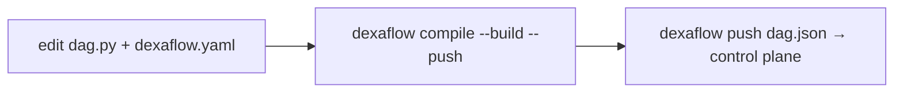

---
# --- AUTO redirect aliases (build_redirects.py) — do not edit by hand ---
aliases:
  - /deploy.html
# --- end AUTO redirect aliases ---
title: "CI/CD & deploy examples"
linkTitle: "CI/CD & deploy"
weight: 20
description: "Build, push and register DAGs from CI — GitHub Actions, GitLab CI, Cloud Build."
---

{}
[**Your first Pro DAG (≈10 min)**](/operate/first-pro-dag/) takes one DAG from source
to a running pod with **one command** (`dexaflow deploy`), so you see each
artifact boundary before you automate it. This page is the CI recipes for the
same pipeline.
{}

Deploying a Dexaflow DAG is the same everywhere because a DAG is an **immutable
artifact**: a `dag.json` + a container image, versioned together (ADR 0003).

**By hand or in a pipeline,** one command does it all:

```bash
dexaflow auth login --server https://pro.example.com   # by hand, once; stores the session
dexaflow deploy --yes                                  # compile → build → push → pin digest → register
```

`dexaflow deploy` is the [pipeline-less promotion](/project/adrs/0041-leoflow-deploy-pipelineless/):
it builds for the cluster's architecture (`--platform`, else `build.platforms`
in `dexaflow.yaml`, `linux/amd64` when neither is set) with the first
[builder](/operate/builders/) that applies, pins the image by digest, and
registers the artifact.
`--yes` skips the confirmation prompt (use it in automation). **It is the
recommended command in CI too**, and the recipes below use it.

**The explicit steps** are still available when a pipeline wants the build and
the register as separate stages:



1. **`dexaflow compile --build --push`**: parse `dag.py`, overlay
   `dexaflow.yaml`, run the **guardrails** (unknown `task_id`, unsupported
   operator, duplicate keys), build the DAG image and push it.
2. **`dexaflow push dag.json`**: register the artifact with the control plane.

{}
`compile --build --push` writes the image **tag** it pushed into `dag.json`
(`registry/image:tag`), and `push` registers that file as it is. The control
plane then pulls by tag, so a tag that is rebuilt later can run different bytes
under the same version. `dexaflow deploy` is the only command that resolves the
pushed image's digest and registers `registry/image@sha256:…`. Prefer `deploy`
in CI; if you split the steps, tag by commit (`tag_strategy: git_sha`) and never
reuse a tag. An operator can make the control plane warn about, then refuse, a
register by tag: see [Require images pinned by digest](#require-images-pinned-by-digest).
{}

{}
The same checks that warn you locally in `dexaflow lite` fail the CI build, so a
bad `dag_id`/`task_id` binding or an unsupported operator never reaches prod.
{}

{}
The [**first Pro DAG walkthrough**](/operate/first-pro-dag/) runs `deploy` by
hand so you can watch the DAG cross each boundary. Come back here to wire the
same command into CI.
{}

{}
Registry auth, RBAC scope, non-root images, private-registry pulls, and the
`--dag-version`/`409` gotcha are exactly the errors CI hits first, since a
runner has none of a laptop's ambient state (no `docker login`, no
`dexaflow auth login` session, often a shallow clone with no tags for the
default version label to start from). **[Deploy prerequisites & why shortcuts fail](/operate/deploy-prerequisites/)**
has the exact error and fix for each.
{}

## Your repo of DAGs (CI is the recommended path)

In Pro you keep your DAGs in a Git repository, one directory per DAG, and **CI**
turns each into an artifact when it changes. This is the recommended path: a push
triggers the pipeline, no one builds by hand. Each DAG is just **two files**, no
Dockerfile and no `requirements.txt`:

```text
my-dags/                      # your Git repo
├── .github/workflows/
│   └── deploy-dag.yml        # the CI below (the recommended path)
└── dags/
    ├── my_pipeline/
    │   ├── dag.py            # the DAG (TaskFlow / operators)
    │   └── dexaflow.yaml      # id, python_version, dependencies, registry
    └── another_pipeline/
        ├── dag.py
        └── dexaflow.yaml
```

`dexaflow deploy` (and `compile --build`) **generates the Dockerfile from
`dexaflow.yaml`**: `FROM` the published Dexaflow base, your deps/connectors
installed, your DAG copied in. No Dockerfile to maintain. A `Dockerfile` in the
DAG directory is used verbatim instead and the yaml's dependencies then do not
reach the image, so ship one only if you want full control (see
[your own Dockerfile](/operate/first-pro-dag/#advanced-your-own-dockerfile)).

The built image is **your** artifact: push it wherever you like (Docker Hub, ECR,
Artifact Registry, ACR, GHCR, a private registry). `deploy` needs a registry
prefix from one of `--registry`, `DEXAFLOW_REGISTRY`, the `registry:` block of
`dexaflow.yaml`, the target, the workspace defaults, your config file or the
cluster's deploy defaults
([Registry, platforms and base image](/operate/workspaces-and-targets/#registry-platforms-and-base-image)),
and names the image after the `dag_id` unless `registry.image_name` says
otherwise; it has no `--image` flag. The only image Dexaflow owns is the base
your DAG layers on.

**The mental model:** a push that touches `dags/my_pipeline/**` triggers CI for
*that* DAG only (the `paths:` filter), which compiles → builds (from yaml) →
pushes the image to your registry → registers `dag.json`. The control plane runs
the new version on the next trigger. One DAG per pipeline keeps blast radius
small: a broken `another_pipeline` never blocks `my_pipeline`.

The first registration of a DAG leaves it **paused**, as in Airflow: its
schedule creates no run until someone unpauses it (UI switch, or
`dexaflow admin dags unpause <dag_id>`). Later registrations never change that,
so a pipeline that redeploys an active DAG keeps it active. A DAG that should
start active sets `is_paused_upon_creation=False`; see
[New DAGs start paused](/concepts/core-concepts/#new-dags-start-paused).

### What a deploy says, and the flags that change it

Every deploy prints the server it goes to (and the target that chose it)
before it builds, and ends with a line saying what happens next:

```text
next: etl is paused, so nothing runs until `dexaflow admin dags unpause etl`; unpausing creates 13 catchup runs since start_date 2026-10-01T00:00:00Z, then one run per tick; next tick 2026-10-14T00:00:00Z (UTC).
```

An active DAG gets its next run time instead. The line follows the scheduler:
with `catchup=True` and a `start_date`, every tick since `start_date` gets a
run; otherwise only the latest tick does. A DAG that already ran resumes after
its last run, so its count is an upper bound, as it is for `--active` on a DAG
that was paused. Times are in UTC: the scheduler does not yet apply a DAG's
`timezone` or `end_date`, so the line ignores them too.

With no server set anywhere (no `--server`, `--target`, `DEXAFLOW_SERVER_URL`
or `server_url`), `deploy` stops before building instead of going to
`http://localhost:8080`; a machine set up for Lite keeps the local default.

#### Checks before the build (preflight)

A deploy that the server or the registry would refuse fails in seconds,
before the build, with a message that names what to fix. `deploy` checks, in
this order:

1. **Before the compile: the control plane answers and the token may
   deploy.** A token the server refuses (`401`) names `dexaflow auth login`;
   a token without the `deployer` role, `deploy` or `write` on dags, or an API
   token without the `deploy` scope (`403`) names
   `dexaflow auth create-token --scope deploy`. With `--paused` or `--active`
   the check also covers what those flags need (`write` on dags and, for an
   API token, the `dexaflow:run` scope), and the refusal says so. A server
   that cannot be reached stops the deploy here.
2. **Before the build: the registry accepts a push** to the image's
   repository with the credentials the daemonless build paths push with:
   the docker config (`~/.docker/config.json` and its credential helpers)
   and, for an Artifact Registry, GCR, ECR or ACR host, the session of the
   `gcloud`, `aws` or `az` CLI, as `registry.auth_method` says (see
   [Registry credentials](/operate/builders/#registry-credentials)). The
   line says where the credential came from. The check starts an
   upload and cancels it (best effort: a registry that refuses the cancel
   expires the empty upload), so no image is written. A refusal of the
   credential found stops a `docker` deploy, naming the login command of the
   registry (`gcloud auth configure-docker <host>`,
   `aws ecr get-login-password --region <region> | docker login ...`,
   `az acr login --name <name>`, or `docker login <registry>`). With no
   credential found, or with another `--builder` (podman, for one, keeps
   credentials of its own in `auth.json`), a refusal is a `note:` naming the
   command for that builder, and why the cloud CLI gave no token when it
   could not (not on `PATH`, not signed in), and the push decides. Nothing is checked when nothing is pushed: with
   `--skip-build`, or when the registry already holds the image for the
   content label.
3. **After the compile, before the build: the server's dry run of the
   register.** The compiled `dag.json` goes to
   `POST /api/v2/dags/{dag_id}/versions/dry_run`, which runs every check the
   register runs (spec validation, the operator's image, service account
   and field allowlists, the resource unit, source mode, the tenant's limits,
   the declared connections and variables, the version label) and writes
   nothing. The register gets the image pinned by digest, which the build
   makes later. When nothing is built (`--skip-build`, or the registry
   already holds the image for the content label) the dry run is sent the
   digest the registry holds for the tag, the very image the register gets,
   so an allowlist that names that exact digest accepts it. Before a build
   it is sent the repository at a placeholder digest, so an allowlist of
   repositories or of `repo@*` decides as for the register. A refusal stops
   the deploy with the server's reason, except two the built image decides
   when it is still to be built. One is a refusal of the placeholder image
   when it is the only refusal and the allowlist names the image's
   repository at a digest (`<repo>@sha256:...`), which a reproducible build
   may match; a repository the allowlist does not cover still stops the
   deploy. The other is a version label registered with other content. Each
   of those is a `note:`, and the register answers it. So is a dry run the server
   could not answer (`5xx`, or `429` under load): the deploy goes on and the
   register runs the checks. A warning (a task that does not fit its size
   under `executor.unit.enforce: warn`) prints on stderr and the deploy goes
   on.

Each check that passes prints a `preflight:` line (on stderr with
`--output json`). A server from before the dry run route answers it with
`404` and registers nothing, also during a rolling upgrade when one replica
is older: the deploy prints a `note:` and its policy checks run at the
register, after the build, as before. `dexaflow doctor` runs the first two
checks for the target in use, refreshing a saved session as a deploy does.

| Flag | What it does |
|---|---|
| `--paused` / `--active` | Leaves the DAG paused or active after this deploy, new or not, instead of the creation rule above. The register sets it in its own transaction, audited as `dag.pause` or `dag.unpause`; for content that is already current, nothing is registered and the DAG is paused or unpaused with the Airflow `PATCH /api/v2/dags/{dag_id}`. Pausing is a run-state write: these flags need `write:dag` (the `deployer` role alone is refused with `403`), and a scoped token needs `dexaflow:run` as well as `dexaflow:deploy`, so a deploy-only token is refused with `403`. |
| `--plan` | Says per DAG what a deploy would build, push and register, and why (content changed, already current, an older version, a new DAG), without running the parser, the builder or the register. Works with `--all`. |
| `--changed-since <ref>` | With `--all`, deploys only the projects whose files changed since a git ref, and lists the others as skipped. See [Deploying only what changed](#deploying-only-what-changed). |
| `--output json` | Prints one JSON document on stdout for the pipeline to read; the human lines and the builder's output go to stderr. |

The JSON document has one entry per DAG:

```json
{
  "server": "https://pro.example.com",
  "target": "prod",
  "dags": [
    {
      "dag_id": "my_pipeline",
      "status": "registered",
      "version": "v1.4.0-3f9c2a1b7d4e",
      "image": "ghcr.io/acme/my_pipeline@sha256:4e1f...",
      "digest": "sha256:4e1f...",
      "spec_hash": "9b0c...",
      "created": true,
      "dag_created": true,
      "is_paused": true,
      "next": "my_pipeline is paused, so nothing runs until ...",
      "execution": {
        "warm_pools": true,
        "tasks": [
          { "task_id": "extract", "mode": "warm" },
          { "task_id": "load", "mode": "dedicated", "reason": "node_selector set" }
        ],
        "pool": { "state": "on", "detail": "2 idle warm workers (up to 5) ...", "min_idle_workers": 2, "max_pool_size": 5 }
      }
    }
  ]
}
```

`created` says a new version was registered and `dag_created` that it was
the DAG's first. `status` is `registered` (a new version), `unchanged` (the server already had
this exact content), `current` (the content label is the current version, so
nothing was built), `skipped` (unchanged since the `--changed-since` ref, with
`reason`), or `failed` (one DAG of `--all`, with `error`). With
`--plan` it is `planned` or `refused`, and a `plan` object carries `build`,
`push`, `register` and `reason`. After a failure of `--all` the document is
still printed, so the pipeline sees which DAGs went through.

`execution` is the server's answer on where each task runs: `mode` is `warm`
(warm-eligible) or `dedicated`, with the `reason` for a dedicated pod, and
`pool.state` is `off`, `none` or `on`, with `previous_pool: "draining"` for a
new version of an existing DAG on a server that keeps warm workers: the
previous version's pool drains, and the new one starts at the next reconcile
when the DAG declares `min_idle_workers`, else with its first run (see
[Prewarm and drain on deploy](/operate/warm-pools/#prewarm-and-drain-on-deploy)). The human output
prints it as an `execution` line and, unless every task takes a dedicated pod
for one reason, a `warm pool` line; see
[Where a deploy's tasks run](/operate/warm-pools/#where-a-deploys-tasks-run).
A server from before the field sends none, and the entry has no `execution`.
`--plan` does not run the parser, so it has no tasks to report on.

{}
The per-DAG pipeline above stays the recommendation, and the `paths:` filter is
the point of it: one DAG per pipeline is what keeps a broken DAG from blocking
its neighbours.

`dexaflow build [workspace]` is for the times you are **not** in that pipeline:
after a base-image bump that every DAG must pick up, when you clone the repo onto
a new machine, or when you want to see all the images a change produces before
pushing anything. It walks the workspace and builds each project with the image
that project's own `registry:` block derives (the same derivation `deploy` uses,
so nothing about naming is new):

```bash
dexaflow build my-dags/           # build every project under my-dags/
dexaflow build my-dags/ --push    # ...and push each to its registry
```

Two behaviours matter more than the loop itself:

- A project that declares **no `registry:`** is reported by name, not skipped
  quietly. A command that covers less than the workspace without saying so leaves
  you believing images exist.
- A failure **stops** the run, names the project, and lists what was already
  built. A half-built workspace (some images new, some stale) is invisible
  afterwards.

With no `--dag-version` / `--sha` it derives them the same way `deploy` does,
per project: the version label from `git describe` in the project's directory
plus a hash of that project's content, and the short commit hash of that
directory. (`deploy` has no `--sha` flag at all; it always derives the sha.)

Using it **as** your CI, in place of per-DAG pipelines, is a deliberate trade:
one job rebuilds everything on any change, so blast radius and build time both
grow with the repo. Choose it only if you want that.
{}

## Deploying only what changed

In a repository with many DAG projects, `deploy --all --changed-since <ref>`
deploys only the projects whose files differ from a git ref, so a commit that
touches one DAG does not compile the others:

```bash
dexaflow deploy --all --changed-since origin/main --yes
```

```text
==> orders: dags/orders/dag.py changed since origin/main
==> skipping billing (unchanged since origin/main)
==> deploying orders (/repo/dags/orders)
...
Deployed 1 DAG(s) from /repo (1 unchanged since origin/main, skipped)
```

A project counts as changed when a file its image or its version label is
built from changed: the DAG source, the `include_paths` (shared code included),
the dbt project and `dbt_groups` directories, `dbt.manifest`, its
`dexaflow.yaml` (or `leoflow.yaml`), its `.dockerignore`, and its own
Dockerfile (with a project Dockerfile, every file of the project directory the
`.dockerignore` keeps). These are the files the content label hashes, so a
skipped project is one whose label would not change. A file that `exclude_paths`
leaves out, or that the generated Dockerfile does not copy (a `README.md` next
to `dag.py`, say), changes nothing. A change to the workspace file
(`dexaflow.workspace.yaml`, which holds the shared defaults and the targets)
counts as a change to every project.

How the comparison works:

- **The ref is compared with the working tree**, not with `HEAD` and not from a
  merge base: committed, staged, unstaged and untracked files all count, and so
  do submodules, whatever `diff.ignoreSubmodules` says. A change on the ref's
  side since your branch started counts too, so the comparison errs toward
  deploying.
- **A file git ignores cannot be compared.** A project built from one (a
  generated module under `include_paths`, dbt `deps` output) always counts as
  changed, and the output names the file. Inside a submodule, the submodule's
  own ignore rules decide. So does a project built from a file
  outside the repository, or one whose folder resolves outside it.
- **The ref must be in the clone.** A shallow clone (the default of
  `actions/checkout`) stops with a message saying to fetch the history: use
  `fetch-depth: 0`, or `git fetch --unshallow`. A ref that does not exist, or a
  folder outside a git repository, stops the deploy too; nothing is deployed
  by guess.
- **A project removed since the ref** (its `dexaflow.yaml` or `dag.py` deleted)
  is reported with its `dag_id`, and nothing is deployed or deregistered for
  it: its DAG stays registered and scheduled until you pause it with
  `dexaflow admin dags pause <dag_id>` (or every such DAG at once with
  [`dexaflow sync <dir> --prune`](#syncing-a-target-with-the-workspace-gitops))
  or remove it with `dexaflow dags delete <dag_id> --deregister`. A project moved to another
  folder keeps its `dag_id`: it is reported as moved, with no removal advice,
  and deployed from its new folder. A `dag_id` changed in place is not reported:
  the project is deployed under its new id, and the DAG under the old id stays
  registered until you remove it.
- **It selects among the workspace's projects**, so it goes with `--all`, or a
  bare `dexaflow deploy` at the workspace root. With a `dag_id` or a path it is
  refused, rather than silently skipping the DAG you named.
- What git does not see is not compared: the CLI version, `--registry`,
  `--platform`, the target's settings and the config file. After upgrading the
  CLI or changing a target, deploy with `--all` alone once.

With `--output json`, every skipped project has an entry with `status:
"skipped"` and its `reason`, the removed ones are listed under `removed`
(`path`, `dag_id`, `reason`), and the moved ones under `moved` (`dag_id`,
`from`, `to`).

`--changed-since` and the content label solve different costs. Without the
flag, `deploy --all` already registers nothing for a project whose label is the
current version, and reuses an image the registry holds for its label
([ADR 0076](/project/adrs/0076-reuse-image-by-content-label/)); but it still
compiles every project and asks the server about each. `--changed-since`
skips those projects before any of that. Use it in the pipeline of a large
repository, on every push; use `--all` alone when the inputs git does not see
changed (above), or to check that every project is deployed.

A GitHub Actions job that deploys the projects a push to `main` changed:

```yaml title=".github/workflows/deploy-changed.yml"
name: Deploy changed DAGs
on:
  push:
    branches: [main]
jobs:
  deploy:
    runs-on: ubuntu-latest
    permissions: { contents: read, packages: write }
    steps:
      - uses: actions/checkout@v4
        with: { fetch-depth: 0 }          # the ref and git describe need history
      - uses: actions/setup-python@v5
        with: { python-version: '3.12' }
      - uses: docker/login-action@v3
        with:
          registry: ghcr.io
          username: ${{ github.actor }}
          password: ${{ secrets.GITHUB_TOKEN }}
      - uses: dexadata/dexaflow/.github/actions/setup-dexaflow@<VERSION>
        with:
          server-url: https://pro.example.com
      - name: Deploy the DAGs this push changed
        env:
          DEXAFLOW_TOKEN: ${{ secrets.DEXAFLOW_TOKEN }}   # a deploy token
          BEFORE: ${{ github.event.before }}
        run: |
          # A new branch has no previous commit (all zeros), and a force push
          # can leave one the clone lacks: deploy everything then.
          if [ "${BEFORE//0/}" ] && git cat-file -e "$BEFORE^{commit}" 2>/dev/null; then
            dexaflow deploy --all --changed-since "$BEFORE" --yes
          else
            dexaflow deploy --all --yes
          fi
```

`github.event.before` is the commit `main` was on before the push, so a push of
several commits deploys what all of them changed.

A failed or cancelled deploy is not retried by the next push: that push
compares with its own previous commit, which already holds the change that did
not deploy. Either rerun the job (or run `dexaflow deploy --all`) after a
failure, or compare with the last commit that deployed: move a ref after each
successful deploy (for example `git push -f origin HEAD:refs/tags/deployed-prod`
in a last step) and pass `--changed-since deployed-prod`, with a `concurrency:`
group on the job so two runs never move it out of order.

For a pull request, `--plan` says what merging would deploy. Pass the base
branch through `env:` rather than inline in `run:`:

```yaml
      - name: What would this pull request deploy
        env:
          BASE_REF: ${{ github.base_ref }}
        run: dexaflow deploy --all --changed-since "origin/$BASE_REF" --plan
```

## Rolling back

A rollback makes a version the control plane already holds current again. It
rebuilds nothing: the version runs the image digest it was registered with.

```bash
dexaflow dags versions my_pipeline                 # what is registered, and which is current
dexaflow rollback my_pipeline                      # back to the version before the current one
dexaflow rollback my_pipeline --to v1.4.0-3fa2c1   # or to a label (or a version number) from the list
```

`dexaflow dags versions` lists each version, newest first: its number, its
label, a `*` on the current one, when it was registered, the id of the user
who registered it (`dexaflow admin users list` maps ids to emails), the
commit it was built from (see [Where a version was built](#where-a-version-was-built))
and the short image digest. `--to` matches a label first, then a version number. `dexaflow rollback` prints the version it moved from and
the one it moved to, and takes `--server` and `--token` like the other
commands. Both read and write through the API: the listing is
`GET /api/v2/dags/{dag_id}/dagVersions`, and the rollback is
`PUT /api/v2/dags/{dag_id}/currentVersion` with `{"version": "<label>"}` or
`{"version_number": <n>}`, which needs the same permission as registering a
version (scope `dexaflow:deploy` for a scoped token).

A rollback passes the checks a register of the version would pass today.
Under `deploy.require_digest: enforce`, a version registered with a tag
cannot be made current again: redeploy its sources with `dexaflow deploy`, or
set the setting to `warn` (see
[Require images pinned by digest](#require-images-pinned-by-digest)).

What a rollback changes, in one transaction:

- **New runs** use the version made current, from the next scheduler tick.
- **The schedule** and the other DAG settings (catchup, start date, max active
  runs, description, owner, tags) become that version's.
- **Runs already created keep their version**, including runs in flight.
- **Pause state does not change.** A paused DAG stays paused, an unpaused one
  stays unpaused.

What the UI shows after a rollback follows Airflow, which has no rollback and
always runs its newest version:

- **The DAG header's Latest Dag Version** and the version the **Code** tab
  opens on are still the newest version, not the current one. The Code tab's
  version picker shows the source registered with each version
  (`GET /api/v2/dagSources/{dag_id}?version_number=<n>`; without
  `version_number` or with `0`, the newest version's source).
- **A run, and each of its task instances, shows the version it ran with**, so
  a run created after the rollback shows the version made current, and its
  Code tab opens on that version's source.
- **The Clear dialog offers "Run with latest bundle version"** even on a run
  that already uses the current version, because the UI compares the run's
  version with the newest one. In Dexaflow that option re-pins the run to the
  current version, so on such a run it changes nothing.
- **Which version is current** is the `*` in `dexaflow dags versions`, and the
  `is_current` field of each version in `GET /api/v2/dags/{dag_id}/dagVersions`
  and of `latest_dag_version` in the DAG details. The MCP `dag://source`
  resource serves the current version's source, as `dag://spec` serves its
  spec.

The version must still pass what a register of it would pass today: the
operator's execution policy, the tenant limits, and its declared Variables and
Connections. A version that no longer does is refused with `400` (or `403` for
a tenant limit), and the current version stays. Naming the version that is
already current changes nothing. Every rollback is recorded in the audit log as
`dag.version.set_current`, with the user and the from and to versions.

Two things that look like a rollback are not:

- Re-running `dexaflow push` with an older `dag.json` is a no-op: content the
  control plane already has answers `created: false`, and the newer version
  stays current, schedule included.
- Retagging an image in the registry changes nothing: a version registered by
  `deploy` names its image by digest.

`dexaflow deploy` of code that matches a version registered earlier (after a
`git revert`, for example) stops before building and suggests the
`dexaflow rollback <dag_id> --to <label>` command for that version.

## Where a version was built

Every `dexaflow deploy` and `dexaflow push` records where the version was
built. `GET /api/v2/dags/{dag_id}/dagVersions` (and `.../dagVersions/{n}`, and
the answer of a rollback) returns it as `build_info` next to Airflow's fields,
`null` for a version registered without it; the `dag_version` embedded in task
instance, run and DAG details answers leaves it out:

| Field | Where the CLI reads it |
|---|---|
| `commit` | `git rev-parse HEAD` in the project directory, when it is in a git work tree. |
| `repo` | The `origin` remote of that work tree, as an `https` URL: credentials and a trailing `.git` are dropped, and an ssh remote (`git@host:org/repo.git`) becomes `https://host/org/repo`. Outside git, `GITHUB_SERVER_URL`/`GITHUB_REPOSITORY` or GitLab's `CI_PROJECT_URL`. |
| `pipeline_url` | The CI run: on GitHub Actions `GITHUB_SERVER_URL/GITHUB_REPOSITORY/actions/runs/GITHUB_RUN_ID`, else `CI_PIPELINE_URL` (GitLab), `BUILD_URL` (Jenkins), `BUILDKITE_BUILD_URL` or `CIRCLE_BUILD_URL`, without a query string or fragment. |
| `builder` | The builder that produced the image, as the deploy prints it (`code-layer`, `local-daemon (docker)`, ...). Absent when the deploy built nothing: with `--skip-build`, and when it reused an image the registry already held for this content label. |
| `base_image` | The base image of the generated Dockerfile, which carries the task agent. Absent when the project ships its own Dockerfile, and when the deploy built nothing (`--skip-build`, or a reused image). |
| `cli_version` | The version of the CLI that built and registered the version. |

What cannot be read is left out; a deploy never fails for it. `dexaflow promote`
forwards the source version's `build_info` to the destination.

Build info is metadata of the register, not part of `dag.json`: it changes
neither the spec, its hash nor the version label, so the same sources built by
two pipelines still compile to one version. A version is immutable, so a
re-push of content already registered creates nothing and keeps the build info
of its first register. The CLI sends it as the `build_commit`, `build_repo`,
`build_pipeline_url`, `build_builder`, `build_base_image` and
`build_cli_version` query parameters of
`POST /api/v2/dags/{dag_id}/versions`; another client can send them too. The
server checks them as external input (a commit is 7 to 64 lower case hex
characters, the two URLs are absolute `http` or `https` URLs of at most 2048
bytes without credentials, query string or fragment, every field is valid
UTF-8 without control characters) and
refuses a bad value with `400`. The register's `dag.version.register` audit
entry records the same `build_info`. It is the caller's claim, recorded as
sent and not verified: a deploy token can write any commit there.

## Syncing a target with the workspace (GitOps)

`dexaflow sync <dir>` makes the target in use run what a folder of DAG
projects holds, the way Argo CD or Flux make a cluster match a repository. It
compares every project under `<dir>` with the DAGs registered on the target,
says per DAG what it does, and does it:

```bash
dexaflow sync ./dags --dry-run --prune     # what would change; exit 1 if anything would
dexaflow sync ./dags --prune --yes         # make the target match
```

```text
workspace: /repo/dags
target prod: https://pro.example.com (target prod, from --target)

  DAG      STATE             CURRENT VERSION             PAUSED  ACTION
  billing  drift             v1.3.0-4-g77aa01-1f0c (#4)  no      deploy v1.4.0-3fa2c1
  intake   not deployed      -                           -       deploy v1.4.0-9b0e12
  orders   behind            v1.4.1-c41d2e (#7)          no      none: registered content is newer than the workspace; run with --rollback to make v1.4.0-0d11f9 current
  reports  in sync           v1.4.0-5e6f70 (#2)          no      none
  legacy   not in workspace  -                           no      pause
  old_etl  not in workspace  -                           yes     none: already paused

dry run: 3 change(s) would be made (2 deploy, 1 pause); 1 behind, left as is (pass --rollback)
```

| State | What it means | What sync does |
|---|---|---|
| `in sync` | The local content label is the current version. | Nothing. |
| `drift` | The local content label is no registered version: the files changed, or the commit did (the label starts with `git describe`). | Deploys it. |
| `not deployed` | The server does not know the DAG, or holds no current version of it. | Deploys it. |
| `behind` | The local content label is a registered version older than the current one: the target was deployed from a newer commit than this checkout. | Reports it and leaves it. With `--rollback`, makes that version current again, as `dexaflow rollback --to <label>` does: nothing is built and `is_paused` is kept. |
| `not in workspace` | The target holds a DAG no project under `<dir>` defines. | Reports it; with `--prune`, pauses it. |
| `error` | The project could not be read (its `dexaflow.yaml` does not parse, say) or its DAG could not be read. | Nothing; the exit code is 2. |

A `git revert` does not make a DAG `behind`: the revert is a new commit, so
`git describe` and the label change, and the DAG is `drift` and deployed again
under the new label. A DAG is `behind` when the checkout itself is older than
what was deployed, for example when Argo CD syncs an earlier revision.

The comparison is the one [`dexaflow status`](/operate/workspaces-and-targets/)
makes, and the label is the one `dexaflow deploy` computes, so "in sync" means
a deploy would build and register nothing. What goes into the label decides
when sync agrees with the job that deployed:

- **`git describe` of the project.** A new commit moves the label even for a
  DAG whose files did not change: after each commit, `sync` deploys every DAG
  once, as `deploy --all` would. Run anywhere else (a hook, a second clone),
  sync must see the same history and tags as the job that deployed, or every
  DAG reads as `drift`.
- **The CLI version.** Pin the same `dexaflow` version in CI and in the hook;
  after an upgrade every DAG reads as `drift` once.
- **`--registry`, `--platform` and `--dockerfile`**, and the target's, the
  workspace's and the cluster's deploy defaults. Pass `sync` the flags a
  deploy is given.
- **Only the default label.** Sync deploys with the content label. A DAG
  deployed with `--dag-version` never reads as `in sync`, and sync would
  register it again under the content label: a team that labels its versions
  by hand should keep using `deploy` and use `sync --dry-run --prune` only to
  find the DAGs to retire.

How each change is made:

- **Deploys** go through the same code as `dexaflow deploy --all`: compile,
  build and push (or reuse the image the registry already holds for the
  content label), pin the digest, register. A new DAG is paused or active as
  the server decides for new DAGs (`is_paused_upon_creation`, then
  `dags_are_paused_at_creation`); a redeploy never changes `is_paused`.
- **Rollbacks** (`--rollback` only) make the matching version current with
  `PUT /api/v2/dags/{dag_id}/currentVersion`, as in [Rolling back](#rolling-back).
- **`--prune` pauses**, it never deletes: `PATCH /api/v2/dags/{dag_id}` with
  `is_paused: true`, undone with `dexaflow admin dags unpause <dag_id>`. A DAG
  that comes back to the workspace later is deployed again but stays paused,
  since a deploy never changes `is_paused`: unpause it yourself. To remove a
  DAG for good, use `dexaflow dags delete <dag_id> --deregister`.
- A change that fails is reported on its DAG and the other changes still go
  through.
- At a terminal, sync shows the plan and asks before it changes anything
  (`Apply 2 deploys and 1 pause on https://pro.example.com? [y/N]`); `--yes`
  skips the question. `--output json` never asks: pass `--yes` or `--dry-run`.

What `--prune` guards against:

- **Every DAG the token can see is a candidate.** Nothing marks which
  workspace deployed a DAG yet, so every DAG on the target that no project
  under `<dir>` defines is `not in workspace`, and `--prune` pauses a DAG
  deployed to the same target from another repository. Sync one folder per
  target (or per tenant), the folder that holds all of that target's DAGs.
- **A project sync cannot read stops it.** A `dexaflow.yaml` that does not
  parse hides the project's `dag_id` (a project with a `dag.py` is found under
  its folder name, a dbt project not at all), so its DAG would read as
  `not in workspace`. With `--prune`, a project in `error` makes sync apply
  nothing at all and exit 2; without `--prune` the other changes go through.
- **A cap.** With `--prune`, sync applies nothing when it would pause more
  DAGs than `--max-prune` (by default, the number of projects under `<dir>`).
- **A confirmation.** Without a terminal, `--prune` needs `--yes`.
- **The DAG list.** With `--prune`, a list of the target's DAGs that cannot
  be read changes nothing; without it, that is a warning and the deploys and
  rollbacks go through.
- **An empty folder** is refused, so a wrong path never reads as "nothing
  should run".

Targets resolve as for a command run in `<dir>`, whatever folder sync runs
in: `--server`, `--target`, `DEXAFLOW_TARGET`, `DEXAFLOW_SERVER_URL`, the
target selected for the workspace around `<dir>` (`dexaflow target use`), its
`default_target`, then `server_url` in the config file. The token is
`--token`, then `DEXAFLOW_TOKEN`, then the one saved for that server, and the
token decides the tenant. Like a deploy, sync refuses to guess the built-in
`http://localhost:8080`.

**Credentials.** A [deploy token](#credentials-for-the-control-plane) can
read, deploy and roll back, so it is enough for `sync`, `sync --rollback` and
`sync --dry-run --prune`. Pausing needs `write` on DAGs (and the
`dexaflow:run` scope for a scoped token), which the `deployer` role and a
deploy token do not have: `sync --prune` with one reports each pause as
failed (`403`) and exits 2.

Exit codes, for a CI check or a hook:

| Code | Meaning |
|---|---|
| `0` | The target matches the workspace (`--dry-run`), or every change was applied. |
| `1` | `--dry-run` found something to change, or a `behind` DAG was left alone (no `--rollback`). |
| `2` | The target or a project could not be read, a change failed, `--prune` refused to apply, the confirmation was declined, or the command was used wrongly. |

A DAG that is `not in workspace` counts as a change only with `--prune`, and
only while it is not paused, so `sync --dry-run` without `--prune` passes on a
target that also runs DAGs from elsewhere.

`--output json` prints one JSON document on stdout (the deploy lines go to
stderr): `workspace`, `target`, `server`, `source`, `dry_run`, `prune`, an
`error` when the target could not be read, `refused` when `--prune` applied
nothing, `dags` (each with `dag_id`, `path` for a project, `state`,
`local_version`, `current_version`, `matched_version` for `behind`,
`is_paused`, `action` (`none`, `deploy`, `rollback` or `pause`), `result`
(`planned`, `applied` or `failed`), the `deploy` result of a deployed DAG,
and `error`), a `summary` (`in_sync`, `behind`, `deploy`, `rollback`,
`pause`, `not_in_workspace`, `errors`) and the `exit_code`. Fields are only
ever added.

**As a CI check.** Run the dry run on a schedule, or after the deploy job, to
catch a target changed by hand or a deploy that did not finish:

```yaml
      - name: Is prod running what main holds
        env:
          DEXAFLOW_SERVER_URL: https://pro.example.com
          DEXAFLOW_TOKEN: ${{ secrets.DEXAFLOW_TOKEN }}   # a deploy token
        run: dexaflow sync ./dags --dry-run --prune
```

**As an Argo CD hook.** Argo CD runs a `Job` annotated as a hook after each
sync of an Application. The control plane never reads git (the DAGs are
built and registered from outside it), so the Job clones the repository at
the revision Argo CD synced and runs `dexaflow sync` itself. Argo CD hands a
Helm source the synced commit as `$ARGOCD_APP_REVISION` in its parameters, so
ship the Job as a small chart in the DAG repository, for example
`deploy/dexaflow-sync/`:

```yaml title="deploy/dexaflow-sync/Chart.yaml"
apiVersion: v2
name: dexaflow-sync
version: 0.1.0
```

```yaml title="deploy/dexaflow-sync/values.yaml"
revision: ""                       # set by Argo CD to the synced commit
repository: https://github.com/acme/dags
server: https://pro.example.com
image: registry.example.com/tools/dexaflow-cli:1.4.0   # your image: the CLI, git and Python
```

```yaml title="deploy/dexaflow-sync/templates/sync-job.yaml"
apiVersion: batch/v1
kind: Job
metadata:
  generateName: dexaflow-sync-
  annotations:
    argocd.argoproj.io/hook: PostSync
    argocd.argoproj.io/hook-delete-policy: BeforeHookCreation
spec:
  backoffLimit: 0
  template:
    spec:
      restartPolicy: Never
      containers:
        - name: sync
          image: {{ .Values.image | quote }}
          env:
            - name: DEXAFLOW_SERVER_URL
              value: {{ .Values.server | quote }}
            - name: DEXAFLOW_TOKEN
              valueFrom: { secretKeyRef: { name: dexaflow-sync, key: token } }
            - name: REPOSITORY
              value: {{ .Values.repository | quote }}
            - name: REVISION
              value: {{ required "revision is set by Argo CD" .Values.revision | quote }}
          command: [sh, -c]
          args:
            - git clone --quiet "$REPOSITORY" /work &&
              git -C /work checkout --quiet "$REVISION" &&
              dexaflow sync /work/dags --rollback --prune --yes
```

```yaml title="the Application"
apiVersion: argoproj.io/v1alpha1
kind: Application
metadata:
  name: dags
  namespace: argocd
spec:
  project: default
  source:
    repoURL: https://github.com/acme/dags
    targetRevision: main
    path: deploy/dexaflow-sync
    helm:
      parameters:
        - name: revision
          value: $ARGOCD_APP_REVISION
  destination:
    server: https://kubernetes.default.svc
    namespace: dexaflow-sync
```

Notes on the hook:

- **A full clone**, with history and tags, so the labels are the ones CI
  computed; the CLI image pins the same `dexaflow` version as CI.
- **`--rollback`**: syncing an earlier revision in Argo CD is a rollback, so
  the hook makes the older version current instead of stopping on `behind`.
- **No builder in a pod.** Let CI build and push the images
  (`dexaflow deploy --all`); the hook's deploys then reuse the image the
  registry holds for each content label. A DAG whose image is missing fails
  with exit 2, which fails the hook.
- **No published CLI image yet**: build one with the release binary, `git`
  and Python 3.11 to 3.13 (the compile parses `dag.py`).
- **`--prune` needs a token that may pause DAGs** (see Credentials above).
  With a deploy token, drop `--prune` from the hook and run
  `dexaflow sync ./dags --dry-run --prune` in CI to report the DAGs to retire.

**With Flux**, which has no hooks and no revision to hand a `Job`, run sync
in the CI job that pushes the commit Flux deploys, right after
`dexaflow deploy --all` (or in its place), with `--yes`; and run
`dexaflow sync ./dags --dry-run --prune` on a schedule to catch drift.


## Promoting between environments

`dexaflow promote` registers on one [target](/operate/workspaces-and-targets/) the exact
version another target runs: the same `dag.json` and the same image digest.
Nothing is compiled or built, so what reaches production is what ran in
staging.

```bash
dexaflow promote my_pipeline --from staging --to prod --dry-run   # what would be copied and registered
dexaflow promote my_pipeline --from staging --to prod             # the current version of staging
dexaflow promote my_pipeline --from staging --to prod --version v1.4.0-3fa2c1   # or another version
```

- **Which version.** Without `--version` it is the source's current version.
  `--version` matches a label first, then a version number from
  `dexaflow dags versions my_pipeline --target staging`.
- **Only images pinned by digest.** The version must run
  `<repo>@sha256:<digest>`, as every version `dexaflow deploy` registers does.
  A version registered with a tag (`dexaflow push` of a file compiled with
  `compile --build --push`) is refused: a tag can name other bytes tomorrow.
- **The image, copied when needed.** The destination registry is `--registry`,
  else the `registry` of the `--to` target, else the
  `deploy.defaults.registry` its control plane advertises. When one is set and
  the image is not already in it, the image is copied there by digest, with
  every layer and platform, byte for byte (bytes that do not match their
  digest are refused), and the copy is checked in the destination afterwards.
  The repository path is kept: `ghcr.io/acme-dev/team-a/etl@sha256:…` promoted
  to a target whose registry is `registry.acme.dev/prod` becomes
  `registry.acme.dev/prod/acme-dev/team-a/etl@sha256:…` (same digest). The copy
  is also tagged with the version label, unless that tag already names another
  digest there, which refuses the promote: a promote never moves a tag. The
  version is registered with the copy, and only its `image` field differs from
  the source's `dag.json`. When the destination already holds this version,
  nothing is copied. Without a destination registry the same reference is
  registered, and the destination cluster must be able to pull it. The copy
  reads and pushes with the credentials of `docker login` and of a cloud CLI
  session, as a deploy does; a failure names the login command of each
  registry.
- **The normal register.** The destination gets the version through
  `POST /api/v2/dags/{dag_id}/versions`, after its dry run
  (`/versions/dry_run`): a refusal (the execution allowlist, the tenant
  limits, a label already registered there with other content), or any answer
  that is not a dry run other than an older server's `404` or `405`, stops
  the promote before anything is copied. A DAG the promote creates starts
  paused if the server or the DAG says so (`is_paused_upon_creation`, else
  `dags_are_paused_at_creation`), as a deploy's would, and an existing DAG
  keeps `is_paused`. Content the destination already has answers that nothing
  changed. When both servers run the same Dexaflow version, the destination
  records the same spec hash as the source when the image is not copied.
- **Audited, as claimed.** The register's `dag.version.register` audit entry
  carries `promoted_from` with the source target's name and server URL as the
  promoting CLI sent them (`promoted_from` and `promoted_from_server` on the
  register). The destination records this claim; it does not verify it. The
  source version's `build_info` (commit, pipeline, builder) is sent along, so
  the destination lists where the version was built.
- **A token for each control plane.** `--from-token` and `--to-token`, else
  the session saved for each server by `dexaflow auth login --target <name>`.
  `DEXAFLOW_TOKEN` is not read, so one token is never sent to two control
  planes. The source side reads each version's spec
  (`GET /api/v2/dags/{dag_id}/dagVersions/{version_number}/spec`), which holds
  the DAG's source, environment literals and params, so it needs read on dags
  and, for an API token, the `read` scope: a deploy-only token is refused
  there with `403`. The destination side needs only what a deploy needs: a
  `deployer` user or a token with the `deploy` scope.
- **For pipelines.** `--yes` skips the confirmation prompt, and
  `--output json` prints one JSON document on stdout (the source and
  destination targets, servers, version and images, whether the image was
  copied, and the status `registered`, `unchanged`, `planned` or `failed`),
  with the human lines on stderr.

In a pipeline, a promotion job after the staging deploy:

```yaml
      - name: Promote to prod
        env:
          STAGING_TOKEN: ${{ secrets.DEXAFLOW_STAGING_TOKEN }}
          PROD_TOKEN: ${{ secrets.DEXAFLOW_PROD_TOKEN }}
        run: |
          dexaflow promote my_pipeline --from staging --to prod --yes \
            --from-token "$STAGING_TOKEN" --to-token "$PROD_TOKEN"
```

## Require images pinned by digest

A version registered with a tag (`ghcr.io/acme/etl:v1`) runs whatever the tag
names when a node pulls it, so two nodes can run different bytes for one
version. The server setting `deploy.require_digest`
(`DEXAFLOW_DEPLOY_REQUIRE_DIGEST`, Helm `deploy.requireDigest`) decides what
the control plane does with an image that is not pinned as
`<repository>@sha256:<64 hex>` (sha256 only: another digest algorithm counts as
not pinned):

| Value | Register of an unpinned image | Making such a version current again |
|---|---|---|
| `off` (default) | Registered, as every release before the setting did. | Allowed, as before. |
| `warn` | Registered, with a warning in the answer's `warnings`, which `dexaflow push` and `dexaflow deploy` print on stderr. | Allowed, with a warning that `dexaflow rollback` prints on stderr. |
| `enforce` | Refused with a 400 that names the setting and how to pin. Nothing is registered. | Refused with a 400 that names the way out: redeploy the version's sources with `dexaflow deploy`, or set `warn`. |

Under `warn` and `enforce` the server logs each image it warns about
(`admitting an image not pinned by digest`, with the DAG, the version, the
image and the stage) and counts each warning and refusal in
`dexaflow_unpinned_image_total{stage="register|set_current",outcome="warned|refused"}`.
The `dag.version.register` and `dag.version.set_current` audit entries record
`require_digest` and `image_pinned`. The dry run of a register (the deploy
preflight) answers with the same warning or refusal, and records nothing.

**Today only `dexaflow deploy` and `dexaflow promote` register pinned images.**
`dexaflow compile --build --push` followed by `dexaflow push` registers the tag
it pushed, so under `enforce` that path is refused until it pins by digest
(#1703). Use `warn` to find the pipelines that still register a tag, and move
them to `dexaflow deploy` or pin the image yourself before `push`, for example
with `docker buildx imagetools inspect` (a registry port such as
`localhost:5000` is kept):

```bash
dexaflow compile dags/my_pipeline --build --push -o dag.json
ref=$(jq -r .image dag.json)          # ghcr.io/acme/my_pipeline:v1
repo=$ref
case ${ref##*/} in *:*) repo=${ref%:*} ;; esac   # drop the tag, never a registry port
digest=$(docker buildx imagetools inspect "$ref" --format '{{json .Manifest}}' | jq -r .digest)
jq --arg img "$repo@$digest" '.image = $img' dag.json > dag.pinned.json
dexaflow push dag.pinned.json
```

Set `enforce` only once nothing on the cluster registers a tag any more: no
increase of `outcome="warned"` while every pipeline has run.

A [source mode](/operate/source-mode/) version names the runtime image, which
the server requires pinned by digest, so it passes every mode. Under
`dexaflow lite`, the local dev loop registers a placeholder image: leave the
setting `off` there.

## Prerequisites

- The `dexaflow` CLI on the runner (download the release binary, or `go install`).
- **Python 3.11 to 3.13 on the runner** (`dexaflow compile` invokes the
  stdlib-only parser shim, [ADR 0024](/project/adrs/0024-dag-parsing-structural-shim/),
  to turn `dag.py` into `dag.json`). See [Python on the runner](#python-on-the-runner) below.
- A container registry your cluster can pull from, and a credential for it on
  the runner: the `gcloud`, `aws` or `az` session for Artifact Registry, ECR and
  ACR, the docker config (`docker login`, or a login action) for the others,
  and the container tool's own login when it builds
  ([Registry credentials](/operate/builders/#registry-credentials)).
- The control plane URL, passed as `--server` or exported as
  `DEXAFLOW_SERVER_URL` (the pre-rename `LEOFLOW_SERVER_URL` still works). The
  CLI reads no other variable for it: a pipeline that exports something else
  (`DEXAFLOW_SERVER`, for instance) silently targets the default,
  `http://localhost:8080`.
- A CI credential for the control plane, below.

## Credentials for the control plane

A CI job authenticates with a **deploy token**: a long-lived API token that
registers DAG versions and nothing else. Store it as a CI secret named
`DEXAFLOW_TOKEN`; `deploy`, `push`, `rollback` and the other commands read that
variable (the pre-rename `LEOFLOW_TOKEN` still works).

1. Once, as an admin, create a service user for CI with the built-in
   **`deployer`** role. It reads DAGs and their versions, registers versions
   and sets the current version (rollback), and nothing else: it cannot delete
   or pause a DAG, trigger a run, or touch connections, variables or users.

   ```bash
   dexaflow auth create-user --email ci-deploy@example.com --password-stdin \
     --role deployer < password.txt
   ```

2. Create a deploy token for that user. Sign in as the service user (the
   command signs in with `--username` and the password, or uses the session
   `dexaflow auth login` saved), name the token after the pipeline that will
   hold it, and choose its lifetime:

   ```bash
   dexaflow auth create-token --server https://pro.example.com \
     --username ci-deploy@example.com --password-stdin \
     --scope deploy --name github-my-dags --ttl 90d < password.txt
   ```

   The token (it starts with `dxf_`) is printed **once**, alone on stdout; the
   name, id, scopes and expiry go to stderr. Store it as the `DEXAFLOW_TOKEN`
   secret of the pipeline. The server keeps only its SHA-256 hash, so a lost
   token cannot be shown again: create a new one.

3. Set `DEXAFLOW_SERVER_URL` and `DEXAFLOW_TOKEN` in the job and run
   `dexaflow deploy`, as in the examples below.

What a deploy token can do, and how it ends:

- **Scope.** `--scope deploy` carries `dexaflow:deploy`: the token reads
  DAGs, DAG details and versions, registers versions and sets the current
  version, and is refused everything else, whatever its owner's roles: no
  variables, connections, logs, XComs, runs, users or event log. It never does
  more than its owner's roles allow either, and the owner's roles are read
  again on every request. `--scope read` makes a token that reads everything
  its owner can read, so do not give one to CI. `deploy --trigger` needs to
  trigger a run, which a deploy token cannot do.
- **Lifetime.** `--ttl` takes days (`90d`) or a duration (`12h`), from one hour
  to 365 days; the default is 90 days. An expired token answers `401`.
- **Listing.** `dexaflow auth tokens list` shows your tokens with their id,
  name, scopes, expiry and when each was last used (recorded at most once every
  five minutes). An admin sees every token of the tenant.
- **Revoking.** `dexaflow auth tokens revoke <id>` stops a token on its next
  request. Deactivating the owner stops all of the owner's tokens.
- **Limits.** A token cannot create, list or revoke tokens. A user holds at
  most 50 live tokens, and token names are unique among a user's live tokens:
  1 to 64 letters, digits, dots, dashes or underscores. Once a token has
  expired, a new token can take its name: the create retires the expired token
  and records it in the audit log as `api_token.retire_expired`, with the old
  token's id, when it expired and the id of the token that took its name, so
  it is not mistaken for a manual revoke (`api_token.revoke`). The token is
  sent in the `Authorization` header only; it never works as a browser session
  cookie.

Creating, listing and revoking tokens is also available through the API
(`POST`, `GET /api/v2/apiTokens` and `DELETE /api/v2/apiTokens/{id}`). The UI
does not list tokens yet.

{}
A session token from `dexaflow auth create-token` without `--scope` **expires
after one hour** (`auth.jwt.token_ttl_seconds`, 3600 by default), so it cannot
be stored as a CI secret. On a control plane older than deploy tokens, store
the service user's password instead (`DEXAFLOW_CI_PASSWORD` below) and mint a
session token at the start of each job:

```bash
export DEXAFLOW_SERVER_URL=https://pro.example.com
DEXAFLOW_TOKEN="$(printf '%s\n' "$DEXAFLOW_CI_PASSWORD" |
  dexaflow auth create-token --username ci-deploy@example.com --password-stdin)"
export DEXAFLOW_TOKEN
```

That token lives one hour: a build that can take longer should run the steps
apart (`dexaflow compile --build --push`, then mint the token, then
`dexaflow push`, which registers the tag; see the warning at the top).
{}

### When deploys go through your platform's issuer

A control plane with `auth.trusted_issuer.deploy_audience` set takes deploys
only from its trusted issuer
([deploys through the issuer only](/reference/configuration/#deploys-through-the-issuer-only)):
a deploy token, a session token and a password login all get `403` on
`dexaflow deploy`, `dexaflow push` and `dexaflow rollback`, and `deploy` says
that the control plane takes deploys only through its trusted issuer. Deploy
through the platform that owns deployments instead. When that platform runs
`dexaflow deploy` itself, it passes a bearer its issuer minted for the deploy
audience, with the `dexaflow:deploy` scope and a user linked to the issuer,
as `DEXAFLOW_TOKEN` or `--token`, its `aud` being the deploy audience alone.
With `--paused` or `--active`, which set `is_paused`, the token also needs
the `dexaflow:run` scope (and the user `write` on dags). The token is
short-lived (at most `auth.trusted_issuer.bearer_max_lifetime_seconds`), so
mint it for each job. Deleting a DAG goes through the issuer the same way.

## Python on the runner

The `dexaflow compile` step (which `deploy` runs) needs Python 3.11, 3.12, or
3.13 on `PATH` as `python3` to parse `dag.py`. **Bring your own Python** on the
runner; the managed CPython that `dexaflow setup` can download is meant for a
developer laptop, not for build pipelines, where it adds ~50 MB to every run and
bypasses your runner's pin/caching.

The recommended path on each runner type:

| Runner | Recipe |
|---|---|
| **GitHub Actions** | Add `actions/setup-python@v5` with `python-version: '3.12'` before installing dexaflow. Cached automatically. |
| **GitLab CI, Argo CD, Flux, Tekton** | Run the job in the [`dexaflow-cli` image](#the-dexaflow-cli-image): it ships Python 3.13, git and uv next to the CLI. With a Docker daemon in the job, install `python3` in its image (`apk add python3` on `docker:27`). |
| **Cloud Build / CodeBuild** | Run the step on a `python:3.12-slim` image and install the Docker CLI there (the recipe below). `gcr.io/cloud-builders/docker` is Ubuntu 20.04, whose `python3` is 3.8. |
| **Self-hosted runners** | Pin Python via your image baseline (`apt install python3.12` or `pyenv`) and version-lock in your runner provisioning. |
| **Generic Docker-in-Docker** | Base your build container on `python:3.12-slim` (gives you Python + a Debian userland for the `docker build` shell). |

Older Python (≤3.10) fails the compile cleanly: `dexaflow compile` errors out
with the version requirement, not a confusing traceback.

### No `dexaflow setup` in CI

`dexaflow compile` and `dexaflow deploy` extract the parser bundled in the binary
into `~/.dexaflow/pysrc/` on their own the first time they run (and again after a
binary upgrade), so a runner needs no setup step. Install the binary with
`DEXAFLOW_NO_SETUP=1`: `dexaflow setup` would also prepare Lite (credentials,
datastore) and may download a managed Python, none of which a pipeline uses.

Caching `~/.dexaflow/pysrc/` between runs is optional; the extraction takes a
few seconds.

## Installing the CLI in a pipeline

A pipeline pins the CLI it runs, so a release does not change what the next
run deploys. From `v0.5.4` on, the release ships two ways to do that without
piping `install.sh` into a shell: a GitHub Action, and a container image for
every system that runs a job in a container.

### The setup-dexaflow action

```yaml
      - uses: dexadata/dexaflow/.github/actions/setup-dexaflow@<VERSION>
        with:
          server-url: https://pro.example.com   # optional
```

The action installs the release of the ref it is used at (`@v0.5.4` installs
`v0.5.4`) for the runner's OS and architecture (Linux or macOS, amd64 or
arm64), and puts `dexaflow` on `PATH` for the rest of the job. Before it
installs anything, it verifies the keyless cosign signature of the release's
`checksums.txt` against the release workflow at that tag (installing cosign
for the check when the runner has none), and the archive against
`checksums.txt`. The archive is cached with `actions/cache` per version and
platform, so a later run downloads nothing, and its checksum is checked again
on every run.

| Input | Default | What it does |
|---|---|---|
| `version` | the ref of the action | The release to install, `vX.Y.Z` or `vX.Y.Z-rc.N`. Required when the action is pinned by commit SHA or used from a branch. `latest` is refused. Any release from `v0.5.0` on. |
| `server-url` | none | Exported as `DEXAFLOW_SERVER_URL` for the later steps. |
| `verify-signature` | `true` | `false` skips the signature check (the checksum is still checked), for a runner that cannot reach Sigstore. |

| Output | Value |
|---|---|
| `version` | The installed tag (`v0.5.4`). |
| `path` | The absolute path of the `dexaflow` binary. |
| `cache-hit` | `true` when the archive came from the cache. |

To pin the action by commit, as for any third-party action, name the version
too: `uses: dexadata/dexaflow/.github/actions/setup-dexaflow@<sha> # v0.5.4`
with `version: v0.5.4`.

The action installs only the CLI. `compile` still needs a Python 3.11 to 3.13
on `PATH` ([Python on the runner](#python-on-the-runner)), which GitHub's
hosted runners have; `actions/setup-python` pins one.

### The dexaflow-cli image

`ghcr.io/dexadata/dexaflow-cli:<VERSION>` (also tagged without the `v`) is
the CLI of that release for `linux/amd64` and `linux/arm64`, with what
`dexaflow deploy` runs next to it: Python 3.13 for `compile`, git for the
version label and `--changed-since`, [uv](/operate/builders/#building-the-dependency-image-from-wheels)
for the daemonless dependency layer, and the CA certificates. It has no
Docker CLI: a deploy from it takes the `skip`, `code-layer`,
`dependency-layer` or `remote` [builder](/operate/builders/), so a DAG whose
image needs a real build (a package with no wheel, `system_packages`, its own
`Dockerfile`) needs a remote builder or a job with a daemon (the GitLab
recipe under [Examples](#examples)). The Cloud Build remote builder runs
`gcloud`, which the image does not carry.

The entrypoint is `dexaflow`, and the image runs as UID 65532 with
`HOME=/home/dexaflow`. It is signed like the other images:

```bash
cosign verify ghcr.io/dexadata/dexaflow-cli:<VERSION> \
  --certificate-identity "https://github.com/dexadata/dexaflow/.github/workflows/release.yaml@refs/tags/<VERSION>" \
  --certificate-oidc-issuer https://token.actions.githubusercontent.com
```

The CLI reads registry credentials from the docker config
([Registry credentials](/operate/builders/#registry-credentials)), so a job
writes one from its CI variables. In GitLab CI, with no Docker daemon and no
privileged runner:

```yaml title=".gitlab-ci.yml"
deploy_dags:
  image:
    name: ghcr.io/dexadata/dexaflow-cli:<VERSION>
    entrypoint: [""]                   # GitLab runs the script in a shell
  variables:
    DEXAFLOW_SERVER_URL: https://pro.example.com
    GIT_DEPTH: "0"                     # git describe needs history and tags
  rules:
    - if: $CI_COMMIT_BRANCH == "main"
  script:
    - mkdir -p "$HOME/.docker"
    - printf '{"auths":{"%s":{"auth":"%s"}}}' "$CI_REGISTRY" "$(printf '%s:%s' "$CI_REGISTRY_USER" "$CI_REGISTRY_PASSWORD" | base64 -w0)" > "$HOME/.docker/config.json"
    - dexaflow deploy --all --yes      # DEXAFLOW_TOKEN is a masked CI/CD variable
```

The job writes the compiled artifacts under the checkout, which GitLab's
Docker executor leaves writable for any user. The image trusts every
checkout for git (`safe.directory`), since the CI system clones it as another
user.

As an Argo CD hook, the image checks a target against the repository after
each sync; `--dry-run` exits 1 when something would change, which fails the
hook and marks the sync. Drop `--dry-run` and add `--yes` to make the target
match instead ([Syncing a target with the workspace](#syncing-a-target-with-the-workspace-gitops)):

```yaml title="dexaflow-sync-hook.yaml"
apiVersion: batch/v1
kind: Job
metadata:
  generateName: dexaflow-sync-
  annotations:
    argocd.argoproj.io/hook: PostSync
    argocd.argoproj.io/hook-delete-policy: HookSucceeded
spec:
  backoffLimit: 0
  template:
    spec:
      restartPolicy: Never
      securityContext: { runAsNonRoot: true }
      containers:
        - name: sync
          image: ghcr.io/dexadata/dexaflow-cli:<VERSION>
          command: ["sh", "-c"]
          args:
            - git clone https://github.com/your-org/dags /tmp/dags &&
              dexaflow sync /tmp/dags --dry-run --prune
          env:
            - name: DEXAFLOW_SERVER_URL
              value: https://pro.example.com
            - name: DEXAFLOW_TOKEN
              valueFrom: { secretKeyRef: { name: dexaflow-deploy-token, key: token } }
```

Flux has no hooks: apply the same Job (with a fixed `name` instead of
`generateName`) from a `Kustomization` with `force: true`, so each revision
replaces the finished Job with a new one.

## Examples

Each recipe deploys `dags/my_pipeline`, whose `dexaflow.yaml` carries the
`registry:` block (`url` + `image_name`). Replace `https://pro.example.com` with
your control plane.


{}

```yaml title=".github/workflows/deploy-dag.yml"
name: Deploy DAG
on:
  push:
    branches: [main]
    paths: ["dags/my_pipeline/**"]
jobs:
  deploy:
    runs-on: ubuntu-latest
    permissions: { contents: read, packages: write }
    steps:
      - uses: actions/checkout@v4
        with: { fetch-depth: 0 }          # git describe needs history and tags
      - uses: actions/setup-python@v5     # BYO Python, see #python-on-the-runner
        with: { python-version: '3.12' }
      - uses: docker/login-action@v3
        with:
          registry: ghcr.io
          username: ${{ github.actor }}
          password: ${{ secrets.GITHUB_TOKEN }}
      - uses: dexadata/dexaflow/.github/actions/setup-dexaflow@<VERSION>
        with:
          server-url: https://pro.example.com   # exported as DEXAFLOW_SERVER_URL
      - name: Deploy
        env:
          DEXAFLOW_TOKEN: ${{ secrets.DEXAFLOW_TOKEN }}   # a deploy token
        run: dexaflow deploy dags/my_pipeline --yes
```

[`setup-dexaflow`](#the-setup-dexaflow-action) installs the release of its
ref, checks its signature and checksum, and caches it per version.

GHCR refuses image names with upper-case letters, so keep `registry.url` and
`registry.image_name` lower case. If you build the name from
`${{ github.repository }}` (for `compile --image`, say), lower-case it first:
`IMAGE="ghcr.io/${GITHUB_REPOSITORY,,}/my_pipeline:${GITHUB_SHA}"`.

Do not add `docker/setup-buildx-action` to this job. It makes a
`docker-container` builder the default, whose builds stay in the builder's
cache instead of the local image store; the CLI runs a plain `docker build`
without `--load`, so the `docker push` that follows finds no image.

{}
{}

```yaml title=".gitlab-ci.yml"
deploy_dag:
  image: docker:27
  services: [docker:27-dind]
  variables:
    # Talk to the dind service over TLS; the runner shares /certs/client.
    DOCKER_HOST: tcp://docker:2376
    DOCKER_TLS_CERTDIR: "/certs"
    DEXAFLOW_SERVER_URL: https://pro.example.com
  before_script:
    - apk add --no-cache python3 git   # BYO Python, see #python-on-the-runner
  rules:
    - if: $CI_COMMIT_BRANCH == "main"
      changes: ["dags/my_pipeline/**/*"]
  script:
    - echo "$CI_REGISTRY_PASSWORD" | docker login -u "$CI_REGISTRY_USER" --password-stdin "$CI_REGISTRY"
    - wget -qO- https://raw.githubusercontent.com/dexadata/dexaflow/main/install.sh | DEXAFLOW_VERSION=<VERSION> DEXAFLOW_NO_SETUP=1 DEXAFLOW_INSTALL_DIR=/usr/local/bin sh
    - dexaflow deploy dags/my_pipeline --yes   # DEXAFLOW_TOKEN is a masked CI/CD variable
```

`docker:dind` runs only on a runner configured with `privileged = true` (and,
for the TLS variables above, `volumes = ["/certs/client"]`) in its
`config.toml`; GitLab's shared SaaS runners are. `DEXAFLOW_TOKEN` is a
masked CI/CD variable holding the deploy token. `registry.url` in `dexaflow.yaml` is your project's
`$CI_REGISTRY_IMAGE`, written out (for example
`registry.gitlab.com/your-group/my-dags`).

{}
{}

Build, push and register on Cloud Build; the DAG image runs as task pods on your
cluster. The build's service account is already authorized to push to Artifact
Registry in the same project, so `registry.url` in `dexaflow.yaml` is
`us-central1-docker.pkg.dev/<project>/dags`. The deploy token lives in Secret
Manager as `dexaflow-deploy-token` and reaches the step as `DEXAFLOW_TOKEN`.

`gcloud builds submit` uploads the source without `.git`, so `git describe`
cannot name the version and every build would get the label `dev`; a second
deploy with changed content is then refused with `409`. The recipe passes the
build id as `--dag-version` to keep each build's label unique.

```yaml title="cloudbuild.yaml"
steps:
  - name: python:3.12-slim
    entrypoint: bash
    secretEnv: ["DEXAFLOW_TOKEN"]
    env:
      - DEXAFLOW_SERVER_URL=${_DEXAFLOW_SERVER_URL}
    args:
      - -c
      - |
        set -euo pipefail
        # Python 3.12 from the step image; add the Docker CLI and curl. Cloud
        # Build mounts the Docker socket and its registry credentials into
        # every step, so docker build/push work from this image too.
        apt-get update -qq && apt-get install -y --no-install-recommends docker.io curl ca-certificates git
        curl -fsSL https://raw.githubusercontent.com/dexadata/dexaflow/main/install.sh | DEXAFLOW_VERSION=<VERSION> DEXAFLOW_NO_SETUP=1 DEXAFLOW_INSTALL_DIR=/usr/bin sh
        dexaflow deploy dags/my_pipeline --yes --dag-version "$BUILD_ID"
substitutions:
  _DEXAFLOW_SERVER_URL: https://pro.example.com
availableSecrets:
  secretManager:
    - versionName: projects/$PROJECT_ID/secrets/dexaflow-deploy-token/versions/latest
      env: DEXAFLOW_TOKEN
options: { logging: CLOUD_LOGGING_ONLY }
```

{}
When the local Docker daemon can't reach Google's IPs (in Cloud Shell, for
example), don't build locally at all. The `cloudbuild.yaml` above runs the
whole deploy **inside Cloud Build** (Google's network, not your machine):
serverless, still yaml-driven, no Dockerfile, no local egress. Trigger it from
Cloud Shell with:

```bash
gcloud builds submit --config cloudbuild.yaml .
```

Cloud Build receives the source, builds, pushes to Artifact Registry and
registers there; your machine never touches a Docker daemon. (Use
`gcloud builds submit --tag …` only if you ship your own Dockerfile; the
yaml-driven path has none for it to build.)
{}

{}
{}

Any runner with Docker, **Python 3.11+**, and the `dexaflow` CLI
(see [Python on the runner](#python-on-the-runner)):

```bash
export DEXAFLOW_SERVER_URL=https://pro.example.com
export DEXAFLOW_TOKEN="$DEPLOY_TOKEN_FROM_YOUR_SECRET_STORE"   # a deploy token
dexaflow deploy dags/my_pipeline --yes
```

Split into a build stage and a register stage, the same pipeline registers the
image **tag** rather than its digest (see the warning at the top):

```bash
dexaflow compile dags/my_pipeline --build --push -o dag.json   # image from registry: in dexaflow.yaml
dexaflow push dag.json
```
{}


## Control-plane deployment (Helm chart, in validation)

Deploying the control plane itself (Helm chart, published `dexaflow-server`/
`dexaflow-migrate` images, TLS on the agent channel, keyless cloud auth) is the
**Pro** track. One command installs the chart with auto-generated TLS and no
cert-manager — from its published OCI artifact
(`helm install dexaflow oci://ghcr.io/dexadata/charts/dexaflow --version <VERSION>`),
or from source on `main` for the bleeding edge
(`helm install lf ./helm/dexaflow …`). See [Install Pro](/get-started/installation/#install-pro).
The chart is installable today and in validation — see the
[Helm chart](https://github.com/dexadata/dexaflow/blob/main/helm/dexaflow/README.md), the reproducible
[Kubernetes test setup](https://github.com/dexadata/dexaflow/blob/main/deploy/k8s/README.md)
(the `deploy/k8s` recipe is cloud-portable — it runs unchanged on EKS / GKE / AKS),
[Operating modes](/concepts/editions/),
and the [Roadmap](/project/roadmap/). The product proves itself in **Lite** first.

See also: [DAG authoring](/author-dags/dag-authoring/) · [Operating modes](/concepts/editions/).
