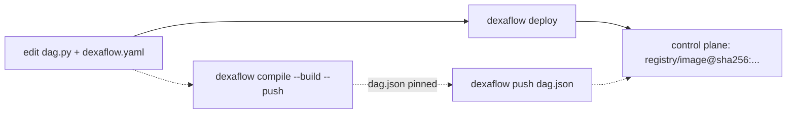

{}
[**Your first Cluster DAG (≈10 min)**](/operate/first-cluster-dag/) takes one DAG from source
to a running pod with **one command** (`dexaflow deploy`), so you see each
artifact boundary before you automate it. This page is the CI recipes for the
same pipeline.
{}

Deploying a Dexaflow DAG is the same everywhere because a DAG is an **immutable
artifact**: a `dag.json` + a container image, versioned together (ADR 0003).

**By hand or in a pipeline,** one command does it all:

```bash
dexaflow auth login --server https://cluster.example.com   # by hand, once; stores the session
dexaflow deploy --yes                                  # compile → build → push → pin digest → register
```

`dexaflow deploy` is the [pipeline-less promotion](/project/adrs/0041-leoflow-deploy-pipelineless/):
it builds for the cluster's architecture (`--platform`, else `build.platforms`
in `dexaflow.yaml`, `linux/amd64` when neither is set) with the first
[builder](/operate/builders/) that applies, pins the image by digest, and
registers the artifact.
`--yes` skips the confirmation prompt (use it in automation). **It is the
recommended command in CI too**, and the recipes below use it.

**The explicit steps** are still available when a pipeline wants the build and
the register as separate stages. Both paths register the image by digest:



1. **`dexaflow compile --build --push`**: parse `dag.py`, overlay
   `dexaflow.yaml`, run the **guardrails** (unknown `task_id`, unsupported
   operator, duplicate keys), build the DAG image, push it, and write the
   pushed image's digest into `dag.json` as `registry/image@sha256:…`.
2. **`dexaflow push dag.json`**: register the artifact with the control plane.

{}
`compile --build --push` reads the digest of the image it pushed (the same read
`deploy` makes, with the same [registry credentials](/operate/builders/#registry-credentials))
and writes `registry/image@sha256:…` into `dag.json`, so `push` registers the
bytes that were built. When only that read fails (the push succeeded), the
compile keeps the tag in `dag.json` and warns with the reason, and `push`
tries the read again; `deploy` stops instead, since it registers only a
digest. `push` pins too: when `dag.json` names a tag (a file
compiled by an older CLI, or an image another tool pushed), it resolves the tag
in the registry and registers the digest it names at that moment. `push --image
<ref>` registers another image than the one in `dag.json`, a tag resolved the
same way or a `<repository>@sha256:<digest>` used as given. When the registry
cannot be read, `push` registers the tag as written with a warning that says
why, and a server under [`deploy.require_digest: enforce`](/operate/cicd-deploy/workflows/#require-images-pinned-by-digest)
refuses it with an error that names the reason and the fix. `dexaflow deploy`
remains the recommended command: it adds the preflight, the plan and the
reuse of an image already built.
{}

{}
The same checks that warn you locally in `dexaflow lite` fail the CI build, so a
bad `dag_id`/`task_id` binding or an unsupported operator never reaches prod.
{}

{}
The [**first Cluster DAG walkthrough**](/operate/first-cluster-dag/) runs `deploy` by
hand so you can watch the DAG cross each boundary. Come back here to wire the
same command into CI.
{}

{}
Registry auth, RBAC scope, non-root images, private-registry pulls, and the
`--dag-version`/`409` gotcha are exactly the errors CI hits first, since a
runner has none of a laptop's ambient state (no `docker login`, no
`dexaflow auth login` session, often a shallow clone with no tags for the
default version label to start from). **[Deploy prerequisites & why shortcuts fail](/operate/deploy-prerequisites/)**
has the exact error and fix for each.
{}

This page covers the deploy itself. The rest of the section:

- [Change, roll back and promote](/operate/cicd-deploy/workflows/): deploy only what changed, roll back, find where a version was built, sync a target with GitOps, promote between environments and require digest pins.
- [Credentials and the CLI in CI](/operate/cicd-deploy/credentials/): the control-plane credential a pipeline uses, CI OIDC without a stored token, Python and the CLI on the runner.
- [Pipelines from `dexaflow ci init`](/operate/cicd-deploy/pipelines/): the files it writes for GitHub Actions, GitLab CI, Google Cloud Build and any other CI.
- [Argo, Tekton, Jenkins, buildah and kaniko](/operate/cicd-deploy/recipes/): recipes for the systems `ci init` does not write a file for.

## Your repo of DAGs (CI is the recommended path)

In Cluster you keep your DAGs in a Git repository, one directory per DAG, and **CI**
turns each into an artifact when it changes. This is the recommended path: a push
triggers the pipeline, no one builds by hand. Each DAG is just **two files**, no
Dockerfile and no `requirements.txt`:

```text
my-dags/                      # your Git repo, a workspace
├── dexaflow.workspace.yaml   # targets and shared defaults (registry, ...)
├── .github/workflows/
│   └── dexaflow-deploy.yaml  # the pipeline `dexaflow ci init github` writes
├── ci/
│   └── dexaflow-deploy.sh    # the deploy step every generated pipeline runs
└── dags/
    ├── my_pipeline/
    │   ├── dag.py            # the DAG (TaskFlow / operators)
    │   └── dexaflow.yaml      # id, python_version, dependencies, registry
    └── another_pipeline/
        ├── dag.py
        └── dexaflow.yaml
```

`dexaflow deploy` (and `compile --build`) **generates the Dockerfile from
`dexaflow.yaml`**: `FROM` the published Dexaflow base, your deps/connectors
installed, your DAG copied in. No Dockerfile to maintain. A `Dockerfile` in the
DAG directory is used verbatim instead and the yaml's dependencies then do not
reach the image, so ship one only if you want full control (see
[your own Dockerfile](/operate/first-cluster-dag/#advanced-your-own-dockerfile)).

The built image is **your** artifact: push it wherever you like (Docker Hub, ECR,
Artifact Registry, ACR, GHCR, a private registry). `deploy` needs a registry
prefix from one of `--registry`, `DEXAFLOW_REGISTRY`, the `registry:` block of
`dexaflow.yaml`, the target, the workspace defaults, your config file or the
cluster's deploy defaults
([Registry, platforms and base image](/operate/workspaces-and-targets/#registry-platforms-and-base-image)),
and names the image after the `dag_id` unless `registry.image_name` says
otherwise; it has no `--image` flag. The only image Dexaflow owns is the base
your DAG layers on.

**The mental model:** a push to `main` runs one pipeline, which deploys only the
DAG projects that push changed (`deploy --all --changed-since <before>`, see
[Deploying only what changed](/operate/cicd-deploy/workflows/#deploying-only-what-changed)): each one is
compiled, built from its yaml, pushed to your registry and registered. The
control plane runs the new version on the next trigger. The projects deploy one
after the other, and a broken `another_pipeline` does not stop `my_pipeline`
from deploying; the job still fails, naming the DAG that did not deploy.
[`dexaflow ci init`](/operate/cicd-deploy/pipelines/#writing-the-pipeline-dexaflow-ci-init) writes that
pipeline for you.

The first registration of a DAG leaves it **paused**, as in Airflow: its
schedule creates no run until someone unpauses it (UI switch, or
`dexaflow admin dags unpause <dag_id>`). Later registrations never change that,
so a pipeline that redeploys an active DAG keeps it active. A DAG that should
start active sets `is_paused_upon_creation=False`; see
[New DAGs start paused](/concepts/core-concepts/#new-dags-start-paused).

### What a deploy says, and the flags that change it

Every deploy prints the server it goes to (and the target that chose it)
before it builds, and ends with a line saying what happens next:

```text
next: etl is paused, so nothing runs until `dexaflow admin dags unpause etl`; unpausing creates 13 catchup runs since start_date 2026-10-01T00:00:00Z, then one run per tick; next tick 2026-10-14T00:00:00Z (UTC).
```

An active DAG gets its next run time instead. The line follows the scheduler:
with `catchup=True` and a `start_date`, every tick since `start_date` gets a
run; otherwise only the latest tick does. A DAG that already ran resumes after
its last run, so its count is an upper bound, as it is for `--active` on a DAG
that was paused. Times are in UTC: the scheduler does not yet apply a DAG's
`timezone` or `end_date`, so the line ignores them too.

With no server set anywhere (no `--server`, `--target`, `DEXAFLOW_SERVER_URL`
or `server_url`), `deploy` stops before building instead of going to
`http://localhost:8080`; a machine set up for Lite keeps the local default.

#### Checks before the build (preflight)

A deploy that the server or the registry would refuse fails in seconds,
before the build, with a message that names what to fix. `deploy` checks, in
this order:

1. **Before the compile: the control plane answers and the token may
   deploy.** A token the server refuses (`401`) names `dexaflow auth login`;
   a token without the `deployer` role, `deploy` or `write` on dags, or an API
   token without the `deploy` scope (`403`) names
   `dexaflow auth create-token --scope deploy`. With `--paused` or `--active`
   the check also covers what those flags need (`write` on dags and, for an
   API token, the `dexaflow:run` scope), and the refusal says so. A server
   that cannot be reached stops the deploy here.
2. **Before the build: the registry accepts a push** to the image's
   repository with the credentials the daemonless build paths push with:
   the docker config (`~/.docker/config.json` and its credential helpers)
   and, for an Artifact Registry, GCR, ECR or ACR host, the session of the
   `gcloud`, `aws` or `az` CLI, as `registry.auth_method` says (see
   [Registry credentials](/operate/builders/#registry-credentials)). The
   line says where the credential came from. The check starts an
   upload and cancels it (best effort: a registry that refuses the cancel
   expires the empty upload), so no image is written. A refusal of the
   credential found stops a `docker` deploy, naming the login command of the
   registry (`gcloud auth configure-docker <host>`,
   `aws ecr get-login-password --region <region> | docker login ...`,
   `az acr login --name <name>`, or `dexaflow registry login <registry>`). With no
   credential found, or with another `--builder` (podman, for one, keeps
   credentials of its own in `auth.json`), a refusal is a `note:` naming the
   command for that builder, and why the cloud CLI gave no token when it
   could not (not on `PATH`, not signed in), and the push decides. Nothing is checked when nothing is pushed: with
   `--skip-build`, or when the registry already holds the image for the
   content label.
3. **After the compile, before the build: the server's dry run of the
   register.** The compiled `dag.json` goes to
   `POST /api/v2/dags/{dag_id}/versions/dry_run`, which runs every check the
   register runs (spec validation, the operator's image, service account
   and field allowlists, the resource unit, source mode, the tenant's limits,
   the declared connections and variables, the version label) and writes
   nothing. The register gets the image pinned by digest, which the build
   makes later. When nothing is built (`--skip-build`, or the registry
   already holds the image for the content label) the dry run is sent the
   digest the registry holds for the tag, the very image the register gets,
   so an allowlist that names that exact digest accepts it. Before a build
   it is sent the repository at a placeholder digest, so an allowlist of
   repositories or of `repo@*` decides as for the register. A refusal stops
   the deploy with the server's reason, except two the built image decides
   when it is still to be built. One is a refusal of the placeholder image
   when it is the only refusal and the allowlist names the image's
   repository at a digest (`<repo>@sha256:...`), which a reproducible build
   may match; a repository the allowlist does not cover still stops the
   deploy. The other is a version label registered with other content. Each
   of those is a `note:`, and the register answers it. So is a dry run the server
   could not answer (`5xx`, or `429` under load): the deploy goes on and the
   register runs the checks. A warning (a task that does not fit its size
   under `executor.unit.enforce: warn`) prints on stderr and the deploy goes
   on.
4. **With the dry run: what the task pods will run as.** The dry run
   answer also says whether the server runs task pods as non-root
   (`taskPodSecurity.runAsNonRoot`) and, for each ServiceAccount a task pod
   would run as (the task's `execution.service_account`, else the chart's
   task ServiceAccount, else the namespace's `default`), whether it exists in
   the task namespace and how many `imagePullSecrets` it carries. Both used
   to fail only when a task pod started.
   - A ServiceAccount that does not exist stops the deploy, naming it and
     its tasks: the pods of those tasks would not be created. Set
     `execution.service_account` to one that exists, or have the operator
     create it (`taskServiceAccount.create` in the Helm values). The
     namespace's `default` ServiceAccount is the exception: Kubernetes
     creates it in every namespace a moment after the namespace, so a
     missing `default` is a `note:` and the deploy goes on.
   - A ServiceAccount with no `imagePullSecrets` is a `note:`: a private
     registry is then pulled only with the nodes' own credentials (IRSA,
     Workload Identity, a credential helper), which the server cannot see.
     The operator lists a pull secret in `taskServiceAccount.imagePullSecrets`
     otherwise. A ServiceAccount the server could not look up is a `note:`
     with the reason: the control plane reads the account with `get` on
     `serviceaccounts` in the task namespace, which the chart grants
     ([ADR 0085](/project/adrs/0085-control-plane-reads-task-service-accounts/)),
     except in a split control plane, whose API role has no access to the
     cluster.
   - When the project builds from its own `Dockerfile`, the deploy reads the
     `USER` its final stage ends with (the one of the stage it is built
     `FROM`, when that is a stage of the same file). On a server that runs
     task pods as non-root, `USER root`, `USER 0` or a user name
     (`USER app`, which the kubelet cannot check is not root) stops the
     deploy and names the fix: a numeric non-root id such as
     `USER 65532:65532`. No `USER` (the base image decides) or a build
     variable (`USER $UID`) is a `note:`. A server that does not run task
     pods as non-root takes any `USER`. When the server does not say (an
     older server, or no dry run), root or a name is a `note:`. The
     Dockerfile generated from `dexaflow.yaml` always ends with
     `USER 65532:65532` and is not read; nothing is read with
     `--skip-build` or in source mode, which build nothing.

Each check that passes prints a `preflight:` line (on stderr with
`--output json`). A server from before the dry run route answers it with
`404` and registers nothing, also during a rolling upgrade when one replica
is older: the deploy prints a `note:` and its policy checks run at the
register, after the build, as before. `dexaflow doctor` runs the first two
checks for the target in use, refreshing a saved session as a deploy does.

| Flag | What it does |
|---|---|
| `--paused` / `--active` | Leaves the DAG paused or active after this deploy, new or not, instead of the creation rule above. The register sets it in its own transaction, audited as `dag.pause` or `dag.unpause`; for content that is already current, nothing is registered and the DAG is paused or unpaused with the Airflow `PATCH /api/v2/dags/{dag_id}`. Pausing is a run-state write: these flags need `write:dag` (the `deployer` role alone is refused with `403`), and a scoped token needs `dexaflow:run` as well as `dexaflow:deploy`, so a deploy-only token is refused with `403`. |
| `--plan` | Says per DAG what a deploy would build, push and register, and why (content changed, already current, an older version, a new DAG), without running the parser, the builder or the register. Works with `--all`, and in [source mode](/operate/source-mode/#deploying-in-source-mode), where nothing is built or pushed. |
| `--changed-since <ref>` | With `--all`, deploys only the projects whose files changed since a git ref, and lists the others as skipped. See [Deploying only what changed](/operate/cicd-deploy/workflows/#deploying-only-what-changed). |
| `--output json` | Prints one JSON document on stdout for the pipeline to read; the human lines and the builder's output go to stderr. |

The JSON document has one entry per DAG:

```json
{
  "server": "https://cluster.example.com",
  "target": "prod",
  "dags": [
    {
      "dag_id": "my_pipeline",
      "status": "registered",
      "version": "v1.4.0-3f9c2a1b7d4e",
      "image": "ghcr.io/acme/my_pipeline@sha256:4e1f...",
      "digest": "sha256:4e1f...",
      "spec_hash": "9b0c...",
      "created": true,
      "dag_created": true,
      "is_paused": true,
      "next": "my_pipeline is paused, so nothing runs until ...",
      "execution": {
        "warm_pools": true,
        "tasks": [
          { "task_id": "extract", "mode": "warm" },
          { "task_id": "load", "mode": "dedicated", "reason": "node_selector set" }
        ],
        "pool": { "state": "on", "detail": "2 idle warm workers (up to 5) ...", "min_idle_workers": 2, "max_pool_size": 5 }
      }
    }
  ]
}
```

`created` says a new version was registered and `dag_created` that it was
the DAG's first. `status` is `registered` (a new version), `unchanged` (the server already had
this exact content), `current` (the content label is the current version, so
nothing was built), `skipped` (unchanged since the `--changed-since` ref, with
`reason`), or `failed` (one DAG of `--all`, with `error`). With
`--plan` it is `planned` or `refused`, and a `plan` object carries `build`,
`push`, `register` and `reason`, and `source_mode: true` for a deploy in
[source mode](/operate/source-mode/#deploying-in-source-mode). `links` and
`checks` carry what the server added to the register's answer, when it added
any ([Links and checks from the server](#links-and-checks-from-the-server)).
After a failure of `--all` the document is still printed, so the pipeline
sees which DAGs went through.

`execution` is the server's answer on where each task runs: `mode` is `warm`
(warm-eligible) or `dedicated`, with the `reason` for a dedicated pod, and
`pool.state` is `off`, `none` or `on`, with `previous_pool: "draining"` for a
new version of an existing DAG on a server that keeps warm workers: the
previous version's pool drains, and the new one starts at the next reconcile
when the DAG declares `min_idle_workers`, else with its first run (see
[Prewarm and drain on deploy](/operate/warm-pools/#prewarm-and-drain-on-deploy)). The human output
prints it as an `execution` line and, unless every task takes a dedicated pod
for one reason, a `warm pool` line; see
[Where a deploy's tasks run](/operate/warm-pools/#where-a-deploys-tasks-run).
A server from before the field sends none, and the entry has no `execution`.
`--plan` does not run the parser, so it has no tasks to report on.

#### Links and checks from the server

A server, or a platform in front of it, may add two optional fields to the
answer of the register and of its dry run: a `links` object (a name for each
URL, such as the page of the new version in its own UI) and a `checks` list
(what it checked, and the result). Each check is an object with a `name`, a
`status` and an optional `detail`, or a plain string. The engine sends
neither; `deploy` prints whatever it gets, the links sorted by name and the
checks in the order given, under the `preflight:` line of the dry run and
under the `Deployed` line of the register:

```text
Deployed my_pipeline -> https://cluster.example.com
  image ghcr.io/acme/my_pipeline@sha256:4e1f...
  registered version v1.4.0-3f9c2a1b7d4e
  link     console: https://console.example.com/dags/my_pipeline
  check    lint: passed (0 findings)
```

Only `http` and `https` links are kept; any other (a `javascript:`, `file:`
or relative URL) is dropped. Before printing, control characters (C0 and C1)
are removed, and so are format characters (bidirectional overrides, zero-width
characters) and line and paragraph separators, so a server cannot drive the
terminal or disguise a link. With `--output json`, the register's `links` and
`checks` are fields of the DAG's entry, absent when the server sent none.

#### How the server recognizes the CLI

Every request the CLI sends to a control plane, from any command (each HTTP
client it builds sets the headers in its transport), carries
`User-Agent: dexaflow-cli/<version>`, and `X-Dexaflow-CI: true` when one of
the usual CI variables is set (`CI`, `GITHUB_ACTIONS` or `GITLAB_CI`, to
anything but empty, `false` or `0`), so a server can tell an interactive
deploy from a pipeline's. Neither header grants anything: authorization
still comes from the token alone.

{}
The pipeline `dexaflow ci init` writes stays the recommendation: it deploys
only the DAGs a change touched (`--changed-since`), and a broken DAG does not
stop the others from deploying.

`dexaflow build [workspace]` is for the times you are **not** in that pipeline:
after a base-image bump that every DAG must pick up, when you clone the repo onto
a new machine, or when you want to see all the images a change produces before
pushing anything. It walks the workspace and builds each project with the image
that project's own `registry:` block derives (the same derivation `deploy` uses,
so nothing about naming is new):

```bash
dexaflow build my-dags/           # build every project under my-dags/
dexaflow build my-dags/ --push    # ...and push each to its registry
dexaflow build my-dags/ --dry-run # print each dag id and its image, build nothing
```

Two behaviours matter more than the loop itself:

- A project that declares **no `registry:`** (or a blank one, which `deploy`
  refuses too) is reported by name, not skipped quietly. A command that covers
  less than the workspace without saying so leaves you believing images exist.
- Every project's `dexaflow.yaml` is checked **before** anything is built, so a
  typo in the last project fails the run at once instead of after the others
  have built.
- A failure **stops** the run, names the project, and lists what was already
  built. A half-built workspace (some images new, some stale) is invisible
  afterwards.

With no `--dag-version` / `--sha` it derives them the same way `deploy` does,
per project: the version label from `git describe` in the project's directory
plus a hash of that project's content, and the short commit hash of that
directory. (`deploy` has no `--sha` flag at all; it always derives the sha.)

Using it **as** your CI, in place of `deploy --all --changed-since`, is a
deliberate trade: one job rebuilds everything on any change, so build time
grows with the repo, and it only builds: nothing is registered. Choose it only
if you want that.
{}

## Control-plane deployment (Helm chart, in validation)

Deploying the control plane itself (Helm chart, published `dexaflow-server`/
`dexaflow-migrate` images, TLS on the agent channel, keyless cloud auth) is the
**Cluster** track. One command installs the chart with auto-generated TLS and no
cert-manager, from its published OCI artifact
(`helm install dexaflow oci://ghcr.io/dexadata/charts/dexaflow --version <VERSION>`),
or from source on `main` for the bleeding edge
(`helm install lf ./helm/dexaflow …`). See [Install Cluster](/get-started/installation/#install-cluster).
The chart is installable today and in validation: see the
[Helm chart](https://github.com/dexadata/dexaflow/blob/main/helm/dexaflow/README.md), the reproducible
[Kubernetes test setup](https://github.com/dexadata/dexaflow/blob/main/deploy/k8s/README.md)
(the `deploy/k8s` recipe is cloud-portable: it runs unchanged on EKS / GKE / AKS),
[Operating modes](/concepts/editions/),
and the [Roadmap](/project/roadmap/). The product proves itself in **Lite** first.

See also: [DAG authoring](/author-dags/dag-authoring/) · [Operating modes](/concepts/editions/).

<script>
// Sections of this page moved to their own pages: send an old link with
// one of their anchors to the page that now holds it.
(function(){var m={"credentials-for-the-control-plane":"/operate/cicd-deploy/credentials/","deploying-only-what-changed":"/operate/cicd-deploy/workflows/","deploying-without-a-stored-token-ci-oidc":"/operate/cicd-deploy/credentials/","examples-what-dexaflow-ci-init-writes":"/operate/cicd-deploy/pipelines/","installing-the-cli-in-a-pipeline":"/operate/cicd-deploy/credentials/","no-dexaflow-setup-in-ci":"/operate/cicd-deploy/credentials/","prerequisites":"/operate/cicd-deploy/credentials/","promoting-between-environments":"/operate/cicd-deploy/workflows/","python-on-the-runner":"/operate/cicd-deploy/credentials/","recipes-for-argo-workflows-tekton-jenkins-buildah-and-kaniko":"/operate/cicd-deploy/recipes/","require-images-pinned-by-digest":"/operate/cicd-deploy/workflows/","rolling-back":"/operate/cicd-deploy/workflows/","syncing-a-target-with-the-workspace-gitops":"/operate/cicd-deploy/workflows/","the-dexaflow-cli-image":"/operate/cicd-deploy/credentials/","the-setup-dexaflow-action":"/operate/cicd-deploy/credentials/","trusting-a-ci-provider":"/operate/cicd-deploy/credentials/","watching-the-exchange":"/operate/cicd-deploy/credentials/","what-the-pipeline-does":"/operate/cicd-deploy/credentials/","when-deploys-go-through-your-platforms-issuer":"/operate/cicd-deploy/credentials/","where-a-version-was-built":"/operate/cicd-deploy/workflows/","writing-the-pipeline-dexaflow-ci-init":"/operate/cicd-deploy/pipelines/"};var a=decodeURIComponent(location.hash.slice(1));
if(m[a]&&!document.getElementById(a)){location.replace(m[a]+'#'+a);}})();
</script>
