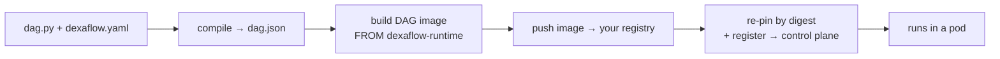

---
# --- AUTO redirect aliases (build_redirects.py) — do not edit by hand ---
aliases:
  - /first-pro-dag.html
# --- end AUTO redirect aliases ---
title: Deploy your first Pro DAG
weight: 10
description: Take a DAG from Lite to a Kubernetes control plane — your first Pro deployment.
---

This is the end-to-end Pro path: take one DAG from source to a running task on a
control plane — in **one command**. Where the 2-minute [Lite loop](/contribute/local-dev-loop/)
hides the artifact boundary so you can iterate, Pro makes it explicit, because that
boundary is what `dexaflow deploy` automates for you.

A DAG is an **immutable artifact** — a `dag.json` + a container image, versioned
together ([ADR 0003](/project/adrs/0003-dag-as-image/)). `dexaflow deploy` moves it across
every boundary in one shot:



A DAG project is **two files**, `dag.py` and `dexaflow.yaml`. There is no
Dockerfile to write: `dexaflow deploy` generates one from `dexaflow.yaml` at
build time (`FROM` the published Dexaflow runtime base, your `system_packages`,
`dependencies` and `connectors:` installed, your DAG copied in) and removes it
when the build is done.

## Prerequisites

- **`docker`** (or `podman`/`nerdctl`, passed with `--builder`). Used to build and
  push the DAG image.
- The **`dexaflow` CLI** and Python 3.11 to 3.13 on your `PATH`. `dexaflow
  compile` and `dexaflow deploy` extract the bundled parser on their own; run
  `dexaflow setup` only if you want it to fetch a managed Python for you.
- **A container registry your cluster can pull from**: Docker Hub, GHCR,
  Amazon ECR, Google Artifact Registry, Azure ACR, or a private one. You push the
  DAG image there; the control plane pulls it. (Lite needs none; this is a Pro
  thing.)
- **A reachable Pro control plane.** A throwaway one comes from the
  [Helm chart](/operate/helm-chart/). To rehearse this whole page on your
  machine, [Try Pro on a local cluster](/operate/local-cluster/) sets up a
  local cluster, a registry and the chart (for testing only).

## Step 0: log in once

```console
$ dexaflow auth login --server https://pro.example.com
Username: admin
Password:
Logged in to https://pro.example.com (token saved to ~/.dexaflow/config.yaml)
```

The session is stored, so every later `dexaflow deploy` needs **no auth flags**,
and `deploy` refreshes it before it expires. The password is read hidden, so it
never lands in your shell history. (This is the control-plane login; it is
unrelated to `docker login`, which authenticates your *builder* to the registry.
Do that once too: `docker login ghcr.io`.)

## Step 1: a project (`dag.py` + `dexaflow.yaml`)

```python title="dag.py"
from airflow.sdk import DAG, task

@task
def extract() -> dict:
    return {"rows": 42}

@task
def load(data: dict) -> None:
    print(f"loaded {data['rows']} rows")

with DAG("first_pro_dag", schedule=None) as dag:
    load(extract())
```

```yaml title="dexaflow.yaml"
dag_id: first_pro_dag
python_version: "3.11"
dependencies:
  - requests==2.32.3
registry:
  # Wherever you want the artifact to live; this is just an example.
  # Docker Hub: docker.io/your-user · ECR: <acct>.dkr.ecr.<region>.amazonaws.com
  # Artifact Registry: <region>-docker.pkg.dev/<project>/<repo> · GHCR: ghcr.io/your-org
  url: ghcr.io/your-org
  image_name: first-pro-dag
```

That is the whole project. A provider package is one line too: `connectors:
[postgres]` installs `apache-airflow-providers-postgres` into the image (see
[Installing a connector's provider](/connections/#installing-a-connectors-provider)).

{}
The generated Dockerfile layers `FROM` the **published Dexaflow task base**
(`ghcr.io/dexadata/dexaflow-runtime:py3.11-v<cli version>`). It bundles the
`dexaflow-agent` (PID 1, talks gRPC to the control plane) and the
`leoflow_runtime` helper, is multi-arch and signed, and is built by our CI. Pin
another base with `base_image:` in `dexaflow.yaml` if you need one.
{}

## Step 2: deploy (one command)

```console
$ dexaflow deploy
Deploy first_pro_dag -> https://pro.example.com? [y/N] y
…  (compile → build for linux/amd64 → push → register)
Deployed first_pro_dag -> https://pro.example.com
  image ghcr.io/your-org/first-pro-dag@sha256:9f2c…
  registered version 1a2b3c4
```

That one command crossed every boundary:

1. **compile**: parsed `dag.py`, overlaid `dexaflow.yaml`, ran the guardrails
   (unknown `task_id`, unsupported operator, duplicate keys), wrote `dag.json`.
2. **build**: generated the Dockerfile from `dexaflow.yaml` and built the image
   **for the cluster's architecture**, which is `build.platforms` in
   `dexaflow.yaml` (`linux/amd64` when unset), so a macOS/arm64 laptop produces
   an image an amd64 cluster can run.
3. **push**: pushed it to your `registry:`.
4. **re-pin + register**: captured the image **digest**, wrote
   `…@sha256:…` into `dag.json`, and registered that with the control plane. Pro
   now pulls **exactly** the bytes you built, with no `:latest` drift.

{}
`deploy` publishes the artifact. A DAG deployed for the first time starts
**paused**, as in Airflow: its schedule creates no run until you unpause it
with the switch in the UI or `dexaflow admin dags unpause first_pro_dag`.
Add `--trigger` to kick a run immediately (a manual trigger runs even while the
DAG is paused), or trigger from the Airflow UI. Later deploys keep the DAG
paused or active as you left it. To have new DAGs start active, set
`is_paused_upon_creation=False` on the DAG or ask the operator to set
`DEXAFLOW_DAGS_ARE_PAUSED_AT_CREATION=false`; see
[New DAGs start paused](/concepts/core-concepts/#new-dags-start-paused).
{}

## Step 3: trigger and watch it run

```console
$ dexaflow deploy --trigger --follow
…
Deployed first_pro_dag -> https://pro.example.com
  image ghcr.io/your-org/first-pro-dag@sha256:9f2c…
  registered version 1a2b3c4
  triggered run manual__1717525200
Following run manual__1717525200 of first_pro_dag (Ctrl-C stops following; the run keeps going)
  https://pro.example.com/dags/first_pro_dag/runs/manual__1717525200
note: first_pro_dag is paused: this manual run starts anyway, but its schedule creates no run until you unpause it: dexaflow admin dags unpause first_pro_dag
  extract  queued
  extract  running
  extract  success  2.9s
    | [leoflow] loading dag:extract
    | [leoflow] returned dict (12 B XCom)
  load     queued
  load     running
  load     success  3.1s
    | [leoflow] loading dag:load
    | [leoflow] pulled data (12 B)
    | [leoflow] resolved kwargs: ['data']
    | loaded 42 rows
    | [leoflow] returned None (no XCom pushed)
Run manual__1717525200 succeeded (followed for 21.4s).
```

The scheduler pulls your image, runs each task in its own pod, and the Airflow UI
shows state and logs. That is the whole Pro lifecycle, in one verb.

`--follow` prints each task state change and the logs of each attempt as it
finishes, with the link to the run in the UI, and exits with the result of the
run, so a script or a CI job can rely on it:

| Exit code | Meaning |
|---|---|
| `0` | the run succeeded |
| `1` | the deploy or the API failed (the error says why) |
| `2` | the run failed; the error names the failed tasks and the ones that did not run because of them (`upstream_failed`) |
| `3` | `--timeout` elapsed before the run ended (for example `--timeout 30m`) |
| `130` | you pressed Ctrl-C |

Ctrl-C and `--timeout` only stop following: the run keeps going, and
`dexaflow runs status first_pro_dag --run <run_id>` shows it later. A run that
stays queued for two minutes gets a note saying no task has started and where
to look. `dexaflow runs trigger <dag_id> --follow` does the same for a run you
start without deploying, and `dexaflow runs logs <dag_id>` prints the logs of
every task of the latest run.

## When it doesn't work

`deploy` fails loudly and tells you the fix. The four you'll actually hit:

| Symptom | Cause | Fix |
|---|---|---|
| `deploy requires a container registry…` | no `registry:` in `dexaflow.yaml` | add the `registry:` block (Step 1) and `docker login <registry>` |
| `denied` / `unauthorized` on push | builder not logged in to the registry | `docker login ghcr.io` (registry auth ≠ control-plane auth) |
| Task pod: `exec format error` | image arch ≠ cluster arch | set the cluster's architecture in `dexaflow.yaml`, for example `build: {platforms: [linux/arm64]}` on a Graviton cluster. `deploy` has no `--platform` flag; the platform always comes from `build.platforms` |
| DAG runs but a task fails on a missing `conn_id` | connections live in the control plane, **not** in the image | deploy prints `note: this DAG expects connection(s): …`; create them on Pro (UI/API) first. See [Variables & Connections](/author-dags/variables-connections/) |

Hit something not on this list (an unsupported task type, `CreateContainerConfigError`,
a `401`/`403`, a private-registry `ErrImagePull`, or a `409` on a second deploy)?
**[Deploy prerequisites & why shortcuts fail](/operate/deploy-prerequisites/)**
collects every gate `deploy`/`push` enforce, with the exact error and the fix.

## Deploy more than one DAG

```bash
dexaflow deploy <dag_id>     # a specific DAG of the workspace around the current folder
dexaflow deploy --all        # every DAG in the workspace (best-effort; non-zero exit if any fail)
dexaflow deploy --skip-build # reuse the existing image (skip docker build/push); dag.json is still recompiled from dexaflow.yaml/dag.py
```

The workspace is the folder holding `dexaflow.workspace.yaml` above the current
folder, else the git repository around it. To keep many DAGs in one repository
with named control planes (`--target dev`, `--target prod`) and one shared
registry, see [Workspaces and targets](/operate/workspaces-and-targets/).

## Build in one CI job, deploy in another

`dexaflow deploy` builds, pushes and registers in one command, and that is the
path to use when one machine does all three. A CI/CD pipeline usually splits
them: a build job that produces the image, and a deploy job, often on a
different runner with different credentials, that only registers it.

```bash
# build job
dexaflow compile . --output dag.json --build --push --dag-version "$VERSION"

# deploy job, later, possibly elsewhere
docker pull "ghcr.io/your-org/first-pro-dag:$VERSION"   # deploy reads the digest from the local store
dexaflow deploy . --skip-build --dag-version "$VERSION"
```

The two steps have to name the **same image**, and the name comes from
`registry.tag_strategy` in `dexaflow.yaml`. Pass the same `--dag-version` to
both, and run both from the same commit when the strategy is `git_sha`.
`deploy --skip-build` still pins the digest: it asks the builder for the repo
digest of that image, which only works when the image is in the runner's local
store, hence the `docker pull` on a fresh runner.

{}
With the default `version` strategy the tag is the DAG version label, which
comes from `git describe` and a hash of the DAG's content, so two runs of the
same pipeline on the same commit produce the same tag and a rebuild silently
replaces what is already in the registry. `git_sha` ties the tag to the commit
instead, which is what makes a deploy reproducible.

Either way `deploy` re-pins the artifact by digest after the push, so the tag is
a convenience and not the integrity boundary.
{}

If the deploy job reports that it cannot find the image the build job pushed,
check `--dag-version` and the commit first. The error names the image it looked
for, which reads like a failed push but is more often the two steps disagreeing
about the tag.

## Advanced: your own Dockerfile

A hand-written Dockerfile is an escape hatch, not the default
([ADR 0003](/project/adrs/0003-dag-as-image/)). When the project directory holds
a file named `Dockerfile` (or the file named by `build.dockerfile` in
`dexaflow.yaml`, or by `--dockerfile`), `deploy` and `compile --build` build it
**verbatim** and generate nothing. That means `dependencies:`,
`system_packages:`, `connectors:` and `base_image:` in `dexaflow.yaml` no longer
reach the image: the Dockerfile has to install them itself. Use it only for what
the yaml cannot express, and start from the published base:

```dockerfile title="Dockerfile"
FROM ghcr.io/dexadata/dexaflow-runtime:py3.11
USER root
RUN pip install --no-cache-dir requests==2.32.3
COPY dag.py /home/leoflow/dag.py
ENV PYTHONPATH=/home/leoflow
USER 65532:65532
```

Keep the last `USER` numeric and non-root, or the task pod fails with
`CreateContainerConfigError`
(see [gate 4](/operate/deploy-prerequisites/#4-non-root-task-image)). A
`FROM` on an image that only exists on your laptop, such as the
`leoflow-base` image `dexaflow lite` builds locally, fails on any other builder.

## From here

- **Automate it.** `dexaflow deploy --yes` is exactly what a pipeline runs on
  every push; see [CI/CD & deploy examples](/operate/cicd-deploy/) for GitHub
  Actions / GitLab / Cloud Build recipes (and the Python-on-the-runner notes).
- **The design.** [ADR 0041](/project/adrs/0041-leoflow-deploy-pipelineless/) records why
  deploy works the way it does (registry mandatory, digest pinning, two-tier path).
