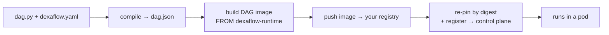

---
# --- AUTO redirect aliases (build_redirects.py) — do not edit by hand ---
aliases:
  - /first-pro-dag.html
# --- end AUTO redirect aliases ---
title: Deploy your first Pro DAG
weight: 10
description: Take a DAG from Lite to a Kubernetes control plane — your first Pro deployment.
---

This is the end-to-end Pro path: take one DAG from source to a running task on a
control plane — in **one command**. Where the 2-minute [Lite loop](/contribute/local-dev-loop/)
hides the artifact boundary so you can iterate, Pro makes it explicit, because that
boundary is what `dexaflow deploy` automates for you.

A DAG is an **immutable artifact** — a `dag.json` + a container image, versioned
together ([ADR 0003](/project/adrs/0003-dag-as-image/)). `dexaflow deploy` moves it across
every boundary in one shot:



A DAG project is **two files**, `dag.py` and `dexaflow.yaml`. There is no
Dockerfile to write: `dexaflow deploy` generates one from `dexaflow.yaml` at
build time (`FROM` the published Dexaflow runtime base, your `system_packages`,
`dependencies` and `connectors:` installed, your DAG copied in) and removes it
when the build is done.

## Prerequisites

- The **`dexaflow` CLI** and Python 3.11 to 3.13 on your `PATH`. `dexaflow
  compile` and `dexaflow deploy` extract the bundled parser on their own; run
  `dexaflow setup` only if you want it to fetch a managed Python for you.
- **[uv](https://docs.astral.sh/uv/getting-started/installation/) on your
  `PATH`**, so the image is built with no container daemon: your dependencies
  are installed from wheels for the cluster's platform and your DAG code is
  pushed as one layer on them, straight to the registry. `deploy` picks a
  [builder](/operate/builders/) and says which one ran. Without uv, or for a
  project uv cannot build (`system_packages`, a package with no wheel), a
  local container tool builds the dependency image: `docker`, or
  `podman`/`nerdctl` passed with `--builder`. It builds the whole image when
  a dependency is not pinned to one version and uv cannot build it, or when
  the project ships its own `Dockerfile`.
- **A container registry your cluster can pull from**: Docker Hub, GHCR,
  Amazon ECR, Google Artifact Registry, Azure ACR, or a private one. You push the
  DAG image there; the control plane pulls it. (Lite needs none; this is a Pro
  thing.)
- **A reachable Pro control plane.** A throwaway one comes from the
  [Helm chart](/operate/helm-chart/). To rehearse this whole page on your
  machine, [Try Pro on a local cluster](/operate/local-cluster/) sets up a
  local cluster, a registry and the chart (for testing only).

## Step 1: a workspace and a target

A [workspace](/operate/workspaces-and-targets/) is the folder, usually a git
repository, that holds your DAGs. A **target** names a control plane and the
registry its deploys push to, so no command needs a `--server` or a
`registry:` block after this:

```console
$ dexaflow workspace init acme-dags --git
Initialized Dexaflow workspace in /home/you/acme-dags
  dexaflow.workspace.yaml    targets and shared defaults (commit it; it holds no credentials)
  dags/                      one folder per DAG
  git: initialized a git repository
…
$ cd acme-dags
$ dexaflow target add prod https://pro.example.com --registry ghcr.io/your-org
Added target prod (https://pro.example.com) to /home/you/acme-dags/dexaflow.workspace.yaml
prod is now the default target.

Next: sign in once with
  dexaflow auth login --target prod
```

The target lives in `dexaflow.workspace.yaml`, so everyone who clones the
repository deploys to the same place. Tokens never go there. When the cluster
advertises a registry
([Cluster deploy defaults](/operate/workspaces-and-targets/#cluster-deploy-defaults)),
`--registry` is optional too.

## Step 2: sign in, to the control plane and to the registry

```console
$ dexaflow auth login --target prod
Logging in to https://pro.example.com (target prod, from --target)
…
Logged in to https://pro.example.com (target prod; token saved to /home/you/.dexaflow/config.yaml)
```

When the server offers single sign-on, `auth login` opens your browser on its
sign-in; on a machine with no browser (an SSH session) it prints a page and a
short code to confirm from any device instead. A server without single sign-on
asks for a username and a password, read hidden so they never land in your
shell history. See [Signing in from the CLI](/operate/sso-google-workspace/#signing-in-from-the-cli).
The token is saved for that server only, and `deploy` renews it before it
expires.

The registry is a separate credential. The CLI reads and pushes to it itself
([Registry credentials](/operate/builders/#registry-credentials)):

| Registry | What the CLI needs |
|---|---|
| Artifact Registry, GCR | be signed in to `gcloud` (`gcloud auth login`) |
| ECR | be signed in to `aws` (`aws sso login`, `aws configure`, environment credentials or an instance role) |
| ACR | be signed in to `az` (`az login`) |
| GHCR, Docker Hub, any other | `dexaflow registry login <registry>` once, with no docker needed (GHCR uses your `gh` session; Docker Hub a personal access token on stdin), or `docker login <registry>`; both store the credential in `~/.docker/config.json` or in the credential helper it names ([Signing in without docker](/operate/builders/#signing-in-without-docker)) |

When a project falls back to the local container tool, the tool pushes with
its own login, which a cloud session alone does not give it: the deploy
preflight names the command for your registry and tool (for ECR and docker,
`aws ecr get-login-password --region <region> | docker login --username AWS --password-stdin <host>`).

## Step 3: a DAG (`dag.py` + `dexaflow.yaml`)

```console
$ dexaflow new first_pro_dag
Created DAG "first_pro_dag" in dags/first_pro_dag
…
```

`new` writes `dags/first_pro_dag/dag.py`, `dexaflow.yaml` and a `.gitignore`.
Replace the first two with
a two-task DAG that has one dependency:

```python title="dags/first_pro_dag/dag.py"
from airflow.sdk import DAG, task

@task
def extract() -> dict:
    return {"rows": 42}

@task
def load(data: dict) -> None:
    print(f"loaded {data['rows']} rows")

with DAG("first_pro_dag", schedule=None) as dag:
    load(extract())
```

```yaml title="dags/first_pro_dag/dexaflow.yaml"
dag_id: first_pro_dag
python_version: "3.11"
dependencies:
  - requests==2.32.3
# The target names the registry. To push this DAG elsewhere, set it here:
# registry:
#   url: ghcr.io/your-org
#   image_name: first_pro_dag   # defaults to the dag_id
```

That is the whole project. A provider package is one line too: `connectors:
[postgres]` installs `apache-airflow-providers-postgres` into the image (see
[Installing a connector's provider](/connections/#installing-a-connectors-provider)).

{}
The image layers on the **published Dexaflow task base**
(`ghcr.io/dexadata/dexaflow-runtime:py3.11-v<cli version>`). It bundles the
`dexaflow-agent` (PID 1, talks gRPC to the control plane) and the
`leoflow_runtime` helper, is multi-arch and signed, and is built by our CI. Pin
another base with `base_image:` in `dexaflow.yaml` if you need one.
{}

## Step 4: deploy, run and watch it (one command)

A DAG deployed for the first time starts **paused**, as in Airflow, and a run
triggered while it is paused waits in `queued` until you unpause it.
`--active` unpauses the DAG in the same register, so one command deploys it,
starts a run and follows it:

```console
$ dexaflow deploy first_pro_dag --active --trigger --follow
workspace: /home/you/acme-dags (from /home/you/acme-dags/dexaflow.workspace.yaml)
server:     https://pro.example.com (target prod, from default_target in /home/you/acme-dags/dexaflow.workspace.yaml)
registry:   ghcr.io/your-org/first_pro_dag (from target "prod" in /home/you/acme-dags/dexaflow.workspace.yaml)
platforms:  linux/amd64 (from the default)
Deploy /home/you/acme-dags/dags/first_pro_dag -> https://pro.example.com? [y/N] y
preflight:  control plane https://pro.example.com answers, the token may deploy
preflight:  ghcr.io/your-org/first_pro_dag accepts a push (credential from the docker config)
preflight:  the server would register first_pro_dag 1a2b3c4 as a new DAG, active
builder:    dependency-layer (uv 0.11.32), then code-layer, no dependency image ghcr.io/your-org/first_pro_dag:deps-9b07... in the registry (GET https://ghcr.io/v2/your-org/first_pro_dag/manifests/deps-9b07...: MANIFEST_UNKNOWN: ...): it is built from wheels without a daemon and pushed, then the DAG code is appended to it
…  (compile → build for linux/amd64 → push → register)
Deployed first_pro_dag -> https://pro.example.com
  image ghcr.io/your-org/first_pro_dag@sha256:9f2c…
  registered version 1a2b3c4
  execution  every task runs on a dedicated pod: warm pools off
next: first_pro_dag is active and has no schedule; it runs only when triggered (`dexaflow runs trigger first_pro_dag`).
  triggered run manual__1717525200
Following run manual__1717525200 of first_pro_dag (Ctrl-C stops following; the run keeps going)
  https://pro.example.com/dags/first_pro_dag/runs/manual__1717525200
  extract  queued
  extract  running
  extract  success  2.9s
    | [dexaflow] loading dag:extract
    | [dexaflow] returned dict (12 B XCom)
  load     queued
  load     running
  load     success  3.1s
    | [dexaflow] loading dag:load
    | [dexaflow] pulled data (12 B)
    | [dexaflow] resolved kwargs: ['data']
    | loaded 42 rows
    | [dexaflow] returned None (no XCom pushed)
Run manual__1717525200 succeeded (followed for 21.4s).
```

That one command crossed every boundary:

0. **preflight**: checked that the control plane answers, that your token may
   deploy and that the registry accepts your push, then, once `dag.json` was
   compiled, had the server run every check of the register on it without
   registering anything. A refusal stops here, before the build, naming what to
   fix; see [Checks before the build](/operate/cicd-deploy/#checks-before-the-build-preflight).
1. **compile**: parsed `dag.py`, overlaid `dexaflow.yaml`, ran the guardrails
   (unknown `task_id`, unsupported operator, duplicate keys), wrote `dag.json`.
2. **build**: built the image **for the cluster's architecture**: `--platform`,
   else `build.platforms` in `dexaflow.yaml`, the target's, the workspace's or
   the cluster's deploy defaults (`linux/amd64` when none is set), so a macOS/arm64 laptop
   produces an image an amd64 cluster can run. The `builder:` line names how it
   was built: here uv installed the wheels for `linux/amd64` as a dependency
   image, and the DAG code went on top as one layer, with no container daemon.
   The next deploy that changes only `dag.py` pushes that one layer
   (`builder:    code-layer, ...`). See [Builders](/operate/builders/).
3. **push**: pushed it to the target's registry.
4. **re-pin + register**: captured the image **digest**, wrote
   `…@sha256:…` into `dag.json`, and registered that with the control plane. Pro
   now pulls **exactly** the bytes you built, with no `:latest` drift.
5. **execution**: the server said where each task runs. Every task runs on a
   dedicated pod of its own unless the operator turned on
   [warm pools](/operate/warm-pools/#where-a-deploys-tasks-run); then the line
   counts the warm-eligible tasks, names each task that takes a dedicated pod
   and why, and a `warm pool` line follows.
6. **run**: `--trigger` created a run, and `--follow` printed each task state
   change and the logs of each attempt as it finished. The scheduler pulled
   your image and ran each task in its own pod; the Airflow UI shows the same
   state and logs.

{}
Without `--trigger`, `deploy` only publishes the artifact. Without `--active`,
a DAG deployed for the first time stays **paused**, as in Airflow: its schedule
creates no run until you unpause it with the switch in the UI or
`dexaflow admin dags unpause first_pro_dag`, and a run triggered meanwhile
waits in `queued` until then. Later deploys keep the DAG paused or active as
you left it, so `--active` is only needed the first time. To have new DAGs
start active, set `is_paused_upon_creation=False` on the DAG or ask the
operator to set `DEXAFLOW_DAGS_ARE_PAUSED_AT_CREATION=false`; see
[New DAGs start paused](/concepts/core-concepts/#new-dags-start-paused).
{}

Setting `is_paused` needs write on dags: the built-in deployer role and a
deploy-only token cannot pass `--active`, so in CI an admin unpauses the DAG
once instead (`dexaflow admin dags unpause first_pro_dag`).

If you trigger while the DAG is still paused, the command says so and the run
waits:

```console
$ dexaflow deploy first_pro_dag --trigger --follow
…
  triggered run manual__1717525200
Following run manual__1717525200 of first_pro_dag (Ctrl-C stops following; the run keeps going)
  https://pro.example.com/dags/first_pro_dag/runs/manual__1717525200
note: first_pro_dag is paused: this run waits in queued until you unpause it: dexaflow admin dags unpause first_pro_dag
```

Run the unpause from another terminal (or the switch in the UI) and the
followed run starts.

`--follow` prints each task state change and the logs of each attempt as it
finishes, with the link to the run in the UI, and exits with the result of the
run, so a script or a CI job can rely on it:

| Exit code | Meaning |
|---|---|
| `0` | the run succeeded |
| `1` | the deploy or the API failed (the error says why) |
| `2` | the run failed; the error names the failed tasks and the ones that did not run because of them (`upstream_failed`) |
| `3` | `--timeout` elapsed before the run ended (for example `--timeout 30m`) |
| `130` | you pressed Ctrl-C |

Ctrl-C and `--timeout` only stop following: the run keeps going, and
`dexaflow runs status first_pro_dag --run <run_id>` shows it later. A run that
stays queued for two minutes gets a note: the pause when the DAG is paused,
otherwise that no task has started and where to look. `dexaflow runs trigger
<dag_id> --follow` and `dexaflow deploy --trigger --follow` follow a run the
same way, and `dexaflow runs logs <dag_id>` prints the logs of every task of
the latest run.

## When it doesn't work

`deploy` fails loudly and tells you the fix. The four you'll actually hit:

| Symptom | Cause | Fix |
|---|---|---|
| `deploy requires a container registry…` | no registry from `--registry`, `DEXAFLOW_REGISTRY`, `dexaflow.yaml`, the target, the workspace defaults, your config file or the cluster | `--registry` on `dexaflow target add` (Step 1), or the `registry:` block in `dexaflow.yaml`; then the registry sign-in of Step 2 |
| `denied` / `unauthorized` on push | no credential for the registry, or one that may not push there | the command the preflight names for your registry: a sign-in to the cloud's CLI for Artifact Registry, ECR and ACR, `dexaflow registry login <registry>` for the others, and the tool's own login when the local container tool builds ([Registry credentials](/operate/builders/#registry-credentials)); registry auth ≠ control-plane auth |
| Task pod: `exec format error` | image arch ≠ cluster arch | build for the cluster's architecture: `dexaflow deploy --platform linux/arm64` on a Graviton cluster, or `build: {platforms: [linux/arm64]}` in `dexaflow.yaml`. The `platforms:` line of the output names where the value came from |
| DAG runs but a task fails on a missing `conn_id` | connections live in the control plane, **not** in the image | deploy prints `note: this DAG expects connection(s): …`; create them on Pro (UI/API) first. See [Variables & Connections](/author-dags/variables-connections/) |

Hit something not on this list (an unsupported task type, `CreateContainerConfigError`,
a `401`/`403`, a private-registry `ErrImagePull`, or a `409` on a second deploy)?
**[Deploy prerequisites & why shortcuts fail](/operate/deploy-prerequisites/)**
collects every gate `deploy`/`push` enforce, with the exact error and the fix.

## Deploy more than one DAG

```bash
dexaflow deploy <dag_id>     # a specific DAG of the workspace around the current folder
dexaflow deploy --all        # every DAG in the workspace (best-effort; non-zero exit if any fail)
dexaflow deploy --skip-build # register the image already in the registry (no build or push); dag.json is still recompiled from dexaflow.yaml/dag.py
```

The workspace is the folder holding `dexaflow.workspace.yaml` above the current
folder, else the git repository around it. To keep many DAGs in one repository
with named control planes (`--target dev`, `--target prod`) and one shared
registry, see [Workspaces and targets](/operate/workspaces-and-targets/).

## Redeploy on save

`dexaflow deploy --watch` deploys once, then keeps running and redeploys a
project each time you save one of its files, the cluster counterpart of the
hot reload of `dexaflow lite`. It takes the same targets as a deploy: the
project in the current folder, a path, a `dag_id`, or `--all` for every DAG of
the workspace, where a save redeploys only the project it belongs to.

```console
$ dexaflow deploy --watch
…
Deployed first_pro_dag -> https://pro.example.com
  image ghcr.io/your-org/first-pro-dag@sha256:9f2c…
  registered version 1a2b3c4
watching .: save a file to redeploy what changed (Ctrl-C to stop)
[10:42:07] first_pro_dag: saved, deploying version 5d6e7f8
preflight:  control plane https://pro.example.com answers, the token may deploy
…
Deployed first_pro_dag -> https://pro.example.com
[10:43:15] first_pro_dag: saved, no deployable change: version 5d6e7f8 is the current version; nothing registered
^C
stopped watching
```

- **Each redeploy is a normal deploy**: the preflight, the server's dry run,
  the content label, the cluster's deploy defaults, and the reuse of an image
  the registry already holds for that label. A save that leaves the label as
  it is (a file saved with no change, or an edit undone before the save)
  prints one line and registers nothing, once the server confirms that label
  is still its current version. When it is not (a rollback or a teammate's
  deploy moved it), the save is deployed like any other.
- **Undoing a deployed save is a rollback**: going back to content an earlier
  save already registered (version A, then B, then back to A) is refused as
  for any deploy, since the server already has that version; the error names
  `dexaflow rollback <dag_id> --to <label>`, which makes it current again.
- **The files watched** are `dexaflow.yaml`, the DAG source, the workspace
  file, and every file the content label covers (the files the image copies,
  or the whole project with your own Dockerfile). Files a deploy writes, such
  as `dag.json` and the output of `dbt parse`, are not watched. Nor is
  `.dockerignore`, which the build rewrites: an edit to it alone is picked
  up with the next save of another file.
- **Saves close together are one redeploy**: the watch polls every 0.75
  seconds and redeploys on the first poll at least half a second after it last
  saw a file move, so the redeploy starts about 0.75 to 1.5 seconds after the
  last save, and a "save all" or a formatter on save deploys once.
- **A failed deploy does not stop the watch**: a config that does not load, a
  compile or build error, or a register the server refuses prints the error,
  and the next save tries again. Ctrl-C stops the watch with exit code `0`.
- **It asks once**: the confirmation for a remote server comes before the
  first deploy, never on a save; `--yes` skips it.
- **The pause state is yours**: `--paused` or `--active` apply to the first
  deploy only, and a redeploy never changes `is_paused`, so a DAG you pause in
  the UI while watching stays paused.

`--watch` refuses the flags that make no sense on every save: `--trigger` and
`--follow` with its `--timeout` (trigger a run when you want one with `dexaflow runs trigger
<dag_id>`), `--output json`, `--plan`, `--changed-since`, `--dag-version`,
`--skip-build` and `--force`. The deploy defaults of the cluster are read once,
when the watch starts.

## See versions and roll back

Every deploy that registers new content adds a version; the newest becomes
current.

```console
$ dexaflow dags versions first_pro_dag
VERSION  LABEL    CURRENT  CREATED           CREATOR ID                            COMMIT        IMAGE
2        5d6e7f8  *        2026-10-02 09:12  7f3c2a10-5b1e-4c3d-9a8e-2f6b1c0d4e5a  5d6e7f81a9c2  sha256:4b1d0c9e2a7f
1        1a2b3c4           2026-10-01 17:40  7f3c2a10-5b1e-4c3d-9a8e-2f6b1c0d4e5a  1a2b3c4d5e6f  sha256:9f2c81d07a3e
$ dexaflow rollback first_pro_dag
first_pro_dag: current version changed from 5d6e7f8 (#2) to 1a2b3c4 (#1).
New runs use 1a2b3c4 (#1) from the next scheduler tick; runs already created keep their version.
```

The rollback reuses the image the older version was registered with, applies
its schedule, and leaves runs already created on their own version and the
pause state as it is. `--to` picks another version by label or number. See
[Rolling back](/operate/cicd-deploy/#rolling-back) for the details.

## Build in one CI job, deploy in another

`dexaflow deploy` builds, pushes and registers in one command, and that is the
path to use when one machine does all three. A CI/CD pipeline usually splits
them: a build job that produces the image, and a deploy job, often on a
different runner with different credentials, that only registers it.

```bash
# build job
dexaflow compile . --output dag.json --build --push --dag-version "$VERSION"

# deploy job, later, possibly elsewhere (no docker needed)
dexaflow deploy . --skip-build --dag-version "$VERSION"
```

The two steps have to name the **same image**, and the name comes from
`registry.tag_strategy` in `dexaflow.yaml`. Pass the same `--dag-version` to
both, and run both from the same commit when the strategy is `git_sha`.
`deploy --skip-build` still pins the digest: it reads it from the registry,
with the same credentials as a push (the docker config, or the `gcloud`, `aws`
or `az` session for a cloud registry), so the deploy runner needs read access
to the registry and no container tool.

{}
With the default `version` strategy the tag is the DAG version label, which
comes from `git describe` and a hash of the DAG's content, so two runs of the
same pipeline on the same commit produce the same tag and a rebuild silently
replaces what is already in the registry. `git_sha` ties the tag to the commit
instead, which is what makes a deploy reproducible.

Either way `deploy` re-pins the artifact by digest after the push, so the tag is
a convenience and not the integrity boundary.
{}

If the deploy job reports that it cannot find the image the build job pushed,
check `--dag-version` and the commit first. The error names the image it looked
for, which reads like a failed push but is more often the two steps disagreeing
about the tag.

## Advanced: your own Dockerfile

A hand-written Dockerfile is an escape hatch, not the default
([ADR 0003](/project/adrs/0003-dag-as-image/)). When the project directory holds
a file named `Dockerfile` (or the file named by `build.dockerfile` in
`dexaflow.yaml`, or by `--dockerfile`), `deploy` and `compile --build` build it
**verbatim** and generate nothing. That means `dependencies:`,
`system_packages:`, `connectors:`, `base_image:` and `include_paths:` in
`dexaflow.yaml` no longer reach the image: the Dockerfile has to install them
itself. The build says so when the yaml sets any of them, naming each one (a
`base_image` that comes from the workspace, a target or the cluster defaults
is not the project's, so it is not named):

```text
warning: the project builds from its own Dockerfile (Dockerfile), so dependencies, connectors in dexaflow.yaml are ignored: only the generated Dockerfile applies them. Install them in your Dockerfile, or remove the Dockerfile to build from dexaflow.yaml (a project Dockerfile is the escape hatch of ADR 0003)
```

Use it only for what the yaml cannot express, and start from the published base:

```dockerfile title="Dockerfile"
FROM ghcr.io/dexadata/dexaflow-runtime:py3.11
USER root
RUN pip install --no-cache-dir requests==2.32.3
COPY dag.py /home/leoflow/dag.py
ENV PYTHONPATH=/home/leoflow
USER 65532:65532
```

Keep the last `USER` numeric and non-root, or the task pod fails with
`CreateContainerConfigError`
(see [gate 4](/operate/deploy-prerequisites/#4-non-root-task-image)). A
`FROM` on an image that only exists on your laptop, such as the
`leoflow-base` image `dexaflow lite` builds locally, fails on any other builder.

## From here

- **Coming from Lite?** [From Lite to Pro](/operate/lite-to-pro/) lists what
  changes between the two: the registry, the sign-in, paused new DAGs and
  where connections live.
- **Automate it.** `dexaflow deploy --yes` is exactly what a pipeline runs on
  every push; see [CI/CD & deploy examples](/operate/cicd-deploy/) for GitHub
  Actions / GitLab / Cloud Build recipes (and the Python-on-the-runner notes).
- **The design.** [ADR 0041](/project/adrs/0041-leoflow-deploy-pipelineless/) records why
  deploy works the way it does (registry mandatory, digest pinning, two-tier path).
