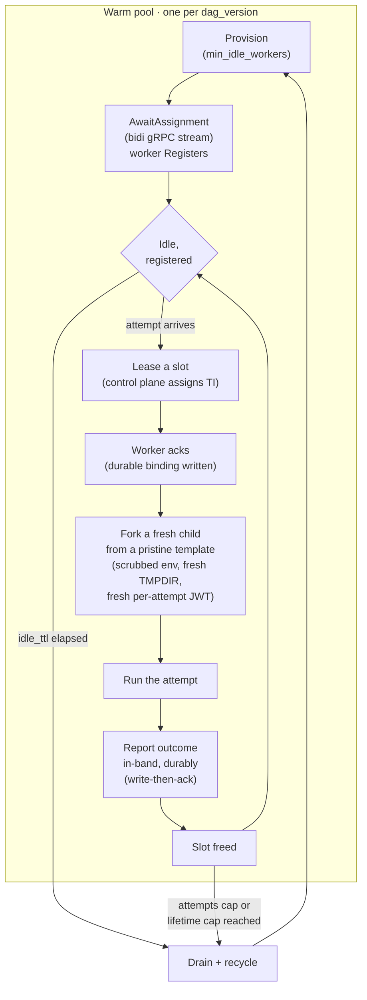

---
# --- AUTO redirect aliases (build_redirects.py) — do not edit by hand ---
aliases:
  - /warm-pools.html
# --- end AUTO redirect aliases ---
title: Warm worker pools
linkTitle: Warm pools
weight: 80
description: Cut task start latency with pre-warmed worker pods.
---

{}
Warm worker pools are a **Pro** feature, gated behind
`execution.warm_pools_enabled` (default **`false`**). With the flag off,
Dexaflow runs a **dedicated pod per task attempt** — the historical behavior
([ADR 0002](/project/adrs/0002-pod-per-task/)), byte-for-byte unchanged. Lite ignores
the flag entirely. Turning warm pools on has hard security prerequisites; read
[How to enable](#how-to-enable) before you flip it.
{}

By default every task attempt runs in its own fresh pod. That pod is correct and
maximally isolated, but each attempt re-pays the full cold start: image pull, pod
schedule, kubelet admit, container start, and the agent's `Register` handshake.
For a DAG whose attempts run for seconds, that overhead can dominate the wall
clock.

A **warm worker pool** amortizes cold start by keeping a small number of task pods
alive and reusing **one pod across many attempts of the same DAG version**
([ADR 0058](/project/adrs/0058-warm-worker-pools/)). The reuse is safe because a warm pod
never reuses a task *identity*: each attempt receives its own short-lived,
liveness-gated credential (the [security model](#security-model) below).

## What it amortizes — and what it does not

A warm pod amortizes the **infrastructure** cold start — image pull, pod schedule,
kubelet admit, container start, and the agent's `Register`/`TokenReview` handshake
(≈ 2–15 s, depending on image size and node state). That cost is paid once when the
pod is provisioned and then spread across every attempt the pod serves.

It does **not** amortize the **Python import graph**. Each attempt runs in a fresh,
hard-scrubbed child process (see [isolation](#isolation-between-attempts)), so it
re-imports the DAG's libraries every time: pandas + numpy ≈ 1 s, dbt ≈ 1–4 s,
torch/tf ≈ 3–10 s. For an import-heavy DAG you therefore retain only ~40–65 % of
the theoretical amortization, not all of it. Isolation is chosen over raw speed
here; a future forkserver optimization (a parent that pre-imports the heavy
libraries and CoW-forks scrubbed children) is the escape hatch when the numbers
justify it, and it will not weaken the isolation invariant.

## When to use it — and when not to

Warm pools help most when the **infrastructure** cold start is large relative to
the work, and the same DAG version runs many attempts.

**Good fits**

- Short tasks (seconds) that would otherwise spend most of their wall clock in pod
  startup.
- Stable DAG versions that run **many attempts** between deploys — the win is a
  function of *attempts-per-version*, not attempts-per-DAG (see the pool key
  below).
- Large images where the pull/schedule cost is the bottleneck.

**Poor fits — or outright excluded**

- **Import-heavy DAGs** (large ML/data-science dependency closures) keep only part
  of the amortization, because each attempt re-pays the import cost.
- **Import-light, infrequent DAGs** — if a version runs only a handful of attempts,
  the pool barely warms before it drains, and you approach pod-per-task economics
  anyway.
- **CI/CD-heavy teams that push often.** The pool is keyed by DAG *version*
  ([D1](#pool-key-dag-version)), so a version bump starts a fresh pool. It
  starts at the deploy, not at the next run, but each new pool still pulls the
  new image and each old one is torn down: teams that deploy on every commit
  keep thin, short-lived pools and see little benefit.
- **DAGs that use the [staging volume](/operate/staging-volume/).** A pod's volumes are
  fixed at creation, so a warm pod (which spans runs) cannot hot-mount a future
  run's per-run staging PVC. Any DAG that declares `staging.enabled: true`
  **automatically falls back to a dedicated pod per task** — this is detected
  statically, no configuration needed.
- **Tasks that set their own placement or pod metadata.** A warm pod is created
  before any task is known, so it carries none of a task's `execution` block. A
  task that sets `node_selector`, `tolerations`, `affinity`,
  `topology_spread_constraints`, `priority_class_name`, `runtime_class_name`
  (gVisor, for example), `termination_grace_period_seconds`, `resource_claims`,
  `labels` or `annotations` **always runs on a dedicated pod**, which applies
  them. Before this check such a task could land on a warm pod and run without
  its node, sandbox, device or NetworkPolicy labels. A task that pins a
  `service_account` other than the warm workers' falls back the same way. A
  value set under `defaults` (a project-wide `node_selector`, for example) is
  copied onto every task, so it sends every task of the project to a dedicated
  pod. A version none of whose tasks is warm-eligible, for this or any reason
  below, gets no warm pool at all, so no warm pod sits idle next to its
  dedicated pods.
- **Non-idempotent tasks.** Warm-pool recovery re-runs an attempt after a worker is
  lost, and the safety argument for "a re-run is harmless" holds only for
  idempotent tasks. This is the same assumption Airflow itself makes; it is a
  precondition, not a guarantee warm pools provide.

### Where a deploy's tasks run

Warm placement never fails a task: one the warm pod cannot run as its own pod
would takes a dedicated pod instead. So that this is not silent, the register
answer, its dry run and `dexaflow deploy` say, per task, where its attempts
run and why, and what the version's pool does. The server decides it with the
same function dispatch places an attempt with, from the same settings, so a
task the report calls dedicated is never placed on a warm worker. It goes
further than that function: where no warm worker of the version can exist (no
idle worker is kept for it, or the server runs none), it reports the task
dedicated with that reason, since dispatch's warm offer would always miss. A
task reported warm-eligible runs on a warm worker when one is free.

```console
$ dexaflow deploy
…
Deployed etl -> https://pro.example.com
  image ghcr.io/acme/etl@sha256:4e1f…
  registered version v1.4.0-3f9c2a1b7d4e
  execution  2 tasks warm-eligible; load on a dedicated pod: node_selector set
  warm pool  2 idle warm workers (up to 5) warming now, kept while this version is the DAG's current version; previous pool draining: its idle workers are removed now and busy ones finish their attempt first
```

With warm pools off, the default, the summary is one line:

```console
  execution  every task runs on a dedicated pod: warm pools off
```

The reasons a task takes a dedicated pod, in the order they are checked:

| Reason | Why |
|---|---|
| `warm pools off` | `execution.warm_pools_enabled` is off. |
| `staging enabled` | The DAG uses the staging volume, which a warm pod cannot mount. |
| `source mode` | The version runs in [source mode](/operate/source-mode/) and `execution.source_mode.warm_pools` is off; a warm pod cannot carry its `dag.py`. With it on, the `dag.py` goes with each assignment ([source mode on warm workers](/operate/source-mode/#warm-workers)). |
| `service_account set` | The task pins a `service_account` other than the warm workers'. |
| `<field> set` | The task sets a placement field or pod metadata (`node_selector`, `tolerations`, `affinity`, `topology_spread_constraints`, `priority_class_name`, `runtime_class_name`, `termination_grace_period_seconds`, `resource_claims`, `labels`, `annotations`). |
| `size N is above the warm pod's 1 unit`, `resources set (a warm pod is 1 unit)` | With `executor.unit` a warm pod is one unit, so only a task of size 1 without its own `resources` fits. |
| `resources above the warm pod's default limits` | Without a unit, the task would get a larger limit on a dedicated pod than the default limits a warm pod has. |
| `no idle warm workers kept for this DAG` | The version's idle target is 0 (`minIdleWorkers: 0` and the DAG declares no `min_idle_workers`), so the reconciler creates no warm worker for it. |
| `the subprocess executor runs no warm workers`, `pod dispatch is disabled on this server` | Only the Kubernetes executor with pod dispatch on starts the warm pool reconciler. |

A warm-eligible task still takes a dedicated pod when no warm worker of its
version is free. The `warm pool` line says what the pool does: `off`, `none`
(this version gets no warm worker: staging, source mode without its warm pools, no warm-eligible
task, an idle target of 0, or a server that runs no warm workers) or `on`
(the idle workers kept and the cap). `warming now` is said only for a DAG that declares
`min_idle_workers`, the DAGs that are prewarmed. For a paused one the line
says the workers start when the DAG is unpaused. For a DAG that declares
none, whose idle workers come from `minIdleWorkers`, it says they start with
the version's first run and stay while it has an active run. A
new version of an existing DAG, on a server that keeps warm workers, adds
`previous pool draining` (`previous_pool: "draining"` in the JSON): see
[Prewarm and drain on deploy](#prewarm-and-drain-on-deploy).

### Pool key: DAG version

A pool is keyed by **`dag_version_id`**, never by `dag_id`. A warm pod caches a
specific image + dependency closure ([ADR 0003](/project/adrs/0003-dag-as-image/)); keying
by `dag_id` would let a pod built on the *old* image serve attempts of *new* code —
silent stale-code execution. When you push a new version, a fresh pool starts
for the new version and the old version's pool drains; attempts already in
flight on the old version finish on the old pod (see
[Prewarm and drain on deploy](#prewarm-and-drain-on-deploy)).

### Prewarm and drain on deploy

The reconciler keeps a pool for the **current version** of every DAG that is
not paused and declares `min_idle_workers`, whether or not it has a run, and
for the version of an active run only while that version is still current
([ADR 0082](/project/adrs/0082-warm-pool-follows-the-current-version/)). A
version becomes current when it is registered (`dexaflow deploy`,
`dexaflow promote`) or made current again (`dexaflow rollback`,
`PUT /api/v2/dags/{dag_id}/currentVersion`). At the next reconcile (30 seconds
at most by default):

- **The new version's pool starts.** For a DAG that declares
  `min_idle_workers`, the reconciler creates that many idle workers (clamped
  to `maxPoolSize`), so its first run finds them warm. Nothing is created
  for a paused DAG until it is unpaused. A DAG that declares none is not
  prewarmed: the operator's `minIdleWorkers` gives its version idle workers
  from its first run on, as before, so the floor alone never keeps a pool per
  DAG. The server logs `prewarming the warm pool of a DAG's current version`
  and counts
  `dexaflow_scheduler_decisions_total{decision_type="warm_pool_prewarm_started"}`.
- **The previous version's pool drains.** It keeps no idle buffer: its idle
  workers are deleted, and a worker serving an attempt finishes that attempt
  and is deleted once it is idle. The server logs `draining the warm pool`
  and counts `warm_pool_drain_started`; once no worker is left it logs `warm
  pool drained` and deletes the pool's anchor (`warm_pool_anchor_deleted`).
- **In-flight runs keep their version.** A run started on the previous
  version finishes on it ([ADR 0058](/project/adrs/0058-warm-worker-pools/)
  D1, D2: each attempt keeps its own version and identity). Its attempts
  that start after the switch find no idle warm worker of their version and
  take a dedicated pod, as any warm miss does.

Pausing a DAG drains its current version's pool once none of its runs is
running; unpausing starts the pool again. The two counters count what one
leader saw: after a leader change the new leader logs and counts each
prewarmed or draining pool it finds once more.

**Cost.** Each unpaused DAG that declares `min_idle_workers: N` keeps N idle
warm pods (at most `maxPoolSize`) even with no run, within the tenant's
`maxWarmPodsPerTenant`: prewarmed pools share what the
[per-tenant cap](#per-tenant-cap) leaves after the idle floors of the
tenant's versions with an active run, and the DAGs last by id get fewer
workers when they do not all fit (a pool whose share drops shrinks with
`workerIdleTtl`, not at once; a run's idle floor is created at once on top
of it, so until then the tenant can hold more than the cap, see
[Per-tenant cap](#per-tenant-cap)).

**Declaring it.** `min_idle_workers` is a top-level key of `dexaflow.yaml`
(an integer from 0 to 100; the server clamps it to `maxPoolSize`). The
compile copies it into `dag.json`, where the reconciler reads it:

```yaml title="dexaflow.yaml"
dag_id: orders
min_idle_workers: 2
```

A DAG with `staging.enabled` cannot be warm, so the compile refuses the key
on one. With warm pools off the key does nothing.

`min_idle_workers` is part of `dexaflow.yaml`, which the
[version label](/operate/deploy-prerequisites/#8-the-version-label-and-its-409)
hashes, so changing it makes a new version: a new image tag, and the previous
version's pool drains like on any deploy. A server older than 0.5.4 accepts
the key but applies it only while a run of the version is active; it does not
prewarm.

The practical consequence: the benefit tracks **attempts per version**. A DAG that
runs thousands of attempts on a stable version pools well; a DAG that ships a new
version hourly does not.

## How to enable

Turning warm pools on is a two-part decision: a **security prerequisite** that the
server enforces at boot, and the **pool knobs** themselves.

### 1. Satisfy the security prerequisite (enforced, fail-closed)

A warm pod reuses one *pod* across attempts, so the credential a task uses must be
**per-attempt**, not per-pod. That requires the exchange transport and liveness
enforcement from [ADR 0055](/project/adrs/0055-secret-scoping-and-token-liveness/). The
control plane **refuses to boot** with warm pools on unless both are set:

```
auth.agent_token_transport = exchange   # DEXAFLOW_AUTH_AGENT_TOKEN_TRANSPORT
auth.secret_liveness_mode  = enforce    # DEXAFLOW_AUTH_SECRET_LIVENESS_MODE
```

This coupling is deliberate and has **no safe degraded mode** — the degraded mode
*is* the vulnerability. Under the shipped `observe` liveness default, a superseded
attempt's token still resolves secrets; on a reused pod that would let one
attempt's credential outlive its attempt. See
[Agent credential transport](/operate/agent-credential-transport/) for the full envvar-vs-
exchange story and the two-token model, and
[Security model](#security-model) below for why per-attempt identity is what makes
reuse safe.

The exchange transport needs a cluster-scoped `tokenreviews` RBAC grant so the
control plane can validate the projected ServiceAccount token each pod presents.
The Helm chart renders that `ClusterRole` + binding **only** when the exchange
transport is selected — see
[Agent credential transport → RBAC](/operate/agent-credential-transport/#rbac--the-tokenreviews-grant).

### 2. Turn on the pool and tune it

The pool knobs live under the chart's `execution` values (which map to the
`DEXAFLOW_EXECUTION_*` server environment). Start with the default,
`minIdleWorkers: 0`:

```yaml
execution:
  warmPoolsEnabled: true      # DEXAFLOW_EXECUTION_WARM_POOLS_ENABLED
  minIdleWorkers: 0           # default: scale-to-zero, no standing cost
```

`minIdleWorkers: 0` is the real code default and the safe starting point: it
turns on the security prerequisites and the warm code path with **no idle pods
kept**, so there is **no standing cost**, preserving the zero-idle floor of
pod-per-task. The reconciler creates warm workers only to restore the idle
buffer, so with `0`, unless the DAG declares `min_idle_workers`, it creates
none, and every attempt takes the dedicated pod path on a warm miss: a deploy says so in its `warm pool` line (see
[Where a deploy's tasks run](#where-a-deploys-tasks-run)). Everything else
carries a sane default (see the [config reference](#configuration-reference)).

**To see it work — or to measure the latency win — raise it to `1`:**

```yaml
execution:
  warmPoolsEnabled: true
  minIdleWorkers: 1           # keep 1 warm pod ready per DAG version — has a cost
```

`minIdleWorkers: 1` keeps a pod ready the instant an attempt arrives (no
first-attempt provisioning wait), which is what you want when demonstrating or
benchmarking the feature. It is not free: it keeps **one pod warm per DAG
version** an active run uses (multiplied across every active version), and it
never prewarms: a version's pool starts with its first run (see
[Prewarm and drain on deploy](#prewarm-and-drain-on-deploy)). Like
turning warm pools on at all, it also rides on the cluster-wide pod-auth change from
the `exchange` transport + `enforce` liveness prerequisite above, which alters
how **every** task pod authenticates, warm or dedicated. Measure the win against
that cost before raising it in production.

{}
Unit and integration tests prove the *logic* with fakes; they cannot prove the
*timing and topology*. Before you flip `warmPoolsEnabled` on a shared cluster,
validate against a real cluster — see [Enable readiness](#enable-readiness).
{}

## Lifecycle



1. **Provision.** The reconciler keeps `EffectiveMinIdle` warm pods ready for the
   current version of each DAG that is not paused and declares
   `min_idle_workers`, from the deploy on
   ([prewarm](#prewarm-and-drain-on-deploy)), and for a version an active run
   still uses while it is current (the DAG's declared warmth, clamped by the
   operator's floor and per-version cap). With the default `minIdleWorkers: 0`, unless the DAG declares
   `min_idle_workers`, that target is zero and no warm pod is created. By default the reconciler checks every 30 seconds. With
   `warmPoolEventRefill: true` it also reacts at once when a warm pod is deleted,
   fails, or is claimed by an attempt, reads the fleet from a pod informer instead
   of listing pods each time, and creates replacements in parallel; before it
   deletes any GC anchor (a drained version's, or an orphan's) it still confirms
   with a live list. Event-driven reconciles run at most once a second. A create
   counts against its version's target and its tenant's `maxWarmPodsPerTenant`
   until the informer shows that exact pod, and the reconciler re-reads the
   fleet live when a create was never observed and at least every 5 minutes.
   After a live read it keeps reading live until the informer holds (or saw
   deleted) every pod that read returned, so a lagging or stale cache, a hung
   watch included, cannot overshoot either bound. A check deletes only idle
   workers: it issues every delete before any create, and checks again that a
   worker is still idle right before deleting it, so a worker that takes an
   attempt while a long check is running is kept.
2. **AwaitAssignment.** Each warm pod opens a long-lived bidirectional gRPC stream
   (`AwaitAssignment`) and **registers** under its authenticated identity, naming
   its `dag_version` and pod name. Work assignments flow down the stream; acks and
   slot-free signals flow up. The stream is gated to the scheduler **leader**.
3. **Lease + ack.** When an attempt for that version is ready, the control plane
   leases a free slot on a registered worker and sends the assignment. The worker
   **acks**, and a durable warm-attempt binding is written so a leader failover can
   recover which worker holds which task instance. A failed binding write is
   retried with backoff for about 12 seconds. An ack that arrives after the
   30 second lease still binds the attempt for up to 5 minutes after the lease
   expired, and the worker is not offered other work during that time, since it
   runs the attempt as soon as it acks.
4. **Fork from a pristine template.** The worker runs each attempt in a **fresh
   child process forked from a pristine template — never from a sibling attempt**
   ([isolation](#isolation-between-attempts)).
5. **Durable in-band outcome.** The worker records the attempt's terminal outcome
   (`Succeeded` / `Failed` / `Unexecutable` / `Rescheduled`) **in-band, per attempt,
   durably** — written **before** it acks the attempt on the control channel
   (write-then-ack). A crash between write and ack replays at-least-once, and an
   idempotent, `(run, task, try_number)`-guarded settle makes the replay harmless.
   The warm path **never reads pod phase** to decide an outcome (there is no
   per-attempt pod) — a tested invariant.
6. **Slot free → reuse.** The slot is freed and the worker waits for the next
   assignment on the same stream.
7. **Drain + recycle.** On any recycle trigger the worker **drains** — see
   [Drain and recycle](#drain-and-recycle).

### Isolation between attempts

Each attempt runs in a **fresh child process, hard-scrubbed, forked from a pristine
template — never from a sibling attempt.** Before each attempt the worker:

- **rebuilds the environment from scratch** — only that attempt's `AIRFLOW_VAR_*` /
  `AIRFLOW_CONN_*` + `DEXAFLOW_*`, with no residue from a prior attempt, and the
  agent-only variable strip re-runs per attempt;
- **resets the agent scratch and redirects `TMPDIR` into it** — the child's
  `TMPDIR` points at a per-attempt subdirectory of the agent scratch that is wiped
  before every attempt, so a token cache, a dbt profile, or `~/.aws`-style
  credentials written to `$TMPDIR` do not survive into the next attempt;
- **drops the prior attempt's task JWT** before minting the next one;
- **kills every process the previous attempt left behind**, including one that
  detached with `setsid`, and checks that none is left before it accepts the next
  assignment. A survivor it cannot kill ends the worker instead, and the pool
  replaces the pod.

The agent itself is **not dumpable**, so an attempt cannot read the worker's
credentials out of `/proc/<agent>/environ` or `/proc/<agent>/mem` even though it
runs as the same user. A side effect operators should know: a non-dumpable
process writes no core dump, so a warm agent that crashes leaves its log and exit
code but no core file. Task processes are not affected, since `execve` makes each
attempt dumpable again.

The invariant, tested rather than best-effort: *each attempt's child forks from a
pristine template, never from a sibling attempt; no attempt observes another
attempt's secrets, environment, or the writable filesystem state under the agent's
control — the agent scratch and the `TMPDIR` redirected into it.* A long-lived
shared interpreter (state persisting across attempts) is explicitly rejected.
Phrasing the invariant as "fork from pristine" keeps a future forkserver
optimization open without reopening the guarantee — library code carries no tenant
data, and secrets re-enter per child.

{}
The per-attempt scrub covers what the agent owns: the scratch space and the
`TMPDIR` redirected into it. It does **not** reset paths outside the agent's
control on a writable root filesystem — most notably **`$HOME`** (which keeps its
image-baked `~/.config` and anything a task writes there, e.g. `~/.aws/credentials`
or a `~/.dbt/profiles.yml`), the container image layers, and mounted volumes. These
persist for the whole worker's lifetime and are shared by every attempt the worker
serves (same tenant + DAG version). Turn on
**`execution.warm_read_only_root_filesystem`** to close this: the warm container's
root filesystem becomes read only, each attempt gets its own `$HOME` and XDG dirs
(`XDG_CONFIG_HOME`, `XDG_CACHE_HOME`, `XDG_DATA_HOME`, `XDG_STATE_HOME`) inside the
scratch the worker wipes, and the other writable paths a read-only root leaves,
the `/tmp` emptyDir and the pod's `/dev/shm` tmpfs, are emptied before each
attempt and again as soon as it ends, so a generated dbt profile does not stay on
an idle worker. A task that writes anywhere else (its working directory, an image
path) fails with it on, and a task that reads config baked into the image's home
dir must point at it explicitly, for example with `DBT_PROFILES_DIR`. The setting
takes effect on warm pods created after it is turned on: running warm pods keep
their spec until they recycle (`workerIdleTtl`, `maxWorkerLifetime`).

The sweep is done by the agent inside the task image, so it **needs a task image
built on runtime v0.5.1 or later**. Each warm worker states in its registration
whether it does the sweep. With the setting on, a worker that does not confirm
it (an image built before the confirmation existed, or a pod created before the
setting was turned on) logs a `warm worker does not confirm it empties /tmp and
/dev/shm` warning with `reason=attempt_home_sweep_unconfirmed` and counts in
`dexaflow_scheduler_decisions_total{decision_type="warm_worker_sweep_unconfirmed"}`,
but still serves attempts, because images built on runtimes from v0.5.1 sweep
without being able to say so. Once your task images are rebuilt, set
**`execution.warm_require_attempt_home_sweep`** (Helm:
`execution.warmRequireAttemptHomeSweep`) to refuse such a worker instead: that
DAG version's attempts run on dedicated pods, and each refusal counts as
`decision_type="warm_worker_refused_no_sweep"`. A refused worker exits and the
pool replaces it, so an image that does not confirm the sweep keeps cycling warm
pods until it is rebuilt.
{}

Because a fresh scrubbed child and a fresh per-attempt token are mandatory, there is
**no per-pod secret cache** to leak across attempts: each attempt does exactly one
scoped secret read, the same as pod-per-task. Reuse does not amortize secret reads —
by design (correctness over caching).

## Security model

Warm pools are only *safe* to run because reuse never reuses a task **identity**.
Two distinct credentials keep the pod-scoped and attempt-scoped concerns apart:

| Credential | Held by | Lifetime | Authorizes |
|---|---|---|---|
| **Bootstrap token** (worker-scoped) | the warm pod | pod lifetime (short TTL, heartbeat-renewed) | **only** `Register` + `AwaitAssignment` — authenticates the pod to the control plane; **fetches no secrets** |
| **Task-scoped token** (per-attempt) | one attempt | the attempt (short TTL, liveness-gated) | that attempt's declared secrets, XCom, and state report — dies with the attempt |

The two-token split is the whole security argument, and it is the same exchange
mechanism described on the
[Agent credential transport](/operate/agent-credential-transport/#the-two-token-model)
page (with the [two-token diagram](/operate/agent-credential-transport/#the-two-token-model)).
Why it makes reuse safe:

- **Per-attempt identity is what dies with the attempt.** The task-scoped token is
  minted per attempt, short-lived, and gated on task-instance **liveness** — a
  finished, failed, or superseded attempt's token stops resolving secrets the
  instant its task instance is no longer live, regardless of the clock. On a reused
  pod that is exactly the property that stops a superseded attempt's credential from
  leaking into the next one. This blast-radius argument holds **only** under
  `secret_liveness_mode=enforce`, which is why enforcement is a boot prerequisite.
- **The bootstrap token cannot reach the vault.** It authenticates the pod and
  nothing more; it fetches no tenant secrets. Even a fully compromised idle worker
  loses its channel within one TTL of the operator cutting it, because the bootstrap
  token is short-TTL and heartbeat-renewed.
- **Recycle on suspicion.** Any attempt that trips a security signal — an auth
  failure, or a liveness denial under enforce — **recycles the whole worker** rather
  than serving the next attempt on it. Cheap, bounded insurance.
- **One live registration per worker.** A warm worker's identity can hold only
  one assignment stream at a time. While a worker's stream is connected and
  heartbeating (the worker re-sends its registration on the stream every 15
  seconds), a second registration under the same identity is refused with
  `AlreadyExists`, so nothing holding a copy of the worker's credential can open
  a parallel stream and receive assignments, and the attempt tokens they carry,
  meant for the real worker. A worker that reconnects after its previous stream
  ended registers normally. A stream that stays open but sends no heartbeat for
  60 seconds is treated as stale: a new registration replaces it and the stale
  stream is closed with `Aborted`.

### Keeping the bootstrap credential from task code

Under the exchange transport the warm pod mounts its projected bootstrap token
read only at `/var/run/leoflow/token`, in the warm container only, and mounts no
Kubernetes API token. The agent reads it to authenticate and again when it
reconnects (the kubelet rotates it). The task process the agent starts does not
inherit the token path or any agent variable (they are stripped from its
environment), and the agent is not dumpable, so the task cannot read the
agent's in-memory credentials through `/proc`.

The agent and the task run in the same container as the same user, so file
permissions cannot hide the mounted token from a task that knows where to look.
What bounds that case is the token's scope: it authorizes only `Register` and
`AwaitAssignment`, never secrets, and the one-live-registration rule above stops
a task from using it to open a second stream while its own worker is serving.
Running the task as a separate user would need privileges the restricted Pod
Security profile does not grant, so it is not done today.

Without the exchange transport a bearer credential would sit in plaintext on the pod
spec and could not carry a per-attempt identity at all — which is why
`agent_token_transport=exchange` is the other half of the boot prerequisite. The
full contrast between the plaintext-envvar transport and the exchange transport is
on the [Agent credential transport](/operate/agent-credential-transport/) page.

## Drain and recycle

A warm worker is recycled — never a task killed mid-flight — on any of:

- **Attempts cap** (`maxAttemptsPerWorker`, default 50): the worker has served its
  budget of attempts.
- **Lifetime cap** (`maxWorkerLifetime`, default 1h): the worker has been alive past
  its wall-clock ceiling.
- **Idle-TTL** (`workerIdleTtl`, default 5m): the worker has sat idle with no work.
- **Suspicion**: an attempt tripped a security signal (see above).

The caps exist to bound the exposure that a persistent worker would otherwise
accumulate — a stale image, or a leaked in-pod credential — while staying high
enough to keep real amortization. They are **operator-set, never DAG-author-set**,
the same stance as the secret-scoping policy: whether a pod may be reused, and for
how long, is a security decision the operator owns.

**Recycle is a graceful drain, never a mid-attempt kill.** The `should_terminate`
signal to a warm worker means *"finish the current attempt, ack it, then exit and
let the pool respawn"* — it **must not** hard-kill an in-flight attempt (a tested
invariant). A separate `terminate_now` signal is the hard-kill reserved for a
compromise. Because recycle drains rather than force-kills, a worker whose lifetime
cap is shorter than the credential ceiling is harmless: the worker finishes its
in-flight attempt on its own renewed credential before recycling. (There is
therefore **no** `max_worker_lifetime ≥ max_attempt_credential_lifetime` boot guard —
the real "credential lapses mid-attempt" bound is per-attempt, enforced on the
execution path via the attempt watchdog, not by an ordering rule between these two
knobs. The watchdog is derived from `max_attempt_credential_lifetime`, so a
non-positive ceiling disables it too — boot logs a `WARN`.)

### Losing a worker

Losing a **worker** is one infrastructure event that fans out to **all** the
in-flight task instances on that pod. Each is re-placed on the infrastructure-retry
budget **without** charging the user's `try_number`, exactly as a lost dedicated pod
is today. The pod-lost liveness check runs **per pod**, not per task instance, which
collapses the API-server load from "proportional to running tasks" to "proportional
to pools" — the shared-cluster win. On a leader failover the reconciler reconciles
its in-memory slot index against a live pod list once before trusting it, so a stale
index cannot drive incorrect reaps. A double-run is bounded to wasted compute by the
`try_number`-guarded idempotent settle — and is harmless only for idempotent tasks
(stated as a precondition above).

## Per-tenant cap

On a shared, multi-team cluster one tenant must not pin unlimited idle pods and
starve its neighbors. `maxWarmPodsPerTenant` (default 100) caps the **total** warm
pods a single tenant may hold across **all** its DAG versions — where
`maxPoolSize` bounds a single version's pool, this bounds the tenant's aggregate
warm footprint.

It is a **reserve-then-ration budget, never a starvation lever**:

- A tenant's **promised idle floors** — the sum of its versions' effective
  `minIdleWorkers` — are always honored, even when that sum exceeds the cap. The
  reconciler raises the effective budget to the floor sum and **meters the
  misconfiguration** (so you can see a tenant whose floors overcommit its cap)
  rather than silently starving a promised floor.
- A **prewarmed** version (a DAG's current version with no active run, see
  [Prewarm and drain on deploy](#prewarm-and-drain-on-deploy)) does not raise the
  budget. The tenant's prewarm floors share what the cap leaves after the floors
  of its versions with an active run, served by DAG id: each takes its
  `min_idle_workers` or what is left. The order is stable, so the same DAGs keep
  their pools on every reconcile. When a version's share drops below the idle
  workers it has (a DAG whose id sorts first is deployed, or a run of another
  version needs its floor), no worker is deleted: the version stops creating,
  and its idle workers retire with `workerIdleTtl` and are not replaced. A
  run's floor does not wait for them: it is created at once, so the tenant
  exceeds the cap by those idle workers for at most one `workerIdleTtl` after
  each share drop (a worker's idle TTL runs from when it connected or
  finished its last attempt). The bound is per drop: a run version with no
  prewarm of its own drains when its run ends, the prewarmed pool refills,
  and the next run exceeds the cap again, each time for at most the shorter
  of the run and one `workerIdleTtl`. Each reconcile that creates such
  workers logs `creating a run's idle floor past the per-tenant cap` and
  meters `warm_pool_run_floor_over_retiring_prewarm`. A DAG whose id sorts
  first gets the room once they have retired. When the floors do not all
  fit, the server logs the versions that got less (at most 10, and how many
  more) and meters `warm_pool_prewarm_rationed`, once each time that set
  changes ([ADR 0082](/project/adrs/0082-warm-pool-follows-the-current-version/)
  D7).
  When busy workers already hold the tenant's budget, the floors of versions
  with an active run take the room that is left before any prewarmed version,
  whatever their version ids, and what they miss is created on a later
  reconcile.
  A rationed version gets its full floor again once one of its runs is active,
  and a version rationed to no worker logs its prewarm start when it later gets
  a share.
- The cap is enforced **only by refusing to create new** warm pods once a tenant is
  at its budget — **never** by deleting a busy worker.

## Enable readiness

Turning warm pools on for real traffic is a **reliability decision, stated in rates,
not median latency**. The warm reaper, reclaim, and placement decisions already
surface on the metrics endpoint (the scheduler-decisions counter, labelled by
decision, plus the warm-pool reconciler counters), so the safety bar is scrapeable
today without new instrumentation. Cold-start decomposition and warm-hit-vs-dedicated
latency are read from pod events/timestamps on the cluster during the run.

Drive a warm workload on a **real cluster** (k3d/CI or staging) and gate the flip on:

**Go / no-go bar (rates, not means)**

- **Zero double-runs** under induced worker death — a hard requirement.
- Cold-start-failure and worker-register-failure rates below your agreed threshold.
- The dispatch-lost-deferred count non-zero but bounded (the double-run defer is
  working without over-deferring); lease-expiry reclaim rate low (else the lease
  window is mistuned).
- Warm-hit rate high in steady state — the pool is actually being used, not churning
  back to dedicated pods.

**Real-cluster scenarios only a cluster can prove**

Each of these is unprovable in fakes; validate every one before you enable:

1. **HA topology** — workers reach the leader; a follower refuses and the agent
   reconnects to the leader.
2. **Worker dies mid-attempt** (SIGKILL / OOM / node loss) — fan-out to the
   infrastructure budget (not `try_number`), the attempt re-runs, **double-run == 0**.
3. **Leader failover with in-flight warm attempts** — busy workers survive; the new
   leader recovers from the durable binding + reconciler.
4. **Slow-start deferral** — an attempt queued past the slow-start threshold defers
   correctly.
5. **Node drain / eviction** — busy workers finish; the reconciler replaces them.
6. **Image-pull storm** — a new version with `minIdleWorkers = N` pulls all at once
   with no thundering herd; dispatch defers on slow pulls.
7. **Scale-to-zero and back.**
8. **Per-tenant cap under contention** — a tenant at its cap starves neither its
   neighbors nor its own promised floor.
9. **Reclaim re-placement vs reconciler recovery** — no double dispatch.

Enable is gated on all of the above passing **and** the two security flips
(`agent_token_transport=exchange`, `secret_liveness_mode=enforce`) being in place.

## Running on GKE Sandbox (gVisor)

Warm pools can run under GKE Sandbox (`runtimeClassName: gvisor`), with two things to know: how warm workers get the gVisor runtime class at all, and what GKE Sandbox stamps on a pod if you also run your own admission policy on the task namespace.

**Dexaflow does not put warm workers in the sandbox.** A dedicated task pod takes `runtimeClassName`, node selector, tolerations and affinity from its DAG's `execution` settings. A warm worker is created before any task is known, from the operator's settings only, and gets none of them. The dispatcher also does not keep a task that pins `runtime_class_name` off warm workers: a size-1 task of a DAG that asks for `gvisor` can run on a warm worker that is a plain `runc` pod on an ordinary node, with no error or warning. Until that is fixed, run warm pools on GKE Sandbox only with a mutating admission policy on the task namespace that sets, on every pod:

- `spec.runtimeClassName: gvisor`;
- the toleration for the sandbox node taint, `sandbox.gke.io/runtime=gvisor:NoSchedule`, unless the RuntimeClass's own `scheduling` already adds it.

Then every task pod, warm or dedicated, runs in the sandbox whatever its DAG declares. Without such a policy, do not rely on `runtime_class_name` for isolation while warm pools are on.

**GKE Sandbox edits gVisor pods at admission, before any ValidatingAdmissionPolicy of yours sees them:**

- `dev.gvisor.internal.seccomp.<container>: RuntimeDefault` on each container that asks for the `RuntimeDefault` seccomp profile. A user-set value, such as `Unconfined`, is rewritten to `RuntimeDefault`. Dexaflow asks for `RuntimeDefault` on every task container, so every gVisor task pod, warm or dedicated, gets `dev.gvisor.internal.seccomp.task`.
- For every `emptyDir` volume, three gVisor mount hints:
  - `dev.gvisor.spec.mount.<volume>.type: bind`
  - `dev.gvisor.spec.mount.<volume>.share: container` when one container mounts the volume (a warm worker's `leoflow-tmp`), or `pod` when several do
  - `dev.gvisor.spec.mount.<volume>.options: rw,rprivate`

**It also refuses some requests itself,** with fixed messages:

- user-set annotations starting with `dev.gvisor.internal.` or `dev.gvisor.spec.mount.` ("user annotations starting with … are not allowed");
- `hostNetwork`, `hostPID`, `hostIPC`, `hostPath`, `privileged: true` and `allowPrivilegeEscalation: true`.

Which dexaflow pods have an `emptyDir`: the `leoflow-tmp` volume is added to dedicated task pods when `taskPodSecurity.readOnlyRootFilesystem` is on, and to warm workers when either that or `execution.warmReadOnlyRootFilesystem` is on. With both off (the chart defaults), no dexaflow pod gets mount hints, but every gVisor pod still gets the seccomp key.

**If your policy refuses `dev.gvisor.*` annotations** (a sound rule, since runsc reads them as flags), allow exactly the keys and values above, and the mount hints only for the pod's own `emptyDir` volumes. Otherwise every gVisor task pod is refused, warm and dedicated alike, because each one carries at least the seccomp key. For warm workers the symptom is ERROR lines `creating warm worker` in the server log carrying your policy's denial, `dexaflow_scheduler_decisions_total{decision_type="warm_pool_create_error"}` rising, and no worker ever registering; dedicated task pods fail to dispatch with the same denial. Check what your cluster stamps with a server-side dry run of a warm pod in a namespace your policy does not bind, for example `kubectl create --dry-run=server -o json -f warm-pod.json`, and read `.metadata.annotations`.

### Sizing against a pod deadline

If the task namespace caps `activeDeadlineSeconds` on every pod (a mutating policy that enforces a task time limit, for example), the cap applies to warm workers too, so a worker's whole life must fit inside it. The worker checks its own lifetime only after an attempt ends, so the worst case is:

```text
maxWorkerLifetime + workerIdleTtl + longest attempt + pod start  <=  activeDeadlineSeconds
```

The longest attempt is bounded by `auth.max_attempt_credential_lifetime`. With a 2040 s deadline and 30 minute attempts, for instance, `maxWorkerLifetime: 90s` and `workerIdleTtl: 90s` leave 60 s for the pod to start. If the sum exceeds the deadline, the kubelet can kill a warm pod in the middle of an attempt, and the attempt is then recovered as a lost worker. "Pod start" covers everything before the worker first registers: image pull, the token exchange, and any reconnect backoff while it looks for the scheduler leader. The worker's lifetime clock also restarts when it reconnects after a leader change, so leave extra margin on a control plane that fails over often.

Short values have a cost: an idle worker exits after `workerIdleTtl` and is replaced on the next reconcile, so attempts of a DAG version that arrive further apart than that land on dedicated pods. Size `workerIdleTtl` against how often each DAG version runs before you expect a high warm-hit rate.

### Checking a real cluster by hand

Fakes cannot show admission, the token exchange or placement on a real cluster, so run this check once on each cluster where you enable warm pools, and again after a cluster, GKE or policy upgrade. [`test/gcp/`](https://github.com/dexadata/dexaflow/tree/main/test/gcp) provisions a throwaway GKE cluster for this (`provision.sh`, then `teardown.sh`), and `warm-pool-ab.sh` measures warm against dedicated latency on it. Those scripts do not set up GKE Sandbox or any admission policy: for the sandbox checks, add a sandbox node pool and your own policies to that cluster first.

1. **Workers are admitted and start.** Give a DAG `min_idle_workers: 1` (or set `minIdleWorkers`) and wait one reconcile. `kubectl -n <task namespace> get pods -l leoflow.io/warm-worker=true -o wide` lists a Running `leoflow-warm-<dag_version>-…` pod on the node pool you expect. If none appears, look for `creating warm worker` ERROR lines in the server log: the apiserver's refusal is in them.
2. **Workers run in the sandbox.** On GKE Sandbox, `kubectl -n <task namespace> get pods -l leoflow.io/warm-worker=true -o custom-columns=NAME:.metadata.name,RUNTIME:.spec.runtimeClassName,NODE:.spec.nodeName` shows `gvisor` for every warm worker, on a sandbox node. An empty runtime column means your mutating policy did not apply and the worker runs on `runc`: stop here and fix the policy before turning warm pools on for sandboxed DAGs.
3. **Workers register with a worker-scoped credential.** The server logs `exchanged projected token for a WORKER-scoped agent JWT` and then `warm worker registered` for the pod.
4. **Attempts run on the warm worker.** Trigger a run whose task prints its container's UTS hostname, which Kubernetes sets to the pod name: `cat /proc/sys/kernel/hostname`. The task log must show a `leoflow-warm-<that dag_version>-…` name, not a dedicated task pod's. A worker may recycle between your first look and the attempt, so match the DAG version, not one pod name.
5. **Each worker serves its own tenant.** Its `leoflow.io/dag-version-id` label is a version the tenant's own session lists, and its `leoflow.io/tenant-id` label is that tenant's.
6. **Nothing is left after the idle TTL.** Once `workerIdleTtl` plus a reconcile has passed with no runs: no warm pod stays in `Succeeded` or `Failed`, and every `leoflow-pool-<dag_version>` anchor ConfigMap (`-l leoflow.io/warm-anchor=true`) belongs to a version that still has a live warm pod or is the current version of an unpaused DAG that declares `min_idle_workers`. Such a version keeps its idle workers by design ([prewarm](#prewarm-and-drain-on-deploy)): pause the DAG to check that its pool is torn down. Until [#1501](https://github.com/dexadata/dexaflow/pull/1501) (issue #1500) is released, this step can fail for a version whose warm pods were never created, for example because admission refused every create: its anchor ConfigMap is never deleted. Delete such an anchor by hand once the version has no warm pod and no active run.

## Configuration reference

Pool knobs live under `execution` in the Helm chart values and map to the
`DEXAFLOW_EXECUTION_*` server environment. All are **operator-scoped** (never
DAG-author-settable). With `warmPoolsEnabled: false` (the default) **none** of the
others is read — the deployment is byte-for-byte pod-per-task.

| Chart value (`execution.`) | Env (`DEXAFLOW_EXECUTION_`) | Type / unit | Default | Meaning |
|---|---|---|---|---|
| `warmPoolsEnabled` | `WARM_POOLS_ENABLED` | bool | `false` | Master switch for N:1 pod reuse. Off ⇒ dedicated pod-per-task. Requires the exchange + enforce security flips at boot. |
| `minIdleWorkers` | `MIN_IDLE_WORKERS` | int (pods) | `0` | Warm pods kept ready **per DAG version**. `0` = scale-to-zero. A DAG author may request warmth per DAG; this is the operator floor when the DAG declares none, and the value is clamped to `maxPoolSize`. |
| `maxPoolSize` | `MAX_POOL_SIZE` | int (pods) | `8` | Cap on total warm workers a **single DAG version** may hold. Must be ≥ 1 when warm pools are on. |
| `maxAttemptsPerWorker` | `MAX_ATTEMPTS_PER_WORKER` | int (attempts) | `50` | Attempts a worker serves before it drains + recycles. Must be ≥ 1. Bounds stale-image / leaked-credential exposure. |
| `maxWorkerLifetime` | `MAX_WORKER_LIFETIME` | duration | `1h` | Wall-clock ceiling on a worker before it drains + recycles, independent of attempt count. Must be > 0. |
| `workerIdleTtl` | `WORKER_IDLE_TTL` | duration | `5m` | How long an idle worker is kept before recycle. Must be > 0. |
| `maxWarmPodsPerTenant` | `MAX_WARM_PODS_PER_TENANT` | int (pods) | `100` | Cap on total warm pods a **single tenant** may hold across all its DAG versions (M4). Reserve-then-ration; the idle floors of versions with an active run are always honored, and prewarmed versions share what is left. Must be ≥ 1. |
| `warmReadOnlyRootFilesystem` | `WARM_READ_ONLY_ROOT_FILESYSTEM` | bool | `false` | Read-only warm root, a per-attempt `$HOME` and XDG dirs, and `/tmp` and `/dev/shm` emptied around each attempt (see [isolation](#isolation-between-attempts)). Applies to warm pods created after it is turned on. Dedicated task pods are not affected. |
| `warmPoolEventRefill` | `WARM_POOL_EVENT_REFILL` | bool | `false` | Event-driven refill from a warm-pod informer, with parallel creates (up to 4). Off = the 30s polling reconciler with a pod list per tick. |
| `sourceMode.warmPools` | `SOURCE_MODE_WARM_POOLS` | bool | `false` | Let [source-mode](/operate/source-mode/#warm-workers) versions run on warm workers, which receive the `dag.py` with each assignment. Needs a runtime image whose agent is from 0.5.7 or later. Ignored while source mode is off. |

Durations accept Go duration strings (`"90s"`, `"5m"`, `"1h"`). When
`warmPoolsEnabled` is on, the server **validates these at boot and refuses to start**
on a value that would recycle a worker instantly (zero/negative cap, lifetime, or
TTL) or on a missing security prerequisite — a fail-closed boot error rather than a
silent correction.

The related auth knobs — `agent_token_transport`, `secret_liveness_mode`,
`secret_scoping`, `max_attempt_credential_lifetime` — are documented on the
[Agent credential transport](/operate/agent-credential-transport/) page and in the
[Configuration reference](/reference/configuration/#server-environment-dexaflow_).

## See also

- [Agent credential transport](/operate/agent-credential-transport/) — the envvar-vs-exchange
  transport, the two-token model, and the `tokenreviews` RBAC that warm pools require.
- [Architecture](/concepts/architecture/) — where warm pools and the exchange transport sit
  in the control plane.
- [ADR 0058 — Warm worker pools](/project/adrs/0058-warm-worker-pools/) — the full decision
  record.
- [ADR 0055 — Secret scoping and token liveness](/project/adrs/0055-secret-scoping-and-token-liveness/) —
  the security prerequisite this feature depends on.
- [Configuration reference](/reference/configuration/) — every `DEXAFLOW_*` server variable.
