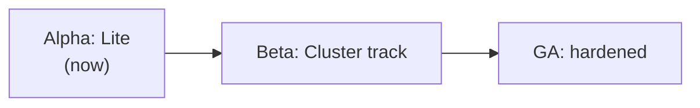

---
# --- AUTO redirect aliases (build_redirects.py) — do not edit by hand ---
aliases:
  - /roadmap-to-release.html
# --- end AUTO redirect aliases ---
title: Roadmap
weight: 20
description: What Dexaflow ships next and when, by release, with the 1.0 criteria; the road to the first release is kept as an archive.
---

## Current roadmap

Planning lives in GitHub issues, each assigned to the release milestone it is
planned for. The [Dexaflow roadmap](https://github.com/orgs/dexadata/projects/4)
project shows them by release as a timeline, a board and a table, and each
[milestone](https://github.com/dexadata/dexaflow/milestones) has its progress
and target date. Dates are targets, not commitments: a release ships when its
milestone is done and its candidate passes the release gates in
[RELEASING.md](https://github.com/dexadata/dexaflow/blob/main/RELEASING.md).
To propose work, open an issue; a maintainer sets its milestone.

**Cadence.** A patch about every week, and a minor every two to three months
(0.5.0 on 2026-10-02, 0.6.0 targeted for 2026-12-11), as the
[versioning policy](/project/versioning/) describes.

### Now: the last 0.5 patches

| Release | Target | Focus |
|---|---|---|
| [v0.5.11](https://github.com/dexadata/dexaflow/milestone/15) | 2026-11-20 | Scheduler standby and failover, scheduler read cost, multi-tenant fixes |
| [v0.5.12](https://github.com/dexadata/dexaflow/milestone/16) | 2026-11-27 | The last 0.5 patch: tenant isolation tests on every route, audit of admin writes, shared rate limits, live log tail cost, release notes and governance |

### Next: 0.6

| Release | Target | Focus |
|---|---|---|
| [v0.6.0](https://github.com/dexadata/dexaflow/milestone/6) | 2026-12-11 (candidate about 2026-12-01) | Reliability and security for production: row level security as an option, lease and failover hardening, the gaps of the production readiness review |
| [v0.6.1](https://github.com/dexadata/dexaflow/milestone/17) | 2026-12-18 | Follow-ups of 0.6.0 and features moved out of 0.5 |
| [v0.6.2](https://github.com/dexadata/dexaflow/milestone/18) | 2027-01-08 | |
| [v0.6.3](https://github.com/dexadata/dexaflow/milestone/19) | 2027-01-15 | |

### Later: 1.0

[v1.0.0](https://github.com/dexadata/dexaflow/milestone/22) targets the end
of February 2027. Its exit criteria are in
[#1958](https://github.com/dexadata/dexaflow/issues/1958) and their tracking in
[#2317](https://github.com/dexadata/dexaflow/issues/2317): what a production
install needs to be supported, the API and configuration surfaces that become
stable, and the evidence (soak, chaos, upgrade tests) a release must carry.

## Archive: the road to v0.1

{}
This page captured the plan **before v0.1**. The `v0.x` line has since
shipped (v0.1 through v0.4 and beyond) and ADR 0037 removed the
Alpha/Beta phase framing. It is kept for context; the Alpha/Beta/GA
phases and the "must-do before release" list below are **superseded**.
For what actually shipped and what is current, see the
[GitHub Releases](https://github.com/dexadata/dexaflow/releases) and the
[ADRs](/project/adrs/).
{}

**Goal:** a stable MVP — a clean Airflow-3.2-compatible orchestrator that runs a
real DAG end to end, with no fancy features — before v0.1.

This consolidates the open work after the audit + reverse analysis
(`docs/reverse-analysis-mvp.md`, which captured and evaluated the real Airflow
3.2.1 task logs, XCom, lifecycle, and API and mapped each to Dexaflow).

## Release phases — Alpha · Beta · GA

The product **proves itself in Lite first**; Cluster matures behind it.

### 🟡 Alpha — Developer experience (current focus)
A data engineer can author, run, and iterate on DAGs locally with confidence.

- `dexaflow lite` (isolated k3d/subprocess), `dexaflow lite provision`, `dexaflow db`, hot reload, LITE marker.
- DAG authoring + binding/overrides (ADR 0023), guardrails, embedded migrations.
- Documentation site, examples, the `dags/` convention.
- **Exit:** the dev loop is reliable end-to-end; the authoring model is documented and tested.

### 🟠 Beta: Cluster track (next)
Run real workloads on a real cluster, deployed via CI.

- Publish images + binaries: `leoflow-server`/`-agent`/`-migrate` + per-OS CLI (#48, #61).
- TLS on the agent channel (#58); keyless cloud auth / workload identity (#56)
  — control-plane → cloud-provider authentication.
- GCP connector (#77): a user-facing `google_cloud_platform` Connection
  supporting both a service-account key and keyless Workload Identity (builds
  on #56).
- Real-cluster verification of staging + pod-path on GKE (#57); least-privilege secret scoping (#59).
- Self-contained dev: migrations via library (#60, done), single binary (#61), "runs liso" embedded deps (#62).
- **Exit:** Helm install + CI deploy on a real cluster with auth + TLS.

### 🟢 GA — Hardened
- Load/scale tests, SLOs, upgrade runbooks, doc versioning (`mike`).
- OpenSSF best-practices badge; supply-chain (ADR 0014) green.
- **Exit:** production-ready, documented, supported.

> *(Historical note: at the time of writing this was the Alpha phase. The
> phase framing was later removed by ADR 0037 and the `v0.x` line shipped.)*

## ✅ Done (this cycle) — the MVP happy path works

End-to-end on the local k3d cluster, verified live: a 3-task Python DAG
(`extract → transform → load`) passing **XCom** (`{rows:100} → doubled:200`),
**clear structured logs** shipped from pods (`::group::` + per-line level), the
**home dashboard** showing real counts, **list filters** working, and **no
zombie/stuck runs** (undispatchable tasks fail fast with a visible reason).

Closed: #33 health · #34 Helm · #35 pod e2e · #36 pod log shipping · #37 audit ·
#38 XCom output · #39 dashboard counts · #40 filters · #41/#53 delete=clear +
deregister (ADR 0020) · #42 clear only_failed · #43 structured logs · #44 real
log levels · #45 Admin Variables+Connections (ADR 0019) · #46 undispatchable
visibility · #47 executor status / Cluster Activity=Home · #49 Code=Python · #50
no eternal-running · #51 TaskFlow value passing · #52 graceful logs.

## 🔴 Pre-release must-do (small, stability) — historical, superseded

*The items below were the pre-v0.1 stability checklist. They have since been
resolved or superseded as the `v0.x` line shipped; see the release notes for
the current state.*

1. **Test DB isolation** — integration tests run against the *demo* Postgres,
   polluting the live demo (ghost dags → wrong home stats). Point
   `go test -tags integration` at a dedicated throwaway DB (compose service /
   ephemeral container), never the running demo. *(Found while QA'ing the demo.)*
2. **XCom cleared on retry/clear** — Airflow purges XCom on retry for
   idempotency; we rely on Redis TTL. Purge the key on `ResetForRetry` / clear.
3. **Task-instance property defaults** — the TI details panel looks sparse:
   `queue`, `priority_weight`, `hostname`, `executor`, `dag_version` come back
   null. Fill sensible defaults (queue `default`, priority_weight `1`), populate
   `hostname`/`executor`/`dag_version` from what the agent/dispatcher already
   knows. *(rendered_fields stays empty until Jinja — post-1.0.)*
4. **Publish the leoflow-migrate image** (#48) to ghcr so `helm install` migrates
   out of the box (image-build infra already in `deploy/Dockerfile.migrate`).
5. **Decide Bash/HTTP-operator XCom** — only Python `@task` XCom is wired. Either
   document "Python tasks for XCom" as the MVP contract, or add operator XCom.

## 🟡 Polish (nice before release, not blocking)

- **Task lifecycle audit events** (#52) — per-task Audit Log is empty (we only
  record dag.version.register). Emit audit on task transitions; needs RunState to
  carry the run_id string + audit metadata.
- **Orphan-run UX** — runs from a previous backend/dir surface missing logs;
  graceful "No logs available" now (#52), but consider hiding/expiring orphans.
- Real `monitor/health` component heartbeats beyond the scheduler (#33 partial).

## ⚪ Post-1.0 (deprioritized)

Deferrable tasks (#13), Jinja templating / rendered_fields (#25), assets/datasets
(#29), providers, pools (#31), plugins (#30), dag tags/warnings (#26/#27),
`multiple_outputs`, KMS-backed secret encryption (evolves ADR 0019), the custom
UI north star (ADR 0018).

## Release smoke test

`make e2e` (k3d) already asserts: pod-per-task success, log shipping (#36),
structured logs (#43), and TaskFlow value passing (#51). Keep it green as the
release gate.
